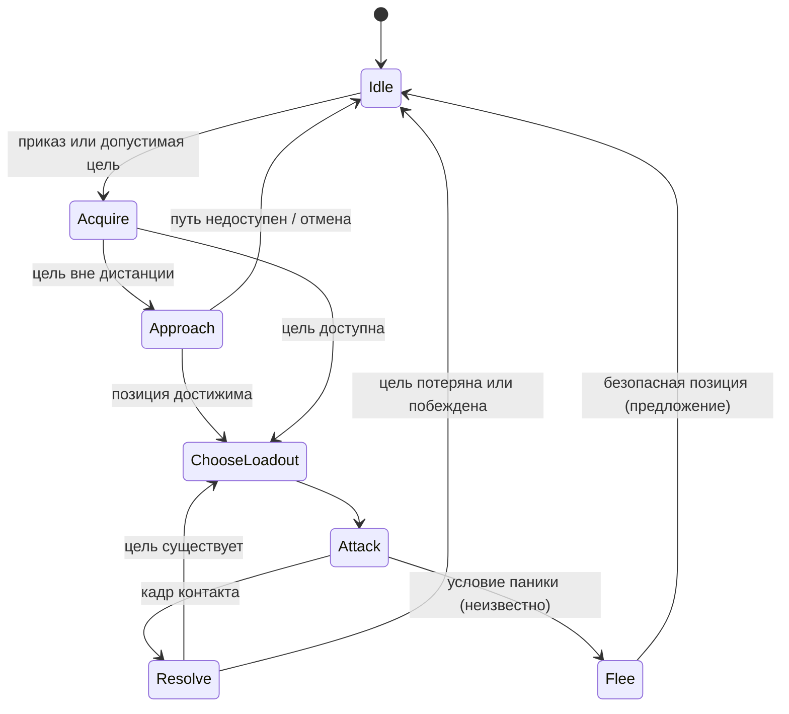

# Diggles: The Myth of Fenris / Wiggles — боевая система, ИИ и живые существа

Исследование для Godot-порта • 19.11.2026

## Scope and evidence

Исследованы только общедоступные материалы. Игра не запускалась; файлы установленной игры, пользовательский проект и EXE не исследовались. Видео не использованы как доказательство конкретных кадров: проверенных таймкодов нет. Вместо них приведены прямые ссылки на документацию, иллюстрированные инструкции и публичные записи моддеров.

**Уверенность:** высокая (В) — документация разработчиков оригинала или прямое подтверждение интерфейса движка; средняя (С) — наблюдение игрока / опубликованный консольный список, где сборка может отличаться; низкая (Н) — ограниченное свидетельство или неоднозначная интерпретация; неизвестно (?). Все предложения для Godot обозначены как реконструкция, а не извлечённый алгоритм оригинала.

### Ключевые источники

| ID | Источник и точка проверки | Статус |
|---|---|---|
| S01 | [Wiggles-Kochstudio, архив сайта SEK](https://wiggles.ruka.at/) — новости 13 и 19 октября 2001 г. о публикации таблиц оружия и приёмов; запись 06.01.2010 о восстановлении архива | Происхождение оригинальной документации |
| S02 | [SEK — Kampf: Grundlegendes](https://wiggles.ruka.at/tipstricks/index.php?c=fgtmain), раздел боевых навыков и автоматического выбора оружия | Первичный, 2001 |
| S03 | [SEK — Waffenübersicht](https://wiggles.ruka.at/tipstricks/index.php?c=fgtwp), таблица оружия, щитов и комбинаций авторства Badgun | Первичный, 2001 |
| S04 | [SEK — Schlagtechniken](https://wiggles.ruka.at/tipstricks/index.php?c=fgthits), таблицы атаки и защиты | Первичный, 2001 |
| S05 | [Wiggles Tcl Commands](https://wiggles.ruka.at/tipstricks/wiggles_tcl.html), разделы `fight_action`, `fight_weapon`, `get_escape_pos`, `get_attack_pos`, `trigger`, `set_diplomacy` | Публичный технический справочник; точная версия движка не установлена |
| S06 | [SEK — управление](https://wiggles.ruka.at/tipstricks/index.php?c=keys) | Архив официального сайта |
| S07 | [SEK — Torwächterin](https://wiggles.ruka.at/tipstricks/index.php?c=urwald&r=3), скриншоты Trollwache, секретного прохода и рычага | Первичный, сюжетная механика |
| S08 | [SEK — Der Krake](https://wiggles.ruka.at/tipstricks/index.php?c=schwefel&r=2), скриншот Krake и объяснение щупалец | Первичный, сюжетная механика |
| S09 | [SEK — Brains и гигантский хомяк](https://wiggles.ruka.at/tipstricks/index.php?c=kristall&r=1), изображение Riesenhamster Laufrad | Первичный, сюжетная механика |
| S10 | [SEK — дракониха и молот](https://wiggles.ruka.at/tipstricks/index.php?c=lava&r=1), раздел Gleipnirhammer | Первичный, сюжетная механика |
| S11 | [SEK — Fenris](https://wiggles.ruka.at/tipstricks/index.php?c=lava&r=4), два способа пленения, скриншоты | Первичный, сюжетная механика |
| S12 | [Wiggles — Das Tagebuch, кристальный мир](https://wiggles.ruka.at/tagebuch/index.php?p=3), рассказ о размножении хомяков, ловле гусениц, пауках и гибели переносчика | Свидетельство прохождения в архиве оригинального сайта |
| S13 | [Rafael — руководство, 20.11.2024](https://steamcommunity.com/sharedfiles/filedetails/?id=3353607951), разделы «Противники», «Персонажи», «Советы», иллюстрации существ | Позднее свидетельство игрока, не гарантированно ванильная сборка; руководство содержит и советы по изменению скриптов |
| S14 | [Консольные классы Steam, 2022](https://steamcommunity.com/sharedfiles/filedetails/?id=2885077150), разделы Mobs, Raw Materials, Weapons, Potions | Перечень имён классов переиздания, не спецификация естественного появления |
| S15 | [DigglesMods/BugFix — CHANGELOG.md](https://github.com/DigglesMods/BugFix/blob/master/CHANGELOG.md) | Первичный источник изменений фанатского мода, не оригинальный код |
| S16 | [Steam — официальное описание переиздания](https://store.steampowered.com/app/1478650/Wiggles/) | Издатель заявляет сохранение игрового процесса; не гарантия побитовой идентичности 2001 г. |
| S17 | [StopGame — прохождение 2002 г.](https://stopgame.ru/show/4504/diggles_the_myth_of_fenris_prohozhdenie), эпизод малой крепости троллей | Раннее свидетельство игрока |
| S18 | [GameSpot — Diggles Preview](https://www.gamespot.com/articles/diggles-preview/1100-2835487/), раздел The Little People | Наблюдения дорелизной версии; вспомогательно |
| S19 | [DigglesMods — идеи модов](https://github.com/DigglesMods/DigglesModManager/wiki/Ideen) | Предложения сообщества; не считать реализованными |
| S20 | [GOG — Controlling the pace and size of the game world](https://www.gog.com/forum/diggles_the_myth_of_fenris/controlling_the_pace_and_size_of_the_game_world/page1), 09.12.2020 | Наблюдение о динамическом создании зон, не проверенный алгоритм |
| S21 | [Wiggles Forum — Waffen-Amulett/Schild Kombinationen](https://wiggles.ruka.at/forum/viewtopic.php?p=1781), обсуждение `Data/Scripts/init/fight.tcl` | Опубликованный фрагмент скрипта и диагноз моддера; corroborated by BugFix changelog |
| S22 | [Diggles Wiki — Hamster](https://diggles.fandom.com/wiki/Hamster) | Вспомогательный фанатский источник |
| S23 | [MogelPower — Wiggles](https://www.mogelpower.de/cheats/Wiggles_PC_21653.html), разделы Gegner, Nahrung, Rohstoffe, Tränke, Startwerte verändern | Публичный перечень классов и путей; не содержимое файлов |

## 1. Creature encyclopedia

Названия классов приведены только при наличии подтверждения. Слово «червь» неоднозначно: класс `Raupe` означает гусеницу, также встречается перевод Grub. Его не следует автоматически отождествлять с вукером. Качественные оценки опасности из позднего гайда не являются проверенными значениями силы или HP.

| Существо | Среда, наблюдаемое поведение и условия | Доказательство / уверенность | Godot: предлагаемая модель |
|---|---|---|---|
| Хомяк — `Hamster` | Подземная дикая фауна; уходит от ловца, ловится при перехвате или с рогаткой. Может находиться в инвентаре, сбежать при выпадении; разведение на ферме. Съедобный ресурс, ездовой вариант и источник энергии в колесе. Питание, пол, время беременности, частота спавна не установлены. | [S12: дневник о потерянных племенных животных](https://wiggles.ruka.at/tagebuch/index.php?p=3) (С–В); [S22](https://diggles.fandom.com/wiki/Hamster), [S13, советы](https://steamcommunity.com/sharedfiles/filedetails/?id=3353607951) (С) | `WildHamster` с состояниями свободного движения, бегства и захвата; `HamsterItem` хранит ID существа; ферма, верховая езда и колесо — отдельные способы использования. |
| Гусеница/личинка — `Raupe` | Переносится и разводится для еды. Дневник описывает сохранение племенных гусениц после гибели гнома. Консольный список различает её от монстров. Способ ловли, еда, ползание, автономное размножение и агрессия не доказаны. | [S12](https://wiggles.ruka.at/tagebuch/index.php?p=3), [S14, Raw Materials](https://steamcommunity.com/sharedfiles/filedetails/?id=2885077150), [S23, Nahrung](https://www.mogelpower.de/cheats/Wiggles_PC_21653.html) (С) | `GrubItem` и `WildGrub`; ферма выдаёт ресурс; не добавлять произвольную боевую атаку. |
| Гигантский хомяк — `Riesenhamster` | Сюжетный огромный хомяк Брейнов в Кристальном мире; освобождение после изъятия кольца из граммофона приводит к бою. Не установлен как обычная дикая разновидность или доступное ездовое животное. | [S09: Riesenhamster Laufrad](https://wiggles.ruka.at/tipstricks/index.php?c=kristall&r=1) (В); [S14](https://steamcommunity.com/sharedfiles/filedetails/?id=2885077150) (С) | Особый класс босса, привязанный к механизму граммофона; `BOUND → RELEASED → HOSTILE`. |
| Вукер — `Wuker` | Встречается в Лесном мире, атакует вблизи; кулачная атака гнома применима. | [S13, Вукер](https://steamcommunity.com/sharedfiles/filedetails/?id=3353607951), [S18, The Little People](https://www.gamespot.com/articles/diggles-preview/1100-2835487/) (С) | Базовый противник ближнего боя, без предполагаемой стаи или размножения. |
| Серный вукер — `Schwefelwuker` | Серный мир, ближний бой; по наблюдению игрока опаснее обычного. | [S13, Серный Вукер](https://steamcommunity.com/sharedfiles/filedetails/?id=3353607951), [S14](https://steamcommunity.com/sharedfiles/filedetails/?id=2885077150) (С) | Вариант профиля Wuker; параметры силы оставить неустановленными. |
| Тролль — `Troll` | Враждебные гарнизоны, крепости, засады; могут спать в форте, быть выманены в ловушку. Поздний гайд различает зелёных, фиолетовых и красных по мирам и вооружению; это не доказательство отдельных классов здоровья. | [S07](https://wiggles.ruka.at/tipstricks/index.php?c=urwald&r=3), [S11](https://wiggles.ruka.at/tipstricks/index.php?c=lava&r=4) (В); [S17, малая крепость](https://stopgame.ru/show/4504/diggles_the_myth_of_fenris_prohozhdenie), [S13, Тролль](https://steamcommunity.com/sharedfiles/filedetails/?id=3353607951) (С) | `TrollGuard`: гарнизон/сон, тревога, приближение, бой. Отличия оружия и мир — параметры, не жёстко прошитые классы. |
| Паук / кристальный паук — `Spinne`, `Kristallspinne` | Оба имени присутствуют в консольном перечне; пауки встречаются в Кристальном мире. Игрок сообщает о ближней атаке и возможности расстрела снаружи радиуса реакции. Автор дневника называет пауков ядовитыми, но периодический урон от яда не подтверждён. | [S14, Mobs](https://steamcommunity.com/sharedfiles/filedetails/?id=2885077150); [S13, Паук](https://steamcommunity.com/sharedfiles/filedetails/?id=3353607951); [S12](https://wiggles.ruka.at/tagebuch/index.php?p=3) (С) | Отдельные профили пауков. `perception_range` и `attack_range` различны; лазание по стенам и статус `poison` выключены до проверки. |
| Хищное растение — `Fresspflanze`; `Alienpflanze` | Консольные классы существуют. Хищное растение Лесного мира, игрок описывает атаку на близкой/средней дистанции. Отдельные свойства Alienpflanze и связь двух классов не установлены. | [S23, Gegner](https://www.mogelpower.de/cheats/Wiggles_PC_21653.html), [S13, Хищное растение](https://steamcommunity.com/sharedfiles/filedetails/?id=3353607951) (С) | Профиль потенциально неподвижного врага `PlantEnemy`, зона удара; неподвижность пока гипотеза. |
| Демон / лавовый демон | Позднее прохождение описывает группы в Кристальном и Лавовом мирах; первые не умеют лазать, вторые умеют перепрыгивать препятствие. Движение стаей как алгоритм, численность и имена классов не подтверждены. | [S13, Демон и Лавовый демон, иллюстрации](https://steamcommunity.com/sharedfiles/filedetails/?id=3353607951) (С/Н); [S12, Fenris Brut](https://wiggles.ruka.at/tagebuch/index.php?p=3) (С, только факт присутствия) | Варианты ходьбы и прыжка; групповой спавн необязателен, координацию стаи не считать фактом. |
| Кракен — `Krake` | Сюжетный враг затонувшего корабля в Серном мире. Захватывает приблизившегося гнома щупальцем и бросает вниз; щупальце также тянется к золоту. Можно убить ловушкой-люстрой через рычаг. | [S08, иллюстрированная инструкция](https://wiggles.ruka.at/tipstricks/index.php?c=schwefel&r=2) (В); [S13, Осьминог](https://steamcommunity.com/sharedfiles/filedetails/?id=3353607951) (С для стрельбы по голове) | Стационарный босс с отдельными зонами щупалец, захватом и броском; сцена содержит рычаг и люстру. |
| Дракон — `Drache`, драконёнок — `Drachenbaby` | Сюжетные существа. Дракон в Серном мире помогает открыть путь; детёныш становится спутником и решает дальнейший сюжет. Дракониха в мире лавы отдаёт молот при возвращении детёныша, иначе её надо победить. Не универсальная механика приручения. | [S10, Gleipnirhammer](https://wiggles.ruka.at/tipstricks/index.php?c=lava&r=1) (В), [S13, Дракон](https://steamcommunity.com/sharedfiles/filedetails/?id=3353607951), [S14](https://steamcommunity.com/sharedfiles/filedetails/?id=2885077150) (С) | `QuestCompanion`, `DragonEncounter` с проверкой возвращения детёныша; дружественная ветка и бой разделены. |
| Фенрис — `Fenris` | Финальный босс дворца в Лавовом мире; после атак по ногам встаёт на колени, шесть точек захвата позволяют повалить и надеть цепь. Альтернатива — опьянение и сюжетный механизм. | [S11, Fenris](https://wiggles.ruka.at/tipstricks/index.php?c=lava&r=4), [S13, Фенрир](https://steamcommunity.com/sharedfiles/filedetails/?id=3353607951) (В для пленения, С для атаки с оглушением) | Отдельный staged boss; не применять стандартное `hp == 0 → dead`. Анимации коленопреклонения, удержания и падения. |
| Гномы и другие кланы — `Zwerg`, `Baby`, `Voodo`, `Knocker` | Автономная работа/отдых, семья, навыки, бой; сюжетные дружественные/враждебные кланы. Не всех гномов автоматически считать врагами. | [S02](https://wiggles.ruka.at/tipstricks/index.php?c=fgtmain), [S09](https://wiggles.ruka.at/tipstricks/index.php?c=kristall&r=1), [S14](https://steamcommunity.com/sharedfiles/filedetails/?id=2885077150), [S16](https://store.steampowered.com/app/1478650/Wiggles/) (В/С) | Общий актор гнома с `faction_id`, навыками, потребностями и прерываемым планировщиком задач. |
| Один, Эльке, отшельник, феи, ключница | Сюжетные NPC, не все должны быть бойцами; отшельник обменивает помощь на возвращение хомяков, ключница освобождается из крепости. | [S07](https://wiggles.ruka.at/tipstricks/index.php?c=urwald&r=3), [S11](https://wiggles.ruka.at/tipstricks/index.php?c=lava&r=4), [S14](https://steamcommunity.com/sharedfiles/filedetails/?id=2885077150) (В/С) | `QuestActor`, диалоги, флаги заданий; `Combatant` подключается только при доказанной необходимости. |

### Размещение и появление

- Крепости, сюжетные боссы и определённые поселения подтверждены сценарными инструкциями S07–S11. Не следует генерировать их как случайную размножающуюся фауну.
- В сообщении [S20](https://www.gog.com/forum/diggles_the_myth_of_fenris/controlling_the_pace_and_size_of_the_game_world/page1) описано появление новых областей при раскопке. Уверенность средняя; не доказаны конкретные условия появления каждого существа, дистанция от игрока и периодический респавн.
- Консольный `qnew` подтверждает возможность создания класса, но не то, что он естественно появляется в кампании, боевой карте или песочнице.

## 2. AI state machines

Ниже — минимальные реконструкции для Godot. Это не найденные исходные автоматы оригинала. Прямых доказательств полного внутреннего графа состояний нет.

### 2.1 Общий бой

| Переход / операция | Свидетельство | Уверенность / реализация |
|---|---|---|
| Приказ игрока → цель | [S06](https://wiggles.ruka.at/tipstricks/index.php?c=keys): Alt + ЛКМ по врагу означает атаковать | В. `AttackOrder(target_id)`; выделение группы подтверждено Shift. |
| Ожидание → обнаружение | [S05: trigger](https://wiggles.ruka.at/tipstricks/wiggles_tcl.html), `trigger set_target_range`, `set_target_type`, `set_target_owner` | В для возможности области сканирования, ? для её применения конкретным монстром. Реализация: spatial query + faction filter. |
| Обнаружение → выбор цели | [S05](https://wiggles.ruka.at/tipstricks/wiggles_tcl.html), `get_attack_pos` принимает атакующего и защитника; `get_best_weapon` выбирает экипировку, не цель | ? — нет подтверждения ближайшей цели, приоритета слабых гномов, агро или зрения. В реализации цель ручного приказа фиксируется; политика автопоиска отдельна. |
| Цель → подход / позиционирование | [S05](https://wiggles.ruka.at/tipstricks/wiggles_tcl.html), `get_attack_pos`, `class_fightdist`, `fight_weapon` с параметром `rng` | В для интерфейса. Навигация до позиции допустимой дистанции, а не до центра цели. |
| Подход → дальняя или ближняя атака | [S02](https://wiggles.ruka.at/tipstricks/index.php?c=fgtmain): гном сначала берёт стрелковое оружие, пока цель далеко, затем переходит к ближнему | В. `SelectLoadout` при смене дистанции; не переключать каждый кадр. |
| Атака → попадание/промах/защита | [S04](https://wiggles.ruka.at/tipstricks/index.php?c=fgthits); [S05](https://wiggles.ruka.at/tipstricks/wiggles_tcl.html), `fight_action`, `get_ballisticresult` | В. Результат удара — событие; защитная анимация влияет на исход по проверяемой конфигурации. |
| Получение атаки → ответный удар | [S05](https://wiggles.ruka.at/tipstricks/wiggles_tcl.html), `fight_setactions_strikeback` | В для существования примитива; ? для всех условий контратаки и фактической области. |
| Угроза → бегство | [S05](https://wiggles.ruka.at/tipstricks/wiggles_tcl.html), `get_escape_pos(obj,scandist,walkdist)`, `get_escape_value`; `panic` в `fight_setactions` | В для API, ? для порогов паники и видов, использующих его. Разделить командное отступление и автономное бегство. |
| Потеря цели → прекращение атаки | [S05](https://wiggles.ruka.at/tipstricks/wiggles_tcl.html), `get_attackinprogress`, `set_attackinprogress`, завершения `fight_setactions` | Возможность завершения подтверждена, порядок отмены, таймаут и политика возвращения неизвестны. |



### 2.2 Хомяк и гусеница

| Состояние → следующее | Свидетельство и предел | Реализация |
|---|---|---|
| Дикий хомяк → бегство/перехват | [S22](https://diggles.fandom.com/wiki/Hamster), [S13, советы](https://steamcommunity.com/sharedfiles/filedetails/?id=3353607951) (С); не доказан радиус | Профиль страха, `escape_position` по доступной поверхности. |
| Бегство → пойман | Рогатка или загон по [S22](https://diggles.fandom.com/wiki/Hamster) (С); неизвестно, наносится ли стандартный урон или отдельное действие захвата | `CaptureResult` отдельно от `DamageResult`, не убивать автоматически. |
| Инвентарь → свободное животное | После гибели переносчика хомяки убежали по [S12](https://wiggles.ruka.at/tagebuch/index.php?p=3) (С) | При выпадении восстановить actor по ID там, где допустимо. |
| Ферма → разведение | В [S12](https://wiggles.ruka.at/tagebuch/index.php?p=3) одиночный неплодный хомяк не дал потомства; упомянуты племенные гусеницы (С) | Производительность фермы зависит от племенного запаса либо скрытого правила; не назначать длительность цикла, половой состав или число детёнышей без проверки. |

Не подтверждены развитый голод, поиск грибов, социальные отношения, независимая репродукция диких животных, сон и смерть от естественного старения у мелкой фауны.

### 2.3 Тролль, паук, босс

- Тролль: `Garrison/Rest → Alert → Engage → Attack`; сон и выманивание в ловушку подтверждаются [S17](https://stopgame.ru/show/4504/diggles_the_myth_of_fenris_prohozhdenie) и [S11](https://wiggles.ruka.at/tipstricks/index.php?c=lava&r=4). Патрульный маршрут, звуковая тревога, пробуждение по радиусу и возврат на пост — неизвестны. С/В.
- Паук: `Idle → Detect → Approach → Melee`; ограничение обнаружения — наблюдение [S13](https://steamcommunity.com/sharedfiles/filedetails/?id=3353607951) (С). Отличать невозможность дойти от отсутствия реакции; яд/лазание остаются неизвестными.
- Кракен: `Idle → Reach → Grab → Throw → Idle`; объект золота может занять щупальце, что позволяет нажать рычаг. [S08](https://wiggles.ruka.at/tipstricks/index.php?c=schwefel&r=2), В. Остальные атаки, интервалы и последовательность используемых щупалец неизвестны.
- Дракониха: `QuestCheck → Friendly/Reward | Hostile/Defeated`; [S10](https://wiggles.ruka.at/tipstricks/index.php?c=lava&r=1), В. Возврат детёныша — сценарный переход.
- Фенрис: `BossCombat → Kneel → CapturedByCrew → Bound` либо `Idle → Drink → Intoxicated → Collapse → Bound`; [S11](https://wiggles.ruka.at/tipstricks/index.php?c=lava&r=4), В. Нельзя заменять квест простой смертью босса.

### 2.4 Связь состояния и анимации

| Состояние | Доказательство | Godot |
|---|---|---|
| Нейтральная стойка, кулачная, одноручная, двуручная, с щитом | [S05](https://wiggles.ruka.at/tipstricks/wiggles_tcl.html), `fight_action`: `normal`, `kungfu`, `sword`, `twohand`, `shield` (В для интерфейса) | AnimationTree state machine + pose parameter |
| Удар, укол, бросок/метание, блок, уклонение, получение удара, ожидание | `fight_action`: `beat`, `stab`, `throw`, `ward`, `dodge`, `hit`, `idle`; пример ID `kungfu_faust_oben`, направления движения/удара [S05](https://wiggles.ruka.at/tipstricks/wiggles_tcl.html) (В) | Каталог `CombatActionData` связывает тип, направление и клип; названия других оригинальных клипов не реконструировать. |
| Шаг назад, уход в сторону, приседание, прыжок | [S04](https://wiggles.ruka.at/tipstricks/index.php?c=fgthits) — таблицы защиты (В) | Разные анимации защиты по стойке и навыку. |
| Удар в прыжке, удар ногой, подсечка, круговой удар | [S04](https://wiggles.ruka.at/tipstricks/index.php?c=fgthits), Kungfu (В) | Отдельные клипы с ключевым событием контакта. |
| Сон тролля, бегство хомяка, захват кракеном, колени/падение Фенриса | [S17](https://stopgame.ru/show/4504/diggles_the_myth_of_fenris_prohozhdenie), [S12](https://wiggles.ruka.at/tagebuch/index.php?p=3), [S08](https://wiggles.ruka.at/tipstricks/index.php?c=schwefel&r=2), [S11](https://wiggles.ruka.at/tipstricks/index.php?c=lava&r=4) (С–В) | Специфические клипы, а не общий `monster_attack`. Точная длительность, переходы кадров и root motion неизвестны. |

## 3. Combat mechanics

### 3.1 Навыки, выбор оружия и защита

| Правило оригинала | Доказательство | Уверенность / перенос |
|---|---|---|
| Пять боевых навыков: кунг-фу, одноручное, двуручное, стрелковое и защита | [S02](https://wiggles.ruka.at/tipstricks/index.php?c=fgtmain), перечень Kampfwerte | В. Независимые поля опыта. Защита — самостоятельный навык. |
| Опыт повышает эффект соответствующего удара, открывает новые приёмы и оружие | [S02](https://wiggles.ruka.at/tipstricks/index.php?c=fgtmain), [S04](https://wiggles.ruka.at/tipstricks/index.php?c=fgthits), пример увеличения урона на 20% при 20 пунктах кунг-фу | В. Не экстраполировать на все множители и финальный урон без проверки. |
| Старые приёмы продолжают использоваться после открытия новых; атаки могут не попадать | [S04](https://wiggles.ruka.at/tipstricks/index.php?c=fgthits), вводное объяснение | В. Пул допустимых приёмов, а не замена базового удара. Веса выбора приёмов неизвестны. |
| Опыт приобретается в бою, на тренировках в додзё и чтением книг; часть наследуется | [S02](https://wiggles.ruka.at/tipstricks/index.php?c=fgtmain) | В. События XP; точная скорость и наследуемая доля неизвестны. |
| Гном сам выбирает эффективное оружие из инвентаря; предпочитает стрельбу издалека и переходит к рукопашной | [S02](https://wiggles.ruka.at/tipstricks/index.php?c=fgtmain); [S05](https://wiggles.ruka.at/tipstricks/wiggles_tcl.html), `get_best_weapon(obj,ballistic)` | В. `LoadoutResolver`, учитывать текущий тип оружия и обученность. Точные критерии и tie-break неизвестны. |
| Одноручное оружие совместимо со щитом при достаточном опыте защиты; двуручное оружие наносит больший урон при попадании | [S02](https://wiggles.ruka.at/tipstricks/index.php?c=fgtmain); [S03](https://wiggles.ruka.at/tipstricks/index.php?c=fgtwp) | В. Off-hand slot, отдельная проверка уровня и типа оружия. |
| Экипировка и особые комбинации изменяют силу оружия; щиты увеличивают запас эффективных HP | [S03](https://wiggles.ruka.at/tipstricks/index.php?c=fgtwp); [S05](https://wiggles.ruka.at/tipstricks/wiggles_tcl.html), `fight_weapon_kombi` | В. `ComboData` как отдельные правила; не смешивать максимальные HP и снижение входящего урона, пока формула не проверена. |
| Класс персонажа и оружие задают дистанцию боя; у стрелковой атаки есть результат попадания | [S05](https://wiggles.ruka.at/tipstricks/wiggles_tcl.html), `class_fightdist`, `fight_weapon`, `get_attack_pos`, `get_ballisticresult` | В для API; реальные дальности неизвестны. `range` и `preferred_distance` не заполнять произвольными числами. |
| После попадания над врагом видна зелёная полоска оставшегося здоровья | [S02](https://wiggles.ruka.at/tipstricks/index.php?c=fgtmain), заключительная часть | В. UI показывает нормализованные HP при повреждении. Время скрытия не установлено. |
| Три визуальных вида боевого шлема отражают примерный боевой опыт | [S02](https://wiggles.ruka.at/tipstricks/index.php?c=fgtmain), описание шлемов | В. Косметическая прогрессия; не считать шлем отдельной бронёй без доказательства. |

### 3.2 Официальные числовые опорные данные

Это не придуманный баланс. Оригинальные таблицы SEK опубликованы в октябре 2001 года ([архив новостей S01](https://wiggles.ruka.at/)). Полные перечни — [оружие и щиты S03](https://wiggles.ruka.at/tipstricks/index.php?c=fgtwp) и [приёмы S04](https://wiggles.ruka.at/tipstricks/index.php?c=fgthits). Для MVP полезны следующие контрольные примеры, но перенос всей таблицы должен проверять локализацию и отличия версий.

| Тип/оружие | Базовая сила по S03 | Минимальный опыт |
|---|---:|---:|
| Кулаки (стандарт) | 5,00 | 0 |
| Дубина (Keule) | 5,77 | 0 |
| Двуручный топор (Zweihandaxt) | 8,82 | 0 |
| Рогатка (Steinschleuder) | 3,67 | 0 |
| Лук (Pfeil und Bogen) | 5,81 | 4 |
| Ружьё (Büchse) | 7,35 | 10 |

Пример S04: при 20 единицах опыта кунг-фу один и тот же успешный удар наносит на 20% больше урона, чем у необученного гнома. Другие открывшиеся техники дополнительно изменяют результат. Таблица приёмов также указывает разблокировку уклонений по навыку защиты. Частоту приёмов, вероятность попадания и полный порядок модификаторов источник не устанавливает.

**Важно:** таблица называет бонусы щитов процентами HP, а не вероятностью блокирования. Уклонение — отдельный тип действия. Для проверки возможной формулы хранить базовую силу, опыт, параметры щита и комбинационные коэффициенты раздельно.

### 3.3 Здоровье, усталость, смерть и восстановление

| Правило | Доказательство | Уверенность / Godot |
|---|---|---|
| HP уменьшаются от успешных ударов; защита даёт большую выживаемость | [S02](https://wiggles.ruka.at/tipstricks/index.php?c=fgtmain), [S04](https://wiggles.ruka.at/tipstricks/index.php?c=fgthits) | В. `HealthComponent`, отдельный `HitResult`. |
| У гнома есть здоровье, питание, внимательность и настроение; перенапряжение вызывает сонливость | [S18](https://www.gamespot.com/articles/diggles-preview/1100-2835487/), The Little People; [S16](https://store.steampowered.com/app/1478650/Wiggles/) | С. Потребности отделить от HP. **Не доказан** непосредственный штраф к урону, точности или защите за усталость/голод. |
| Есть лечебные зелья нескольких классов, а также зелья невидимости и неуязвимости | [S14](https://steamcommunity.com/sharedfiles/filedetails/?id=2885077150), Potions; [S11](https://wiggles.ruka.at/tipstricks/index.php?c=lava&r=4) — использование невидимости; [S07](https://wiggles.ruka.at/tipstricks/index.php?c=urwald&r=3) | В/С. `ConsumableData` + `StatusEffect`; величина и длительность эффектов не определены. |
| Смерть возможна от старости, с потерей переносимых живых ресурсов | [S12](https://wiggles.ruka.at/tagebuch/index.php?p=3), эпизод переправы | С. После смерти выгрузить содержимое инвентаря; точный порядок и сохранение всех предметов неизвестны. |
| Признак смерти в бою и неуязвимости существуют в API | [S05](https://wiggles.ruka.at/tipstricks/wiggles_tcl.html), `get_diedinfight`, `set_invulnerable` | В для интерфейса. Не выводить из этого конкретную формулу смерти. |
| `Krankenhaus`, `Wiederbelebung`, `Grabstein` существуют как имена классов | [S14](https://steamcommunity.com/sharedfiles/filedetails/?id=2885077150), Buildings/Miscellaneous; [S23](https://www.mogelpower.de/cheats/Wiggles_PC_21653.html) | С для существования; неизвестны цена воскрешения, временное окно, сохранение XP, вид могилы, условия автообращения в больницу и скорость восстановления. |
| Побеждённый Фенрис не умирает обычным образом; требуется пленение | [S11](https://wiggles.ruka.at/tipstricks/index.php?c=lava&r=4) | В. Босс переопределяет поведение при достижении порога поражения. |

## 4. Interaction matrix

Матрица описывает известные взаимодействия, а не предполагает, что любой класс умеет атаковать любой другой.

| Инициатор | Цель | Исход / свидетельство | Уровень | Godot |
|---|---|---|---|---|
| Гном | Дикий хомяк | Захват ловушкой траектории или рогаткой — [S22](https://diggles.fandom.com/wiki/Hamster) | С | Capture |
| Гном | Гусеница | Перенос как живой ресурс — [S12](https://wiggles.ruka.at/tagebuch/index.php?p=3) | С | PickUpLivingItem |
| Ферма | Хомяк / гусеница | Разведение, а не универсальное приручение — [S12](https://wiggles.ruka.at/tagebuch/index.php?p=3) | С | BreedingJob |
| Гном | Хомяк в колесе / ездовой | Использование для энергии и транспорта — [S22](https://diggles.fandom.com/wiki/Hamster), [S09](https://wiggles.ruka.at/tipstricks/index.php?c=kristall&r=1) | С/В | Mount / PowerSource |
| Гном | Враг | Ручная атака — [S06](https://wiggles.ruka.at/tipstricks/index.php?c=keys) | В | AttackOrder |
| Гном | Тролль / ворота | Силовой штурм или скрытный обход, ворота можно разрушить — [S07](https://wiggles.ruka.at/tipstricks/index.php?c=urwald&r=3) | В | Combatant / DamageableGate |
| Тролль | Гном | Враждебный бой; можно выманить и заманить в ловушку — [S11](https://wiggles.ruka.at/tipstricks/index.php?c=lava&r=4) | В | Engage / Trap |
| Кракен | Гном | Захват и бросок — [S08](https://wiggles.ruka.at/tipstricks/index.php?c=schwefel&r=2) | В | Grab / Throw |
| Кракен | Золото | Отвлечение щупальца к золоту — [S08](https://wiggles.ruka.at/tipstricks/index.php?c=schwefel&r=2) | В | QuestTarget |
| Гном | Дракониха | Возврат детёныша или бой — [S10](https://wiggles.ruka.at/tipstricks/index.php?c=lava&r=1) | В | DeliverCompanion / Combat |
| Гномы | Фенрис | Бой, захват в уязвимых точках, цепь либо опьянение — [S11](https://wiggles.ruka.at/tipstricks/index.php?c=lava&r=4) | В | BossCapture |
| Гномы | Другой клан | Брейны допускают подход, но изъятие кольца провоцирует боевую ветку; есть способ отвлечения — [S09](https://wiggles.ruka.at/tipstricks/index.php?c=kristall&r=1) | В для квеста | QuestFactionEvent |
| Гномы | Другой клан, принудительная атака | По сообщению игрока может спровоцировать войну — [S13, советы](https://steamcommunity.com/sharedfiles/filedetails/?id=3353607951) | С, точная команда и сборка требуют проверки | Reputation/HostilityChange |
| Виды дикой фауны друг с другом | Хомяк, гусеница, паук, вукер, растение | Нет установленного пищевого графа или межвидовых боёв | ? | По умолчанию отношения не задавать, пока не проверены |

### Дипломатия и кланы

Tcl-команда `set_diplomacy(owner, owner, state)` предусматривает четыре значения: `ally`, `friend`, `neutral`, `enemy` ([S05, точный раздел set_diplomacy](https://wiggles.ruka.at/tipstricks/wiggles_tcl.html)). Есть настройки дверей для владельца, друзей и списков классов. Это прямое свидетельство модели отношений владельцев, но не всех правил её изменения.

В кампании встречаются Непоседы/Wiggles, Травники/Voodoo (Peacers), Ударники/Knockers, Умники/Brains и Вампиры/Vampyr. [S13, раздел «Персонажи»](https://steamcommunity.com/sharedfiles/filedetails/?id=3353607951) описывает их встречи по мирам; [S09](https://wiggles.ruka.at/tipstricks/index.php?c=kristall&r=1) первично подтверждает сюжет Brains. Не приписывать клану постоянную глобальную враждебность из его названия или одного квеста. Числовые бонусы, условия войны, автоматическая эскалация после кражи и возможность перемирия требуют проверки конкретной версии. Кампания и skirmish должны иметь различающуюся начальную матрицу отношений.

## 5. Godot implementation

### 5.1 Архитектура (предложение)

Реализовать общее боевое ядро как систему действий, а не набор отдельных глобальных скриптов врагов. Поддержать изменяемую топологию тоннелей (разрушаемый грунт, лестницы, уступы, двери), поскольку дистанция по прямой не гарантирует достижимость позиции для боя.

| Компонент | Ответственность и аналог в доказательствах |
|---|---|
| `CreatureData` (`Resource`) | ID вида, биомы, навигационные возможности, набор действий, условия спавна и профиль AI. Основание: консольные классы S14, `class_fightdist` S05. |
| `CreatureBrain` | FSM существа; прерывания для опасности, ручного приказа, смерти; без выдуманного общего голода и размножения монстров. |
| `FactionService` | Матрица ally/friend/neutral/enemy и событийные изменения; S05 `set_diplomacy`. |
| `PerceptionSystem` | Пространственный запрос, проверка доступности, фильтрация владельца; S05 `trigger`. Правила видимости неизвестны — настраиваемая политика. |
| `NavigationService` | Поиск позиции атаки/бегства, возможности прыжка и лазания, обновление после изменения грунта. S05 `get_attack_pos`, `get_escape_pos`, `set_climbability`. |
| `WeaponData` | Класс, атака, защита, дальность, стойка, тип навыка, минимальный опыт, отсылки к клипам и кадрам. S05 `fight_weapon`, S03. |
| `CombatActionData` | Стойка, тип, вертикальное/горизонтальное направление, анимация, эффект, минимальный опыт. S05 `fight_action`, S04. |
| `CombatResolver` | Подбор доступного приёма, исход атака/защита/промах, HP/XP, событие завершения. Раздельный путь дальнего боя; S05 `fight_setactions_ballistic`. |
| `InventoryLoadoutResolver` | Выбор оружия и щита по допустимости, дальности, навыку; S02 и S05 `get_best_weapon`. |
| `AnimationTree` + `AnimationPlayer` | Выбор стойки и клипа; события `contact`, `release_projectile`, `finish`, реакция получателя; S05 описывает привязку анимации к действию. |
| `LivingItemSystem` | Однозначная идентичность существа между спавном, переносом, выпадением, фермой, колесом, ездой; S12, S22. |
| `EncounterController` | Сценарные исключения: Кракен, гигантский хомяк, дракониха, Фенрис. S08–S11. |

### 5.2 Иерархия данных и процесс удара

```text
AttackOrder(target_id)
  -> validate target + faction + manual override
  -> choose weapon / shield from inventory
  -> find reachable attack position
  -> choose eligible combat action by pose + experience
  -> play attacker / defender animation
  -> resolve impact once (hit / dodge / ward / miss)
  -> emit damage, experience, status, UI feedback
  -> repeat, disengage or encounter-specific defeat
```

`min_experience`, `base_attack`, `shield_bonus` можно заполнять из подтверждённых таблиц S03/S04. Для `detection_range`, `attack_range`, `pursuit_timeout`, `escape_threshold`, `attack_weights`, `health_max`, `breeding_interval`, `spawn_chance` изначальное состояние данных — `null`/unknown, а не числа, выдаваемые за канон. Для исполняемого прототипа нужны отдельно помеченные **prototype tuning** значения, не попадающие в слой исторической реконструкции.

### 5.3 MVP и критерии приёмки

1. Персонаж может сражаться голыми руками, дубиной и рогаткой; дальняя/ближняя атака выбирается из доступного инвентаря. Сопоставить с S02–S04.
2. Атрибуты пяти боевых дисциплин раздельны; новые приёмы открываются по навыку, старые сохраняются. Проверка доступности оружия и щита.
3. Поддержать два живых существа: хомяк как убегающий ловимый ресурс и вукер как противник ближнего боя. Хомяк не сводится к обычному трупу после успешного захвата.
4. Тролль в гарнизоне способен перейти в бой; возможность бойца войти в пещеру, отступить и заманить противника в ловушку. Учитывать недоступность высоты и препятствия.
5. После успешного попадания изменяется здоровье и видна полоска HP; промах допускается. Смерть прерывает действия; при выпадении живого ресурса тот может свободно перемещаться.
6. Донести до модуля AI изменения рельефа: путь и позиция атаки переоцениваются, когда игрок выкапывает проход или разрушает дверь.
7. В отдельно загружаемой сцене квестовый Фенрис переходит из боя в состояние пленения, а не в обычную смерть. Сценарии других боссов — следующий этап.

### 5.4 Разграничение оригинала, переиздания и модов

| Источник | Что изменено или предлагается | Как обращаться при переносе |
|---|---|---|
| [S15, BugFix v1.2, 12.05.2020](https://github.com/DigglesMods/BugFix/blob/master/CHANGELOG.md) | Исправление ошибочных сочетаний оружия и щитов. [S21](https://wiggles.ruka.at/forum/viewtopic.php?p=1781) связывает определения с `Data/Scripts/init/fight.tcl`: `fight_weapon_kombi` | Сохранять таблицу оригинала и исправления в разных профилях; не считать исправленный результат исходной реализацией. |
| [S15, BugFix v1.3, 10.12.2020](https://github.com/DigglesMods/BugFix/blob/master/CHANGELOG.md) | Исправлена недоступность для готовки гусениц, полученных на ферме | Не интерпретировать баг как биологическое правило. |
| [S15, BugFix v1.0 и более поздние](https://github.com/DigglesMods/BugFix/blob/master/CHANGELOG.md) | Исправления возраста, беременности и отсутствующего Фенриса; изменения затрагивают баги, не обязательно исходный дизайн | Разделить ожидаемое поведение и исторические дефекты. Changelog подтверждает изменения мода, но исходные файлы не были прочитаны. |
| [S19, идеи модов](https://github.com/DigglesMods/DigglesModManager/wiki/Ideen) | Предложены нападения монстров на поселения, спавн в нераскрытых областях и усиление боссов | Это идеи сообщества, не доказательство оригинальной системы рейдов или спавна. |
| [S16, переиздание 2020](https://store.steampowered.com/app/1478650/Wiggles/) | Издатель заявляет неизменность сюжета, визуала и геймплея при технической адаптации | Допустимо использовать для corroboration, но маркировать наблюдения Steam/GOG отдельно от материалов 2001–2002. |

Пути `Data/Scripts/init/fight.tcl` и `Data/Scripts/classes/items/waffen.tcl` опубликованы в обсуждениях [S21](https://wiggles.ruka.at/forum/viewtopic.php?p=1781) и [S19](https://github.com/DigglesMods/DigglesModManager/wiki/Ideen). Это указатели для дальнейшего легального анализа, а не доказательство изучения самих файлов. Репозиторий [BugFix](https://github.com/DigglesMods/BugFix) маркирован GPL-3.0; это не даёт автоматически лицензии на проприетарные ресурсы оригинальной игры. Предложенный порт — собственная реализация наблюдаемых правил.

## 6. Open questions

| Приоритет | Неизвестное | Что нужно для доказательства |
|---|---|---|
| P0 | Точные HP, базовые скорости, радиусы атак, восприятия и бегства каждого существа | Публичные определения классов, проверка версии или измерения кадров с известным масштабом. |
| P0 | Формула выбора оружия, блокирования, попадания, урона, влияния щита, реакций и XP | Проверяемые определения боевых функций, сравнительные тесты одинаковых ударов с разным навыком и экипировкой. |
| P0 | Выбор цели ИИ: ближайший, атакующий, слабейший, видимый; смена цели при нескольких гномах | Непрерывная запись двух и более целей, атака/отход, контроль видимости и дистанций. |
| P0 | Преследование, потеря цели, отмена приказа, возвращение на пост, паника | Видео полного эпизода от обнаружения до потери цели, в том числе закрытие прохода и смерть цели. |
| P0 | Точный способ поимки хомяка оружием: урон, состояние оглушения или прямой захват | Кадры UI/анимации при атаке рогаткой с последующим переносом. |
| P1 | Спавн диких и сюжетных существ, равномерность/условия и респавн по биомам, различия skirmish/campaign | Опубликованные генераторы зон или сравнительные записи новых карт. |
| P1 | Питание, дикий цикл размножения и пол животных, автоматическая работа фермы, минимальное количество производителей | Запись долгого наблюдения и публичный скрипт фермы конкретной версии. |
| P1 | Отличия `Spinne` от `Kristallspinne`, двух растений, цветовых вариантов троллей и демонов | Списки классов и сравнительные записи без модов. |
| P1 | Паучий яд, AoE Фенриса, прерывание анимации, сопротивления и оглушение | Видимые симптомы/изменение HP в записи, либо соответствующие функции/публичные фрагменты кода. |
| P1 | Влияние усталости, еды, настроения, возраста, брони и шлемов на бой | Контролируемые сравнения либо документированная формула. |
| P1 | Лечение в больнице, пассивная регенерация, зелья, воскрешение, инвентарь после смерти | Инструкции или видео с наблюдаемым изменением HP, расходом и восстановлением. |
| P1 | Точные переходы дипломатии, нападение на нейтральный клан, кража и перемирие | Сценарные скрипты или наблюдаемое изменение отношений; не выводить всё из API. |
| P2 | Полные списки клипов, тайминги contact/recovery, звуки и визуальные состояния | Публичная карта анимаций, нейтральные записи по каждому состоянию. |

## Conclusion

Сильнее всего документирована боевая часть: оригинальный сайт SEK позволяет восстановить пять дисциплин, систему доступности атак, выбор оружия, дальний/ближний бой, защиту и комбинации предметов. Tcl-справочник раскрывает структуру параметров и событий, но не внутренние алгоритмы принятия решений. Поведение живых существ фрагментарно: для мелкой фауны подтверждены захват, перенос, ферма и отдельные способы использования; для боссов хорошо подтверждены уникальные сюжетные переходы. Делать из этих данных единую симуляцию экосистемы со случайными рейдами, пищевой цепью и самостоятельным размножением всех монстров пока нельзя.
