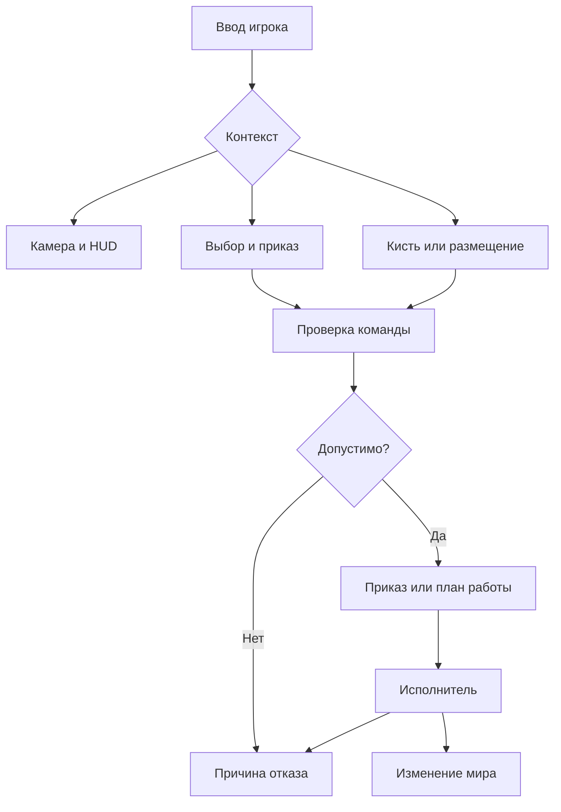

# Diggles / Wiggles (2001–2002): реконструкция UX управления

Дата проверки источников: 19 ноября 2026 г. Цель — спецификация для чистой реализации в Godot, без доступа к оригинальной игре, её файлам или проекту порта.

## 1. Резюме и границы доказательств

Главное свойство UX — не просто управление юнитами, а сочетание трёх независимых механизмов: контекстного приказа конкретному гному, разметки будущих работ для всей колонии и управления камерой/интерфейсом. Размеченный тоннель не равен вырытому; выбор цели не равен завершению приказа; видимость ресурса не равна достижимости.

**Уровни уверенности:** A — подтверждено современным оригиналу источником либо документацией с прямым указанием механизма; B — подтверждено свидетельством игрока, поздним снимком или совокупностью согласующихся описаний; C — гипотеза/неполная последовательность; U — неизвестно. A не означает, что подтверждены все детали кадра и каждой региональной сборки.

**Маркировка:** Ф — установленное правило; С — свидетельство игрока, не гарантированное универсальное правило; Г — предположение; Н — неизвестно. Последний столбец каждой таблицы — предложения для Godot, а не утверждения об оригинальном исходном коде.

**Ограничение исследования:** англоязычный скан руководства Strategy First найден, но полный текст и страницы закрыты проверкой браузера. Видеоролики найдены, но покадровое воспроизведение не удалось верифицировать. Поэтому ниже приводятся точные страницы журналов, прямые изображения, разделы руководств и сообщения форумов; где нет проверенного кадра, это указано. Таймкоды не придуманы. Снимки демонстрируют состояние, но сами по себе не доказывают нажатую клавишу. Поздние свидетельства относятся в том числе к переизданию 2020 г.; издатель сообщает о сохранении геймплея, но это не заменяет сопоставления сборок.

## 2. Реестр источников

| ID | Источник и локатор | Тип / применимость |
|---|---|---|
| S01 | [Wiggles — Tastaturbelegung](https://wiggles.ruka.at/tipstricks/index.php?c=keys), строки таблицы горячих клавиш | Архив страницы с копирайтом SEK GmbH; дата страницы не установлена. Основное доказательство назначений клавиш. |
| S02 | [GameStar, ноябрь 2001, с. 106–108](https://download.gamestar.de/public/31600/31684/11_2001_strategie.pdf#page=4), особенно [с. 108](https://download.gamestar.de/public/31600/31684/11_2001_strategie.pdf#page=6) | Тест релизной эпохи, иллюстрации. На с. 108 подпись к зелёной рамке, описание ластика, групп, тикера и турбо. |
| S03 | [GameStar, февраль 2002, с. 122](https://download.gamestar.de/public/31500/31541/02_2002_cddvd.pdf#page=4), блок Wiggles | Карточка специального демоуровня, не гарантия назначения кнопок полной версии. |
| S04 | [GameStar, декабрь 2001, с. 181–182](https://download.gamestar.de/public/31600/31649/12_2001_tipps_wiggles.pdf#page=1), советы 1, 6–8, 11–17 | Практический гайд при содействии разработчиков; хорошо описывает видимость, производство и квестовые действия. |
| S05 | [Gameswelt, тест 2001, Interface und Steuerung](https://www.gameswelt.de/wiggles/test/wiggles-3266/2) | Свидетельство автора теста: предметы, курсор, миникарта, ограниченное вращение. |
| S06 | [GameSpot, Diggles Review, 2002](https://www.gamespot.com/reviews/diggles-review/1900-2857536/) | Тест английской версии: меню гнома, управление камерой, задержки реакции. |
| S07 | [MogelPower, памятка клавиатуры](https://br.doczz.net/doc/823354/wiggles---mogelpower.de), строки 168–181; [каталог памятки и инструкции](https://www.mogelpower.de/cheats/Wiggles_PC_21653.html) | Вторичный архив keycard Bani; полезен для сравнения ЛКМ/ПКМ, дата неизвестна. |
| S08 | [iXBT Live, «Прикладное гномоводство», 2021](https://www.ixbt.com/live/games/prikladnoe-gnomovodstvo-razbor-syuzhetnogo-simulyatora-gnomov-diggles-the-myth-of-fenris.html), разделы «Знаю цель…», «Гномоводство», «Хомячковый двигатель…» | Свидетельство игрока Steam-версии, не редакционный тест. Описывает кисти, цвета, статусы и размещение. |
| S09 | [Rafael, Steam, руководство, 20.11.2024](https://steamcommunity.com/sharedfiles/filedetails/?id=3353607951&l=english), «Советы по игре», части 1–3 | Сборный фанатский гайд, снимки и GIF; доступность страницы может меняться (поисковая копия прочитана). Возможны ошибки клавиш. |
| S10 | [Wiggles Forum, Fortgeschrittene Fragen, 2013](https://wiggles.ruka.at/forum/viewtopic.php?t=114), сообщения Arthur 01.12.2013 00:10, 08:40 и HaudraufWiggle 19.12.2013 15:42 | Свидетельства игроков предложить работу, последовательную выгрузку и приоритет исполнителя. |
| S11 | [Wiggles Forum, книги и карты](https://wiggles.ruka.at/forum/viewtopic.php?f=2&t=299) | Поисковая копия сообщения 2019 г. об Alt и изменении контура; полная страница не открылась. |
| S12 | [Steam, обсуждение Wiggles won't work on certain tasks](https://steamcommunity.com/app/1478650/discussions/0/3278065083966341842/), 02–17.04.2022, 13.06.2022 | Конкретные симптомы незапуска производства, в том числе skirmish; опыт пользователей, не нормативное поведение. |
| S13 | [iXBT Live, «Возвращение классики», 2021/2022](https://www.ixbt.com/live/games/vozvraschenie-klassiki-the-wiggles-diggles-the-myth-of-fenris.html), «Копать или не копать?» | Позднее описание экрана Сражение и различий с кампанией. |
| S14 | [Wiggles Tcl Commands](https://wiggles.ruka.at/tipstricks/wiggles_tcl.html), именованные разделы функций | Публичный справочник интерфейса движка, не исходники игры. Версия и полнота не установлены. Доказывает наличие описанных операций, не их привязку к кнопкам. |
| S15 | [GOG, описание издания 2020](https://www.gog.com/en/game/diggles_the_myth_of_fenris) | Издательское описание; геймплей сохранён, техническая совместимость обновлена. |
| S16 | [Diggles Manual.pdf, Strategy First, зеркало Yumpu](https://www.yumpu.com/en/document/view/8271679/diggles-manualpdf-strategy-first), загрузка 19.01.2013 | Первоначальное руководство в позднем зеркале. В поисковом оглавлении PDF-листы 6, 11–15 упоминают Alt, курсор, значки над головой, множественный выбор, протягивание и пещеры; полные страницы не получены. Не использовать для домысливания содержания. |

### Проверенные визуальные локаторы

- V01 — [GameStar 11/2001, с. 108](https://download.gamestar.de/public/31600/31684/11_2001_strategie.pdf#page=6): иллюстрация с зелёной разметкой копания и отдельная иллюстрация общения. Страница получена и просмотрена; подпись связывает рамку с участком раскопки.
- V02 — [GameStar 02/2002, с. 122](https://download.gamestar.de/public/31500/31541/02_2002_cddvd.pdf#page=4): снимок демоуровня и таблица клавиш.
- V03 — [Скриншот/иллюстрация инструментов раскопки из S09](https://images.steamusercontent.com/ugc/27685278365306156/9AD2238AA45166F53B8FDD3F35913643D84BCB6B/), часть 3, сразу после пункта об открытии видов пещер.
- V04 — [Иллюстрация протяжённости тоннеля из S09](https://images.steamusercontent.com/ugc/27679570273224556/F2B17871ED6FEA1A889EABABD9D47D2E222DFA2D/), часть 3, после совета о двух клетках.
- V05 — [Иллюстрация маркера пещеры из S09](https://images.steamusercontent.com/ugc/27681646331084540/B75FDCBB1A978A852A02491068D88AC45890CC97/), часть 3, после замечания о красной нижней полосе. Изображение получено; причинную интерпретацию цвета даёт автор гайда.
- V06 — [MobyGames, How to give orders](https://www.mobygames.com/game/5104/diggles-the-myth-of-fenris/screenshots/windows/1077864/), индексированный снимок демо. Изображение не получено (403); это указатель для проверки, не самостоятельное доказательство.

### Видео: маршрут дальнейшей верификации

| Ссылка | Доступная привязка | Что проверять вручную |
|---|---|---|
| [Let's Play Tutorial, немецкий](https://www.youtube.com/watch?v=or659vTw8ss) | Название и описание подтверждают прохождение обучения, таймкод сцены не установлен | Выбор, Alt, обычный приказ, смена курсора, обучение камере |
| [GOG Tutorial Gameplay](https://www.youtube.com/watch?v=V5GBE7gDY5E) | Ролик обучения издания 2020; точные кадры не получены | Сопоставить русскую/английскую последовательность команд |
| [Digging a hole to die in](https://www.youtube.com/watch?v=oEY_4SAz9SQ&t=0s) | 00:00:00 Intro/Tutorial — глава из описания автора | Начать просмотр с обучения; не считать 00:00 фактом какого-либо действия |
| [Gameplay того же ролика](https://www.youtube.com/watch?v=oEY_4SAz9SQ&t=4096s) | 01:08:16 Gameplay — глава из описания автора | Повседневное взаимодействие после обучения |
| [Гномы — Игрореликт](https://www.youtube.com/watch?v=pc1pJW8ohYA) | Русскоязычный ролик, точная сцена не установлена | Локализованные сообщения и HUD |

## 3. Матрица: действие → обратная связь → состояние мира → последствия для Godot

### 3.1. Выбор и общие приказы

| Сценарий / последовательность действий | Обратная связь | Состояние мира | Доказательство и уверенность | Последствия для Godot |
|---|---|---|---|---|
| 01. Навести курсор на своего гнома → ЛКМ | Открываются индивидуальные параметры здоровья, сытости, бодрости и настроения; контур/цвет выделения точно не идентифицирован | Выбран персонаж, нового задания ещё нет | Ф/A: [S03, с. 122](https://download.gamestar.de/public/31500/31541/02_2002_cddvd.pdf#page=4), [S06](https://www.gamespot.com/reviews/diggles-review/1900-2857536/), [S05, Interface](https://www.gameswelt.de/wiggles/test/wiggles-3266/2). V02 — интерфейс | SelectionModel отдельно от CommandDispatcher; HUD обновляется при выборе |
| 02. Открыть список гномов справа → выбрать нужного | Раскрывается панель выбранного гнома; список позволяет видеть рабочий статус, здоровье и настроение | Смена выделения без физического перемещения гнома | Ф/A, детальные цвета B: [S02, с. 108](https://download.gamestar.de/public/31600/31684/11_2001_strategie.pdf#page=6), [S08, Гномоводство](https://www.ixbt.com/live/games/prikladnoe-gnomovodstvo-razbor-syuzhetnogo-simulyatora-gnomov-diggles-the-myth-of-fenris.html) | Finder и клик по миру используют один selection ID |
| 03. Выбрать первого → удержать Shift → выбирать других гномов | Множественный выбор; точный вид групповой подсветки неизвестен | Формируется группа выбранных персонажей; мир неизменён | Ф/A: [S01, SHIFT](https://wiggles.ruka.at/tipstricks/index.php?c=keys); [S02, с. 108](https://download.gamestar.de/public/31600/31684/11_2001_strategie.pdf#page=6) | Хранить набор ID, Shift только для гномов; переключение отдельного члена проверить |
| 04. Сформировать группу → Ctrl+1…0 → 1…0 для повторного вызова → нажать номер дважды | Выбор группы/объекта, при двойном нажатии цифры камера центрируется | Запомнённая группа; повторный вызов не является командой перемещения | Ф/A: [S01, строки Ctrl+1–0 и 1–0](https://wiggles.ruka.at/tipstricks/index.php?c=keys) | Слоты групп на 10 клавиш, допускающие гнома, группу или здание; double-key отдельно от double-click |
| 05. Выделить гнома → кликнуть достижимую точку | Гном начинает движение после принятия команды; конкретный указатель назначения не установлен | Гном направляется к цели; возможна задержка | Ф/A — контекстный приказ; кнопка C: [S03](https://download.gamestar.de/public/31500/31541/02_2002_cddvd.pdf#page=4) для demo называет ПКМ, [S07](https://br.doczz.net/doc/823354/wiggles---mogelpower.de) относит перемещение к ЛКМ | Гибкий InputMap, не фиксировать классическую RTS-схему до проверки полной версии; команда содержит world target |
| 06. Выделить нескольких → указать общую цель | Группа выполняет общий приказ; порядок/разводка в узком переходе неизвестны | Каждый член группы должен добраться или сообщить причину отказа | Ф/B: [S09, Быт — группы](https://steamcommunity.com/sharedfiles/filedetails/?id=3353607951&l=english), [S02](https://download.gamestar.de/public/31600/31684/11_2001_strategie.pdf#page=6) | Раздавать общий intent каждому гному; отдельные результаты и маршруты |
| 07. Двойной ЛКМ по гному, пустому месту либо предмету | Н: визуальный результат не установлен | Н: быстрый бег, принудительный приказ, центрирование или ничего — нельзя определить | U: [S01](https://wiggles.ruka.at/tipstricks/index.php?c=keys) подтверждает только двойное нажатие цифры, а не мыши | Не приписывать двойному клику семантику; сделать экспериментальной настройкой до видеофиксации |
| 08. Протащить рамку выделения вокруг гномов | Н: поддержка рамки выбора не доказана | Н: неизвестно, расширяет ли выделение | U: [S16](https://www.yumpu.com/en/document/view/8271679/diggles-manualpdf-strategy-first) упоминает множественный выбор, но полного текста нет. S03 указывает рамку для соседней игры Battle Realms, не Wiggles | Если нужен drag-box на мобильном/PC, реализовать как улучшение порта, не как исторический факт |
| 09. Выделить гнома → навести курсор на интерактивный объект | Меняется цвет указателя, обозначая возможность взаимодействия | До клика ничего не исполняется | Ф/A: [S05, Interface und Steuerung](https://www.gameswelt.de/wiggles/test/wiggles-3266/2). Конкретная палитра не подтверждена | ContextResolver вычисляет допустимость до подтверждения; отдельный cursor state |
| 10. Выделить гнома → удерживать Alt → ЛКМ по цели | Вторичная функция; по свидетельству для книги/ящика/карты меняется значок и обводка при наведении | Выполняется контекстное действие (подбор, атака, использование и др.) | Ф/A: [S01, ALT](https://wiggles.ruka.at/tipstricks/index.php?c=keys); С/B: [S11](https://wiggles.ruka.at/forum/viewtopic.php?f=2&t=299), доступен поисковый фрагмент | Alt — модификатор контекстного режима, а не универсальная очередь; визуальная реакция на нажатие/отпускание |
| 11. Выделить гнома → навести на врага → Alt+ЛКМ | Действие атаки; точные иконка, звук и цвет не проверены | Гном атакует врага; для нейтрального клана возможна смена отношений, но точный жест требует проверки | Ф/A: [S01](https://wiggles.ruka.at/tipstricks/index.php?c=keys), [S07](https://br.doczz.net/doc/823354/wiggles---mogelpower.de). Конфликт: S09 в части 3 пишет Ctrl+ЛКМ для принудительной атаки | Отделить Attack от Interact; модификатор не хардкодить до разрешения противоречия |

### 3.2. Предметы, переноска и производство

| Сценарий / последовательность действий | Обратная связь | Состояние мира | Доказательство и уверенность | Последствия для Godot |
|---|---|---|---|---|
| 12. Выбрать гнома → Alt+ЛКМ по свободному предмету (например, книге) | Вторичный курсор; изменяется обводка (свидетельство); при успехе предмет появляется в инвентаре | Предмет переносится из мира к гному после выполнения подбора | Ф/A, контур С/B: [S01](https://wiggles.ruka.at/tipstricks/index.php?c=keys), [S05](https://www.gameswelt.de/wiggles/test/wiggles-3266/2), [S11](https://wiggles.ruka.at/forum/viewtopic.php?f=2&t=299) | Резервирование цели, переход world → carried только после успешной анимации/действия |
| 13. Выбрать гнома → кликнуть на предмет в его инвентаре → указать место размещения | Подтверждено, что предметы можно раскладывать кликами; вид призрака простого предмета и точный второй жест не идентифицированы | Предмет возвращается в мир в допустимой позиции | Ф/B (возможность), Г/C (последовательность): [S05](https://www.gameswelt.de/wiggles/test/wiggles-3266/2), [S08](https://www.ixbt.com/live/games/prikladnoe-gnomovodstvo-razbor-syuzhetnogo-simulyatora-gnomov-diggles-the-myth-of-fenris.html) | InventorySlot → PlacementMode → validate → Drop; проверить, используется ли удержание ЛКМ вместо двух кликов |
| 14. Выбрать гнома с предметами → F9 | Слоты освобождаются по мере выкладывания; синхронность и анимация не установлены | Все носимые предметы подлежат выгрузке | Ф/A: [S01, F9](https://wiggles.ruka.at/tipstricks/index.php?c=keys), [S03, F9](https://download.gamestar.de/public/31500/31541/02_2002_cddvd.pdf#page=4) | Batch drop с проверкой каждой позиции; не уничтожать предмет при сбое |
| 15. Выбрать гнома → задать Alt-модифицированные места выкладки | Автор форума описывает упорядоченный список выгрузки, но порядок кликов/кнопок частично неясен | Гном раскладывает предметы в заданном порядке | С/B: [S10, Arthur 01.12.2013 08:40](https://wiggles.ruka.at/forum/viewtopic.php?t=114) | Отдельная DropSequence; не экстраполировать на очередь всех команд |
| 16. Выбрать гнома → Alt-клик по еде/зелью в инвентаре | Предмет используется; поздний пример зелья описывает немедленное потребление. Точная анимация еды неизвестна | Изменение параметров гнома и расход предмета | С/B: [S08, конец раздела о производстве](https://www.ixbt.com/live/games/prikladnoe-gnomovodstvo-razbor-syuzhetnogo-simulyatora-gnomov-diggles-the-myth-of-fenris.html), [Steam, Help fairies](https://steamcommunity.com/app/1478650/discussions/0/4993894146671382195/) | UseItem(gnome, slot) отличать от PlaceItem; проверять расход в момент исполнения |
| 17. Клик по ящику здания → выбрать место → при зелёном контуре подтвердить | Появляется контур здания; зелёный — возможность поставить; форма красного отказа требует кадра | Возникает запланированная постройка, затем свободный гном собирает её. Не мгновенное создание готового объекта | С/B: [S08, Хомячковый двигатель](https://www.ixbt.com/live/games/prikladnoe-gnomovodstvo-razbor-syuzhetnogo-simulyatora-gnomov-diggles-the-myth-of-fenris.html); технически [S14, check_ghost_coll, ai_validlocation](https://wiggles.ruka.at/tipstricks/wiggles_tcl.html) | Ghost → validation → blueprint → worker assignment → built; отдельно фиксировать владельца и ресурсы |
| 18. Готовое здание → клик → выбрать продукт → навести на иконку | Интерфейс продукта, потребности в сырье; ? при недостаточном знании по позднему описанию | Создан заказ производства, гном выполнит его после выполнения условий | Ф/B: [S08](https://www.ixbt.com/live/games/prikladnoe-gnomovodstvo-razbor-syuzhetnogo-simulyatora-gnomov-diggles-the-myth-of-fenris.html). [S04, советы 6–7](https://download.gamestar.de/public/31600/31649/12_2001_tipps_wiggles.pdf#page=1) | ProductionJob с причинами LockedSkill, MissingMaterial, NoWorker, WaitingShift |
| 19. Выбрать работника → Alt+ЛКМ на производстве | Связь с рабочим местом; точная визуализация линии/иконки неизвестна | Гном получает приоритет/закрепление за местом, если находится в рабочем времени; другой гном может поднести ресурсы | Ф/A для закрепления: [S04, совет 7](https://download.gamestar.de/public/31600/31649/12_2001_tipps_wiggles.pdf#page=1). С/B для жеста: [S10, Arthur и HaudraufWiggle](https://wiggles.ruka.at/forum/viewtopic.php?t=114) | PreferredWorkplace хранить отдельно от приказа «выполнить сейчас» и от доставки ресурсов |
| 20. Выбрать гнома → Insert или Delete | Изменение участия в производственном процессе; точный значок неизвестен | Гном включён/исключён из автоматического подбора производственных задач; поведение активного приказа неизвестно | Ф/A: [S01, Einfg/Entf](https://wiggles.ruka.at/tipstricks/index.php?c=keys) | AutoWorkEnabled — отдельный флаг, не удаление персонажа и не общий Stop |
| 21. Выбрать гнома → изменить границы времени работы на часах либо PageUp/PageDown | Границы рабочего интервала сдвигаются; виден режим труда/отдыха | Меняется расписание доступности для автоматического планировщика | Ф/A: [S01, BildHoch/BildRunter](https://wiggles.ruka.at/tipstricks/index.php?c=keys), С/B [S08, Гномоводство](https://www.ixbt.com/live/games/prikladnoe-gnomovodstvo-razbor-syuzhetnogo-simulyatora-gnomov-diggles-the-myth-of-fenris.html) | ScheduleModel отдельно от текущего ActionState; часовые ползунки и клавиши используют общий параметр |

### 3.3. Кисти и планирование раскопок

| Сценарий / последовательность действий | Обратная связь | Состояние мира | Доказательство и уверенность | Последствия для Godot |
|---|---|---|---|---|
| 22. Выбрать иконку тоннеля у миникарты → нажать на грунт → протянуть путь | Зелёная полоса/границы будущей раскопки; красные участки в неподходящей породе | Создаётся разметка. Свободный работник впоследствии выкапывает её; грунт не меняется от самого жеста | Ф/A: [S02, с. 106, 108 / V01](https://download.gamestar.de/public/31600/31684/11_2001_strategie.pdf#page=6); С/B цвета красного: [S08, Знаю цель…](https://www.ixbt.com/live/games/prikladnoe-gnomovodstvo-razbor-syuzhetnogo-simulyatora-gnomov-diggles-the-myth-of-fenris.html) | GridStroke с раздельным Preview и Planned;terrain carve только из успешного рабочего действия |
| 23. Провести кистью через гранит/некопаемую зону | Красные квадраты/часть маркера, в отличие от допустимых зелёных | Некопаемый участок не может стать ходом. Полностью ли запрещается смешанный штрих, неизвестно | С/B: [S08](https://www.ixbt.com/live/games/prikladnoe-gnomovodstvo-razbor-syuzhetnogo-simulyatora-gnomov-diggles-the-myth-of-fenris.html), [S09, Раскопки](https://steamcommunity.com/sharedfiles/filedetails/?id=3353607951&l=english), V05 | ValidateDigCell/ValidateStroke; красить каждую клетку независимо, политику commit mixed оставить на проверку |
| 24. Выбрать малую или большую пещеру → наметить область рядом с уже вырытым тоннелем | Маркер объёма, зелёный при возможности; автор гайда отмечает красную нижнюю полосу без подготовленного тоннеля | Размечается расширение пещеры на основе тоннеля; недостающая опора ограничивает размещение | С/B: [S08](https://www.ixbt.com/live/games/prikladnoe-gnomovodstvo-razbor-syuzhetnogo-simulyatora-gnomov-diggles-the-myth-of-fenris.html), [S09, Раскопки](https://steamcommunity.com/sharedfiles/filedetails/?id=3353607951&l=english), [V05](https://images.steamusercontent.com/ugc/27681646331084540/B75FDCBB1A978A852A02491068D88AC45890CC97/) | CaveTemplate + required corridor footprint; проверка геометрии, отдельная индикация blocked/base missing |
| 25. В начале выбрать доступную кисть → по мере развития пользоваться новыми размерами | В интерфейсе есть тоннель, ластик и четыре размера пещер; часть кистей изначально недоступна | Становятся доступны более крупные планы; уже сделанная пещера может расширяться при наличии места | С/B: [S09, Раскопки / V03](https://images.steamusercontent.com/ugc/27685278365306156/9AD2238AA45166F53B8FDD3F35913643D84BCB6B/). Точные требования разблокировки неизвестны | Data-driven BrushCatalog; уровни доступности вынести в таблицу конфигурации |
| 26. Выбрать ластик → указать ранее размеченные, но ещё не вырытые участки | Зелёная разметка удаляется/корректируется | Отменяются планы; уже открытая порода не возвращается | Ф/A: [S02, с. 108](https://download.gamestar.de/public/31600/31684/11_2001_strategie.pdf#page=6). С/B: [S08](https://www.ixbt.com/live/games/prikladnoe-gnomovodstvo-razbor-syuzhetnogo-simulyatora-gnomov-diggles-the-myth-of-fenris.html) | ErasePlan не меняет Excavated; поведение текущего удара при стирании проверить |
| 27. Сделать разметку → не выбирать конкретного исполнителя → ждать | Видна разметка, затем гном приступает к работе | Задание распределяется планировщиком между свободными работающими гномами | Ф/A: [S02, с. 106–108](https://download.gamestar.de/public/31600/31684/11_2001_strategie.pdf#page=4), [S08](https://www.ixbt.com/live/games/prikladnoe-gnomovodstvo-razbor-syuzhetnogo-simulyatora-gnomov-diggles-the-myth-of-fenris.html) | DigPlan — глобальный job board с резервированием клеток; не связывать все планы с selection |
| 28. Сделать разметку → выбрать определённого гнома → направить на раскопку | Гном начинает ручную работу; точная кнопка назначения не установлена | Прямой приказ отличается от автоматического распределения. Поздний автор описывает продолжение после конца рабочей смены | Ф/B для прямого направления, С/B продолжения: [S08](https://www.ixbt.com/live/games/prikladnoe-gnomovodstvo-razbor-syuzhetnogo-simulyatora-gnomov-diggles-the-myth-of-fenris.html), [S09, Раскопки](https://steamcommunity.com/sharedfiles/filedetails/?id=3353607951&l=english) | ManualDigJob с приоритетом над auto-job; пределы override и отмены настраиваемые |
| 29. Разметить максимум 2 клетки → дождаться выкапывания части → продлить | Постепенно удлиняется разметка; игроки сообщают о меньшем риске непредвиденных сгенерированных пещер | Описанный приём влияет на вероятность/условие появления элементов мира; точный алгоритм не известен | С/B: [S10, Arthur 01.12.2013 00:10](https://wiggles.ruka.at/forum/viewtopic.php?t=114), [V04](https://images.steamusercontent.com/ugc/27679570273224556/F2B17871ED6FEA1A889EABABD9D47D2E222DFA2D/) | Тестировать генерацию отдельно от кисти; не превращать порог 2 клеток в обязательную механику без подтверждения |

### 3.4. Камера, навигация, миникарта

| Сценарий / последовательность действий | Обратная связь | Состояние мира | Доказательство и уверенность | Последствия для Godot |
|---|---|---|---|---|
| 30. Нажимать стрелки или Ctrl+ПКМ с движением мыши | Камера смещается; одиночный кадр не восстанавливает скорость скролла | Только viewport, позиции персонажей неизменны | Ф/A: [S01](https://wiggles.ruka.at/tipstricks/index.php?c=keys), [S07](https://br.doczz.net/doc/823354/wiggles---mogelpower.de) | Pan камеры отдельно от приказов; захват жеста до отпускания кнопки |
| 31. Ctrl или средняя кнопка мыши → изменить угол | Поворот/наклон на ограниченную величину, особенно при приближении | Мир остаётся в той же плоскости; меняется проекция | Ф/A: [S01](https://wiggles.ruka.at/tipstricks/index.php?c=keys), [S05](https://www.gameswelt.de/wiggles/test/wiggles-3266/2), [S06](https://www.gamespot.com/reviews/diggles-review/1900-2857536/). Точные углы C | Camera3D с ограниченным yaw/pitch; world picking на игровой плоскости после обратной проекции |
| 32. Колесо или Ctrl+ЛКМ; альтернативно * и / на NumPad | Масштаб меняется; при сильном отдалении поворот сбрасывается к стандартному по описанию тестера | Только представление, не изменение мира | Ф/A: [S01](https://wiggles.ruka.at/tipstricks/index.php?c=keys), [S05](https://www.gameswelt.de/wiggles/test/wiggles-3266/2) | Ограничить zoom; связать допустимые углы с zoom; точные пределы измерить позже |
| 33. NumPad 1–9 для смещения экрана, NumPad 5 для выравнивания | Камера сдвигается по экранам/выравнивается | Только представление | Ф/A: [S01, NumBlock](https://wiggles.ruka.at/tipstricks/index.php?c=keys) (5 указан отдельно) | Не путать NumPad с верхним рядом цифровых групп |
| 34. Выбрать гнома → Home или дважды нажать номер группы; F8 включает/выключает слежение | Камера центрируется/следует за персонажем | При слежении перемещение персонажа ведёт к обновлению камеры | Ф/A: [S01](https://wiggles.ruka.at/tipstricks/index.php?c=keys), [S14, set_camerafollow](https://wiggles.ruka.at/tipstricks/wiggles_tcl.html) | CameraController: Free/Follow; выход из follow при ручном pan — пока проектное решение |
| 35. Tab или End переключает Finder: гномы ↔ производство | Смена бокового списка/способа поиска | Симуляция не меняется | Ф/A: [S01](https://wiggles.ruka.at/tipstricks/index.php?c=keys) | FinderMode, независимый от камеры и выбранного инструмента |
| 36. В верхнем тикере появилось событие → клик по уведомлению | Камера переносится к месту сообщения | Не создаёт приказа; помогает найти событие (например, атаку или рождение) | Ф/A: [S02, с. 108](https://download.gamestar.de/public/31600/31684/11_2001_strategie.pdf#page=6) | Уведомление хранит actor ID/координату; клик вызывает focus, а не select+command неявно |
| 37. В миникарте изменить масштаб | У миникарты несколько ступеней масштаба, отображается более широкий/узкий участок | Только изменение масштаба миникарты | Ф/A: [S05](https://www.gameswelt.de/wiggles/test/wiggles-3266/2). Точный жест, кнопки, drag и переход по клику U; V02 — общий экран | Независимый minimap zoom, projection; переход по клику допустим как улучшение до проверки |
| 38. Подвести мышь к краю экрана / карты | Исторические материалы подтверждают скролл, но не способ edge-scroll, точную мёртвую зону и поведение на границе мира | Вероятно только изменение камеры, не изменение границ мира | U для edge-scroll и clamp: [S01](https://wiggles.ruka.at/tipstricks/index.php?c=keys), [S05](https://www.gameswelt.de/wiggles/test/wiggles-3266/2) | Edge-scroll опционален; clamp к границам; не позволять кисти создавать задачи за картой |
| 39. Pause → Pause; NumPad +/- для ускорения | Пауза/продолжение и 2×/4×. В тесте 2001 ускорение блокирует команды и скролл | Меняется скорость симуляции; в ускорении мир продолжает жить | Ф/A: [S01](https://wiggles.ruka.at/tipstricks/index.php?c=keys), [S02, с. 108](https://download.gamestar.de/public/31600/31684/11_2001_strategie.pdf#page=6). Возможность планирования на паузе U | TimeController; историческую блокировку турбо сделать опциональной (режим аутентичности); не выключать UI без необходимости |

### 3.5. Ошибки, отмена, очередь, занятость

| Сценарий / последовательность действий | Обратная связь | Состояние мира | Доказательство и уверенность | Последствия для Godot |
|---|---|---|---|---|
| 40. Выделить гнома → дать команду, пока он занят | В списке красное солнце — занят, белое — свободен для задач, луна — отдых (позднее описание); GameSpot сообщает о задержках, смене головного убора | Команда может не исполниться мгновенно. Правила замены или постановки в очередь именно активной команды неизвестны | С/B: [S08, Гномоводство](https://www.ixbt.com/live/games/prikladnoe-gnomovodstvo-razbor-syuzhetnogo-simulyatora-gnomov-diggles-the-myth-of-fenris.html); Ф/A задержки [S06](https://www.gamespot.com/reviews/diggles-review/1900-2857536/) | Busy/Idle/Leisure отображать отдельно от Accepted/Executing; не обещать немедленность; приоритеты политики тестировать |
| 41. Приказать идти к недоступной точке (стена/нет прохода) | Точный вид сообщения, иконка, звук и момент отказа не установлены | Технически существует отдельный результат пути `WS_NOPASSAGE`; это отличается от прерывания и успеха | Ф/A только для справочника: [S14, get_walkresult](https://wiggles.ruka.at/tipstricks/wiggles_tcl.html). UX U | PathResult: NoPassage, Aborted, NotFinished, Error, Reached; связать с разными диагностическими сообщениями порта без утверждения об оригинальном тексте |
| 42. Гном занят заданием → игрок даёт новое распоряжение | В форуме предлагают отвести другого работника в сторону; вид отмены не установлен | Возможно прерывание текущего действия; движок отличает `WS_WALKABORTED`, а также уведомления о прекращении работы | С/B: [S10, Arthur 01.12.2013](https://wiggles.ruka.at/forum/viewtopic.php?t=114); Ф/A только интерфейс функций [S14, get_walkresult, gnome_stopped_work](https://wiggles.ruka.at/tipstricks/wiggles_tcl.html). Политика очереди U | Не смешивать отмену пути и отмену jobs; завершать резервации по единой транзакции cancellation |
| 43. Нажать F7 | Открывается список заказов/заданий | Само открытие списка не доказывает FIFO, drag-reorder или список ручных приказов конкретного персонажа | Ф/A: [S01, F7](https://wiggles.ruka.at/tipstricks/index.php?c=keys), [S03](https://download.gamestar.de/public/31500/31541/02_2002_cddvd.pdf#page=4); состав и редактирование окна U | Глобальный JobBoard и персональный CommandQueue раздельны; F7 — окно заказов, пока не копировать непроверенные операции |
| 44. Дать серийный производственный заказ → удалить его → подождать → поставить повторно | Игрок сообщает о вновь начавшейся работе; конкретные клики удаления не описаны | Иногда сбой планировщика устраняется повторной постановкой; не всегда | С/B, баг: [S12, Aluvian Darkstar, 17.04.2022](https://steamcommunity.com/app/1478650/discussions/0/3278065083966341842/) | Возможность отменить/повторить; watchdog для зависших jobs, но не воспроизводить баг как механику |
| 45. Выделить гнома → Shift+клик по последовательности целей | Н: очередь ручных команд не доказана. Shift официально описан как множественный выбор гномов | Н: FIFO, замена или добавление не установлены | U: [S01, SHIFT, F7](https://wiggles.ruka.at/tipstricks/index.php?c=keys) | Не присваивать Shift роль традиционной RTS-очереди; отдельный QueueToggle/gesture только как расширение |
| 46. Esc во время сценки или меню | Сценка прерывается либо открывается главное меню согласно таблице | Не доказано, что Esc снимает выделение, отменяет план или активный приказ | Ф/A: [S01, ESC](https://wiggles.ruka.at/tipstricks/index.php?c=keys), [S03](https://download.gamestar.de/public/31500/31541/02_2002_cddvd.pdf#page=4) | Управление ModalStack и отменой preview отдельно от физических jobs; приоритет Esc проверить |
| 47. Попытка поднять предмет с полным инвентарём | Свидетельство игроков: отказы от работы/невозможность подобрать еду; точная реплика неизвестна | Предмет остаётся вне инвентаря; новые задачи могут не исполняться | С/B: [S09, Быт](https://steamcommunity.com/sharedfiles/filedetails/?id=3353607951&l=english), [S05](https://www.gameswelt.de/wiggles/test/wiggles-3266/2), [S08](https://www.ixbt.com/live/games/prikladnoe-gnomovodstvo-razbor-syuzhetnogo-simulyatora-gnomov-diggles-the-myth-of-fenris.html) | `InventoryFull` возвращается до действия; оставить предмет в мире, не терять его; показать понятную причину |
| 48. Навести на недоступное оружие/рецепт | Поздний гайд: красный предмет в рюкзаке при недостатке навыка; у рецепта оранжевый вариант с вопросом — недостающие знания, без него — сырьё. Тест 2001: жёлтая иконка исследования, когда квалифицированный гном отдыхает | Предмет/заказ существует, но действие не запускается по конкретной причине | С/B: [S09, Быт](https://steamcommunity.com/sharedfiles/filedetails/?id=3353607951&l=english), [S08](https://www.ixbt.com/live/games/prikladnoe-gnomovodstvo-razbor-syuzhetnogo-simulyatora-gnomov-diggles-the-myth-of-fenris.html), Ф/A [S04, совет 6](https://download.gamestar.de/public/31600/31649/12_2001_tipps_wiggles.pdf#page=1) | Не объединять NoSkill, MissingMaterial и WaitingWorker; цвета зависят от конкретного UI, не единая таблица RGB |
| 49. Дать работу, когда ресурсы за пределами видимости | Может отсутствовать немедленный отказ; гномы игнорируют неразведанное сырьё | Автоматический заказ ждёт доступности ресурса; маяки/пограничные камни увеличивают видимую область | Ф/A: [S04, совет 1](https://download.gamestar.de/public/31600/31649/12_2001_tipps_wiggles.pdf#page=1), С/B [S12, 03.04.2022](https://steamcommunity.com/app/1478650/discussions/0/3278065083966341842/) | KnowledgeMap ≠ NavigationMap; диагностика ResourceNotVisible отдельно от PathBlocked |
| 50. Гном переутомлён/недоволен → попытаться назначить работу | Поздние обзоры: грустный смайлик, протест с табличкой; сообщение об отказе не восстановлено дословно | Автоматическое выполнение может прекратиться; руководство игрока допускает принуждение ручным приказом | С/B: [S09, Быт](https://steamcommunity.com/sharedfiles/filedetails/?id=3353607951&l=english), [S13](https://www.ixbt.com/live/games/vozvraschenie-klassiki-the-wiggles-diggles-the-myth-of-fenris.html), [S04, совет 11](https://download.gamestar.de/public/31600/31649/12_2001_tipps_wiggles.pdf#page=2) | Mood/strike/forced-order проверять независимо; не трактовать протест как баг навигации |

## 4. Кампания и сражение (skirmish)

| Действие игрока | Обратная связь | Состояние мира | Доказательство / уверенность | Godot |
|---|---|---|---|---|
| 51. Выбрать новую игру → «Вступление» | Обучение с эльфом, сюжетные сцены | Последовательно знакомит с механиками; кампания ведёт к квестам Фенрира | Ф/A: [S02, с. 106](https://download.gamestar.de/public/31600/31684/11_2001_strategie.pdf#page=4); [S08](https://www.ixbt.com/live/games/prikladnoe-gnomovodstvo-razbor-syuzhetnogo-simulyatora-gnomov-diggles-the-myth-of-fenris.html) | TutorialController подсказывает действия и ждёт событий симуляции, не только нажатия кнопки |
| 52. Во время кампании подойти к квестовому месту / взаимодействовать с рычагом | Сценка, сюжетные уведомления; дневник помогает узнать следующую цель | Скриптовое изменение состояния квеста/мира, например открытие ворот или включение воды | Ф/A: [S04, советы 12–17](https://download.gamestar.de/public/31600/31649/12_2001_tipps_wiggles.pdf#page=2), [S02, с. 108](https://download.gamestar.de/public/31600/31684/11_2001_strategie.pdf#page=6) | QuestInteractable и script triggers вне общего контроллера ввода; блокировку камеры/приказов во время сценок проверить |
| 53. Выбрать сражение → окружение, размер S/M/L/XL и кланы/противников | Экран настройки свободной карты; пользователь выбирает одиночную игру либо ИИ | Создаётся матч с выбранными параметрами. Не доказана точная последовательность каждого клика и различия HUD | С/B: [S13, Копать или не копать?](https://www.ixbt.com/live/games/vozvraschenie-klassiki-the-wiggles-diggles-the-myth-of-fenris.html); [редактор карт, PC Games, 2001](https://www.pcgames.de/Wiggles-Spiel-42314/Downloads/Wiggles-Der-Level-Editor-14024/) подтверждает создание мира и условий победы | SkirmishConfig отдельно от CampaignScenario; общие системы ввода/копания по умолчанию — гипотеза, подлежащая проверке |
| 54. В сражении поставить исследование на каменоломне → ждать свободного гнома | В конкретном случае пользователь сообщил, что никто не приступает даже при рабочем времени | Производство/исследования присутствуют в skirmish; возможен сбой запуска задания | С/B: [S12, 17.04.2022](https://steamcommunity.com/app/1478650/discussions/0/3278065083966341842/) | Повторно использовать job system в обоих режимах; диагностировать сбои одинаково |

Факт наличия skirmish не доказывает сетевую игру. GameStar 11/2001, с. 108, прямо указывает отсутствие мультиплеера; современные Steam/GOG также маркируют игру как одиночную. Никаких подтверждений особых кнопок управления, формирования, очереди или паузы именно в боевой карте не найдено. Допущение о едином контроллере — архитектурная рекомендация, не факт оригинала.

## 5. Технические доказательства и важные различия состояний

Публичный [справочник Wiggles Tcl](https://wiggles.ruka.at/tipstricks/wiggles_tcl.html) позволяет установить наличие отдельных интерфейсов движка. Не следует извлекать из названия команды точную реализацию UI.

| Раздел справочника | Что подтверждено | Для Godot |
|---|---|---|
| `get_selectedobject`, `is_selected`, `get_selectable`, `get_user_groups` | Выделение, возможность выбора, групповые назначения доступны раздельно | ID выбора и группы — разные состояния |
| `keybind set/get/clr/current`, `camctrlmapping` | Интерфейс привязок учитывает модификаторы, событие нажатия и раскладку камеры | Настраиваемая InputMap; отсутствует доказательство конкретных дефолтов из одной этой функции |
| `get_view`, `set_camerafollow`, `viewlock` | Представление имеет позицию, масштаб, возможный поворот, слежение и блокировку камеры | CameraState независимо от InteractionState; диапазон follow-zoom в справочнике 1.0–2.5, не принимать за весь диапазон камеры |
| `is_dig_marked`, `gnome_announce_dig` | Проверка области разметки и отдельное уведомление действия раскопки | Разметка не совпадает с состоянием твердого грунта |
| `check_ghost_coll`, `ai_validlocation` | Проверки коллизии призрака с неудаляемыми объектами, гномами, границами объекта; проверка допустимой позиции класса | Проверять footprint до фиксации; неизвестно, какие коллизии точно запрещают размещение в каждом классе |
| `get_walkresult` | 0 = `WS_ERROR`; 1 = `WS_WALKABORTED`; 2 = `WS_NOTFINISHED`; 3 = `WS_NOPASSAGE`; 4 = `WS_TARGETREACHED` | Возвращать причину окончания перемещения, а не один bool; эти числа не обязательны в порте |
| `gnome_failed_work`, `gnome_stopped_work`, `gnome_idle` | Раздельные уведомления неуспеха/прерывания работы и простоя (описания первых двух близки) | JobState должен отличать failure, cancellation, idle; не доказано какое именно уведомление отображается в HUD |
| `prod_gnome_get_preferred_workplace`, `get_prod_task_list`, `get_worktime`, `get_viewinfog` | Предпочтительное место, список задач производства, рабочие интервалы и видимость объектов доступны в API | Не сводить задания, видимость, расписание и предпочтения к одной общей очереди |

## 6. Минимальная предлагаемая архитектура Godot

Это спецификация нового кода, а не декомпиляция оригинала.

Системы:

- `InputRouter`: сначала активное окно UI, затем модификатор камеры, активный инструмент и контекст мира. Порядок приоритетов — предлагаемое решение; подлежит измерению оригинала. ЛКМ/ПКМ и Alt переопределяемы.
- `SelectionModel`: текущие уникальные ID, сохранённые группы, прямой Finder; выделение не останавливает ИИ.
- `InteractionResolver`: делает из цели и модификаторов семантическое действие `Move`, `Pickup`, `Attack`, `UseItem`, `AssignWorkplace`, `DropItem`, `PlaceBuilding`. Hover использует тот же валидатор, что и commit.
- `BrushController`: `None`, `Tunnel`, `CaveSmall`, `CaveMedium`, `CaveLarge`, `CaveGiant`, `Eraser`; предпросмотр отдельно от `DigPlan` и `TerrainState`.
- `CommandDispatcher`: ручной приказ с ID исполнителей и цели; отдельный `JobBoard` для производства/раскопок по плану. Очередь drop — специфическая операция; универсальная FIFO не подтверждена.
- `CameraController`: pan, zoom, limited rotation, straight reset, focus, follow. `MinimapController` использует отдельные границы масштаба.
- `FeedbackPresenter`: курсор/контур при наведении, маркер кисти, состояние задачи, сообщение над гномом, тикер. Только проверенные семантики цветов копировать; новые сообщения помечать как реконструированные.
- `ScenarioController`: кампания (обучение, сцены, квесты) или сражение (карта, фракции, условия победы). Не дублировать базовый контроллер для режимов без оснований.

### Жизненный цикл предлагаемой команды и раскопки

| Состояние | Событие перехода | Визуальная реакция в порте |
|---|---|---|
| Preview | Наведение/протягивание | Зелёный либо красный маркер с причиной отказа |
| Planned / Accepted | Подтверждение допустимой разметки или цели | Сохраняем план либо ручную команду; ландшафт ещё не меняется |
| Assigned / Executing | Работник принят, путь найден | Занятость, движение к цели, затем анимация |
| Completed | Рабочий акт завершён | Изменение грунта/инвентаря/строения |
| Blocked | Нет пути, ресурсов, свободного слота, целевого объекта | Состояние ожидания либо отказ, отдельная причина |
| Cancelled / Interrupted | Игрок снимает план/приказ, цель исчезает или путь прерван | Снять соответствующую индикацию и резервации; завершённую часть мира не откатывать автоматически |

### Приоритеты MVP

P0: выбор одного и группы, контекстные команды, pan/zoom/focus, Alt-подбор, drop, зелёная/красная разметка, ластик, реальное выполнение раскопки гномом, статус занятости и причины недоступности.

P1: Finder, группы по цифрам, следящая камера, ограниченный наклон, миникарта, очередь выгрузки, планировщик заданий, прямое закрепление работника, постройка из ящика, тикер.

P2: исторические особенности жестов, точные цвета и длительности анимаций, конкретная геометрия кистей, звуки отказов, поведение турборежима, полная совместимость UI кампании/сражения.

## 7. Неподтверждённые допущения и план измерений

| Неизвестная деталь | Тест для будущего покадрового наблюдения |
|---|---|
| ЛКМ vs ПКМ для обычного приказа: S03 и S07 расходятся | Один гном, неподвижная пустая точка; по отдельности ЛКМ, ПКМ, клики с Alt, снять HUD до/после. Сравнить релиз и demo |
| Двойной ЛКМ и ускоренный приказ | Одна цель, одиночное нажатие и двойное с переменным интервалом; измерить начало движения и скорость. Не переносить действие двойного нажатия цифры на мышь |
| Shift добавляет либо переключает; drag-box | A выбран, Shift+B, Shift+B повторно; проверить клики по портретам и рамку на пустом пространстве |
| Кнопка принудительной атаки: Alt в S01/S07 против Ctrl в S09 | Нейтральный объект, противник и нейтральный гном: сравнить hover и клик с каждым модификатором; не смешивать обычную атаку с объявлением войны |
| Отмена активного приказа, очередь F7, приоритет нового приказа | Отдать длинную команду A, затем B, открыть F7, попробовать ПКМ, Esc, Stop (если имеется). Измерить, какое действие выполняется после A |
| Перетаскивание предмета | Отдельно удержание/отпускание, два клика, бросок за пределы допустимой зоны, отмена при активном призраке |
| Ластик при действующем копании | Стереть будущую клетку и клетку с начатым ударом; определить, останавливается ли гном, завершает ли текущую клетку или берёт следующую |
| Кисть: размер, радиус, сетка, углы и смешанный красно-зелёный штрих | Пройти горизонталь, вертикаль, диагональ, гранит, ранее вырытый участок, край мира; отдельно до и после отпускания кнопки |
| Кисть пещеры: зависимость от тоннеля | До/после тоннеля, частичная опора, соседние пещеры; проверить высоты, точные четыре формы, расширение природной пещеры |
| Камера: edge-scroll, clamp, наклон, zoom-to-pointer | Подвести курсор к каждому краю экрана; измерить пределы, сохранение угла и центр масштаба. Проверить скролл при активной кисти |
| Миникарта: клик, drag, zoom, viewport rectangle | По одному действию с пустой и заполненной областями, затем на границе карты |
| Формы сообщений об ошибке, точные строки и звуки | Создать случаи «полный инвентарь», «нет пути», «цель исчезла», «занят», «конец смены», «прерван приказ»; записать исходный текст, язык и кадр |
| Пауза, планирование на паузе, турбо | Проверить возможные операции в Pause, 2×, 4× во всех режимах |
| Отличия интерфейса сражения | Повторить одинаковый короткий сценарий выбора, перемещения, копания, предметов и атаки в кампании и skirmish; зафиксировать версию и наличие модов |

Для каждого будущего измерения использовать карточку: версия/язык; режим; исходное состояние; координаты курсора и видимые модификаторы (или «не наблюдаемы»); кадр до; кадр после; завершение действия; прямая ссылка с секундами. Если запись не показывает нажатые кнопки, отличать наблюдаемое изменение экрана от предположения о жесте.

## 8. Что уже можно считать готовым к реализации

Наиболее сильные основания: выбор гномов, Shift-множественный выбор, цифровые группы, Alt как контекстное вторичное действие, F9 выгрузка, Finder, F7 список задач, панорамирование/масштаб/ограниченное вращение, следящая камера, разметка и стирание невыполненных раскопок, отдельные статусы пути, сражение как режим с ИИ.

Не считать завершённой реконструкцией: точную мышиную схему команд полной версии, двойной клик, рамочное выделение, универсальную очередь приказов, правила отмены выполняемой анимации, edge-scroll, точные координаты UI, все формы курсоров/ошибок и текстовые реплики. Указанные пробелы не мешают строить прототип при условии явной маркировки проектных решений.
