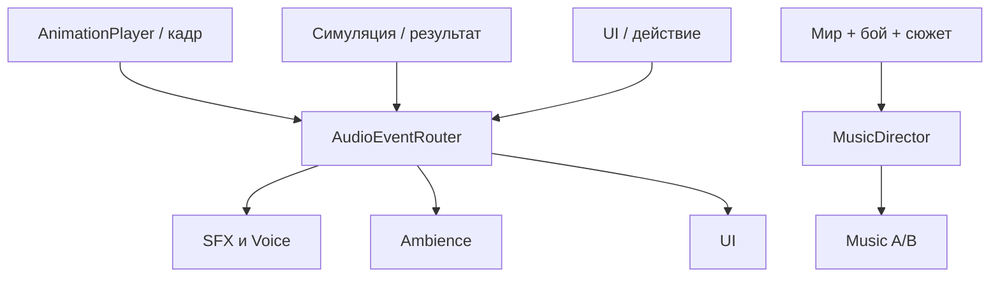
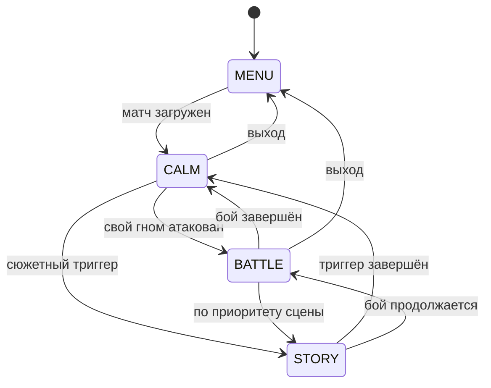

# Diggles / Wiggles (2001–2002): спецификация звука для Godot

Исследование открытых источников • 19.11.2026

## Статус и границы исследования

Доступа к установленной игре, её аудиофайлам, Tcl-скриптам и проекту порта нет. Использованы публичные метаданные файлов переиздания, справочник команд движка, свидетельства игроков, публикация 2001 года, официальный текст издателя, публичный каталог музыки и индексированные видеозаписи. Ниже **не выдаётся наличие файла за услышанный эффект**. Доступный веб-поиск предоставляет страницы и метаданные, но не звуковую дорожку для непосредственного прослушивания видеозаписей. Поэтому точные таймкоды игровых звуков не установлены; вместо выдуманных секунд указаны проверяемые разделы/строки источника или точки входа для последующей аудиопроверки. Таймкоды отдельных музыкальных файлов относятся к их продолжительности, а не к моменту запуска в игре.

### Маркировка

- **D (документировано)** — команда движка или имя ресурса прямо присутствует в публичном документе/индексе; наличие файла не гарантирует его использования.
- **R (reported)** — автор источника прямо описывает услышанное в игре; это свидетельство, а не собственное прослушивание исследователем.
- **I (inference)** — вероятное соответствие семантике имени файла, механике или нескольким источникам.
- **U (unknown)** — отдельный звук/условие не установлены.
- **В/С/Н** — высокая/средняя/низкая уверенность в конкретном утверждении об оригинале. Для строк D+I высокая уверенность относится только к существованию ресурса.
- **P0** — первый играбельный прототип; **P1** — второй проход, существенная часть атмосферы; **P2** — детализация. Это предлагаемые приоритеты порта, не характеристики оригинала.
- **—** в колонке таймкода означает, что источник текстовый или проверенный игровой таймкод отсутствует. Ссылки в каждой строке ведут на соответствующий открытый источник.

## Sound matrix

### 1. Музыка

| ID / событие | Установлено | Источник / позиция | Предполагаемый триггер порта | Приоритет |
|---|---|---|---|---|
| M01 Меню | D: `mmenu.mp3`; I: тема меню по имени; не проверено в игре. В/С | [Depot][DB], стр. 934; [MMENU][MMENU], 0:00–1:58 (трек) | Вход в главное меню, выход при загрузке | P0 |
| M02 Главная тема | D: `mtheme.mp3`; момент использования не установлен. В/Н | [Depot][DB], 935; [MTHEME][MTHEME], 0:00–2:40 (трек) | Тема заставки или титров после сверки | P2 |
| M03 Спокойный игровой фон | R: фон меняется между мирами; в тесте 2001 описан ритмичный саундтрек. В/С | [Gameswelt][GW], 79; [GOG][GOG], 748; — | Мир/биом, отсутствие тревоги, плейлист коротких композиций | P0 |
| M04 Нападение | R: игрок замечает нападение по внезапной смене музыки. С–В | [Yopi][Y], 138; [GOG][GOG], 748; — | Вход дружественного гнома в бой или атака на него, независимо от выбора юнита | P0 |
| M05 Опасность до физического боя | U: не доказано отдельное состояние угрозы, погони или обнаружения врага. Н | [GOG][GOG], [Yopi][Y]; — | Опционально `THREAT` после обнаружения; на первом этапе не включать без подтверждения | P2 |
| M06 Боевая музыка разных миров | R: пользователь GOG (2021) сообщает о разных боевых темах миров и ошибке, при которой остаётся тема первого мира. С | [GOG][GOG], 745–749; — | Выбирать боевой плейлист из текущего мира, обновлять при переходе | P0 |
| M07 Сюжетная смена темы | D: команда `sm_music_theme` привязывает тему к классу триггера и может менять её при активации. В | [Tcl][TCLM], 8139–8147; — | Сигнал сюжетной зоны/события, переопределяющий текущую тему | P1 (кампания), P2 (бой) |
| M08 Пещерный трек | D: `Hoehle.mp3` (название «пещера»); I: возможная тематическая композиция, не доказана автоматическая привязка к пещерам. В/Н | [Depot][DB], 822; [Hoehle][HO], 0:00–4:23 (трек) | Не назначать каждой новой пещере; кандидат фонового пула | P1 |
| M09 Возврат из боя | U: задержка, переход на границе такта, возобновление прерванного трека или перезапуск не установлены. Н | [GOG][GOG], [Tcl][TCLM]; — | После окончания всех активных схваток и защитного интервала | P0 |
| M10 Музыка сражений вне кампании | U: соответствие пулов в skirmish не установлено. Известно сообщение о пропаже музыки в нескольких режимах при проблемной установке. Н | [Форум][BUG], сообщение 2023; — | У карты сражения свой music profile; отдельное тестирование | P0 |

Музыка — не один зацикленный файл: каталог содержит `Mxxx`, `NAxxx`, отдельные именованные композиции. Фанатский gamerip перечисляет 121 файл, общую длительность 2 ч 36 мин; он не содержит доказанного распределения по состояниям. См. [полный каталог][OST] и [индекс переиздания][DB] (821–942). Не реконструировать имена battle/ambient по порядковому номеру композиции.

### 2. Гном: движение, работа, предметы, голос

В колонке ресурса пути без префикса находятся относительно `data/Sound/`. Суффиксы `s/l/e` интерпретируются как вероятные фазы start/loop/end, но сами по себе не доказывают бесшовность или реальный алгоритм вызова.

| ID / действие | Факт / интерпретация | Источник и таймкод | Триггер в Godot | Приоритет |
|---|---|---|---|---|
| G01 Ходьба | D: `gehen_s.wav`, `gehen_l.wav`, `gehen_e.wav`; справочник приводит пример шага на кадре 5 анимации `gehen_loop` (пример, не восстановленная таблица событий). В | [Depot][DB], 2333–2337; [Tcl][TCLS], 8285–8301; кадр 5; видео — | `foot_contact` / фазы движения, выбрать один способ во избежание дубля | P0 |
| G02 Бег / быстрый приказ | D: `laufen_schnell_loop.wav`, `laufen_schnell_end.wav`; I: отдельный быстрый бег, не доказано срабатывание от конкретной кнопки. В/С | [Depot][DB], 2406–2409; — | Фаза быстрого бега, стоп при отмене | P0 |
| G03 Усталое движение и перенос груза | D: группы `g_muede_*`, `g_kiste_*`, `g_kiepe_*`; I: разные движения уставшего гнома, с ящиком, с корзиной. В/С | [Depot][DB], 2324–2332; — | По типу анимации и переносимого предмета | P1 |
| G04 Лазанье по стене | D: `kletter_fuss_1.wav`, `kletter_hand_1.wav`, `kletter_hoch.wav`, направленные варианты. В | [Depot][DB], 2361–2371; — | Контакт руки/ноги со стеной; начало/конец цикла | P0 |
| G05 Лестница | D: `leiter_hoch_l.wav`, `leiter_hoch_s.wav`; I: другой класс контактных звуков. В/С | [Depot][DB], 2410–2412; — | Контакт со ступенью лестницы | P1 |
| G06 Копание | R: глухие удары по породе; D: `hack_l.wav`, `hack_s.wav`, `hack_quer.wav`, `buddeln_o.wav`. В | [Gameswelt][GW], 79–80; [Depot][DB], 2296, 2340–2345; — | Контакт кирки с породой, не клик для приказа | P0 |
| G07 Варианты копания | D: `hack_muede_l.wav`, `hackfit_l.wav`; I: усталость/навык меняют анимацию и вариант звука. В/С | [Depot][DB], 2341–2345; [Steam][STEAM], описание навыка; — | Вариант анимации, тип инструмента и материал | P1 |
| G08 Промах кирки | U: отдельный звук промаха именно при копании не найден. `swish_a.wav` существует, но связь не доказана. Н | [Depot][DB], 2481; — | `pickaxe_miss` только если анимация или симуляция даёт промах; без удара о камень | P1 |
| G09 Застрявшая кирка / неудача | D: официальный издатель подтверждает застревание кирки; перечислены `hack_unfall.wav`, `buddeln_unfall.wav` и варианты по материалам. I: это кандидаты на звук застревания; точный bind не найден. В/С | [Steam][STEAM], описание опыта каменной работы; [Depot][DB], 2297–2300, 2344; — | Отдельное событие неудачи, связанное с анимацией застревания/извлечения | P0 |
| G10 Подбор | R: в игре есть подбор по клику; D: `takeitems.tcl` — имя скрипта, `InGame/buecken_2_s_mo.wav` — кандидат наклона. U: отдельный звук захвата. С/Н | [Gameswelt][GW], 84; [Depot][DB], 979, 1612; — | Только успешная передача предмета в инвентарь; опциональный шорох анимации | P0 |
| G11 Выбрасывание / размещение | D: `schmeissen.wav` («бросать»), `ablegen_a.wav` («класть»), `kiste_ablegen.wav`; I: потенциально разные бросок, помещение на землю и опускание ящика. В/С | [Depot][DB], 2266, 2360, 2450; [Gameswelt][GW], 84; — | Release + отдельный контакт с полом, если реально падает | P0 |
| G12 Сумка / рюкзак | D: `sacki.wav`, `g_kiepe_*`; U: специфические звуки открытия малого/большого инвентаря не установлены. В/Н | [Depot][DB], 2324–2326, 2438; — | `inventory.transfer`, эффект открытия лишь после сверки | P1 |
| G13 Сон | D: `InGame/schlafen_3x.wav`, `schlafen_4o.wav`; U: цикл храпа/частота и принадлежность конкретному полу. В/Н | [Depot][DB], 1678–1679; — | Начало сна, редкие локальные короткие фрагменты | P1 |
| G14 Эмоции, усталость, страх | D: `InGame/angst_3_m_ko.wav`, `anstrengung_2x.wav`, `gaehnen_3o.wav`, `erschrecken_1o.wav`; I: страх, усилие, зевок, испуг. В/С | [Depot][DB], 1594–1637; — | Переход в состояние и событие анимации не одновременно; один голос | P1 |
| G15 Разговор и приветствие | R: игрок описывает слышимые голоса, речевые облачка, жалобы на перегрузку; D: `Sprache/f_gruss_neg.wav`, `m_gruss_pos.wav`, группы `f_ac_...`, `m_re_...`. В/С | [Yopi][Y], 136; [Depot][DB], 1934–2014; — | Диалог: инициатор, ответ, эмоциональная окраска, ограничитель очереди | P0 |
| G16 Ответ на приказ / отказ | U: нет доказанной привязки реплик к клику выбора, принятию или отказу. Имена `InGame/anbieten_1o.wav`, `annehmen_1o.wav` могут относиться к социальным действиям. Н | [Depot][DB], 1595–1597; — | Сигналы `command.accepted/rejected`; временный короткий UI-отклик, голос опционален | P0 |
| G17 Бой / оружие | R: лязг клинков и тихие звуки стрельбы; D: `schwert_stech_a.wav`, `schild_blo.wav`, `schiessen_bogen.wav`. В | [Gameswelt][GW], 79; [Depot][DB], 2443–2464; — | Отдельно замах, блок, контакт и выпуск снаряда | P0 |
| G18 Получение урона / смерть | D: `InGame/schmerz_4x.wav`, `sterben.wav`, `InGame/sterben_3o.wav`. В; связь конкретных файлов с тяжестью неизвестна | [Depot][DB], 1682–1683, 1698–1699, 2476; — | Damage confirmed, death state, не при каждом замахе | P0 |
| G19 Вода и утопление | D: `Swim_l_1.wav`, `Swim_l_2.wav`, `ertrinken.wav`, `InGame/schwimmen_2o.wav`. В | [Depot][DB], 1687–1690, 2015–2016, 2312; — | Вход в воду, гребки, событие утопления | P1 |

### 3. Существа

| ID / источник звука | Факт / интерпретация | Источник / таймкод | Триггер в Godot | Приоритет |
|---|---|---|---|---|
| C01 Хомяк, движение | D: `Hamster/ham_laufen_l.wav`, `ham_hoppeln_l.wav`, `ham_drehen.wav`. I: движение и прыжки. В/С | [Depot][DB], 1579–1582; — | Цикл ходьбы/прыжка хомяка | P0 |
| C02 Хомяк, естественные действия | D: `ham_putzen.wav`, `ham_schlaf_s.wav`, `ham_schlaf_e.wav`, `ham_maennchen.wav`, `hamster.wav`. I: чистится, засыпает, просыпается, встаёт на задние лапы; тембр не установлен. В/С | [Depot][DB], 1584–1589; — | Смена состояния и редкий idle-звук | P1 |
| C03 Хомяк, колесо и транспорт | D: `ham_laufrad.wav`, `ham_karre_l.wav`, `Hamster_reiten.wav`, `Hamster_absteigen.wav`. В | [Depot][DB], 1581–1583, 1590–1592; — | Вращение колеса, перевозка, посадка/спешивание; остановка при выходе | P1 |
| C04 Хомяк, смерть | D: `ham_sterben.wav`; U: отдельный звук при ударе или поедании обычного хомяка. В/Н | [Depot][DB], 1588; — | Смерть существа | P1 |
| C05 Гигантский хомяк | D: `Hamster/Riesenhamster/gehen_loop.wav`, `schlagen.wav`, `get_vorn_schwer.wav`, `sterben.wav`. В | [Depot][DB], 1564–1578; — | Удары/повреждения/движение; отдельный профиль | P2 |
| C06 Черви | U: не установлено, к какому классу оригинала относится конкретный видимый червь, нет подтверждённого файла или тембра. Н | [Depot][DB], разделы классов и Sound; — | Необязательный звук изгиба/атаки; выключен до идентификации вида | P1 |
| C07 Растения и грибы | D: `classes/characters/pflanzen.tcl` есть в каталоге; `Produktion/pilz_umfall.wav` буквально «падение гриба». U: наличие звука роста/пассивного растения, а также связь с опасными растениями. В/Н | [Depot][DB], 952, 1792; — | Объект сломан/урожай собран; рост без звука до сверки | P1 |
| C08 Wuker: враждебное существо | D: `Wuker/WV_aggression_a.WAV`, `w_beissen_a.WAV`, `w_fressen_a.WAV`, `w_schnueffel.WAV`, `w_fliehen_l.WAV`. В | [Depot][DB], 2212–2265; — | Агрессия, укус, еда, обнюхивание, бегство как разные события | P1 |
| C09 Troll: тревога и атака | D: `Troll/t_stehen_alarm_loop_b.WAV`, `t_stehen_drohen_start.WAV`, `t_stehen_faustschlag.WAV`. В | [Depot][DB], 2173–2184; — | Локальная тревога тролля, угроза, удар | P1 |
| C10 Brut: атака / движение | D: `Brut/kbr_beissen.WAV`, `kbr_bruellen_a.WAV`, `kbr_laufen_loop.WAV`. В | [Depot][DB], 1331–1342; — | Укус, рёв, движение; снизить частоту idle-рыка | P2 |
| C11 Фенрис | D: `Fenris/fe_schritt1.WAV`, `fe_schlag.WAV`, `fe_feuer2.WAV`. В | [Depot][DB], 1526–1546; — | Звуки босса по кадрам, отдельный голос/эффект | P2 |

### 4. Окружение и производство

| ID / источник | Факт / интерпретация | Источник / таймкод | Триггер в Godot | Приоритет |
|---|---|---|---|---|
| E01 Факел | U: визуальное наличие факелов документировано, но отдельный звуковой цикл факела не установлен; не переносить на него звук большого костра. Н | [Gameswelt][GW], 76; [Depot][DB]; — | Необязательный тихий точечный эмиттер, по умолчанию отключён | P2 |
| E02 Костёр / очаг | D: восемь файлов семейства `Produktion/Feuerstelle_1.wav`–`Feuerstelle_8.wav`; I: очаг имеет несколько вариантов/фаз. В/С | [Depot][DB], 1749–1756; — | Периодические варианты огня на активном очаге, плавное затухание | P0 |
| E03 Капли и текущая вода | D: `Specials/wasser_mittel_1.wav`, `wasser_viel_1.wav`, `wasser_mittel_zu_viel.wav`, `wasser_viel_zu_troepfel.wav`, `wasser_troepfel_zu_aus.wav`. I: набор переходов интенсивности, вероятно специальных объектов/сцен. В/С | [Depot][DB], 1882–1890; — | Источник воды с уровнями off/drip/medium/high; переходы по изменениям состояния | P1 |
| E04 Вода за границей карты | U: не доказано, слышен ли внешний океан/фон независимо от камеры и глубины. Н | [Depot][DB], [Gameswelt][GW], 75; — | Не добавлять глобальный шум автоматически; тестировать отдельно от потоков | P2 |
| E05 Обвал | D: `Specials/einsturz.wav` («обрушение»), `Landschaft/partikel_stein.wav` и варианты. В; частота/тип обвала U | [Depot][DB], 1738–1740, 1831; — | Однократный эффект после реального разрушения породы, опциональные частицы | P0 |
| E06 Землетрясение | D: `Specials/erdbeb_fade_in.wav`, `erdbeb_fade_out.wav`, группы `erdbeb_heftig_*`. В | [Depot][DB], 1835–1842; — | Событие тряски с attack/sustain/release | P2 |
| E07 Строительство | R: игрок сообщает о звуках строительства; D: `aufbauen_holz.wav`, `aufbauen_stein.wav`, `aufbauen_met.wav`. В | [Yopi][Y], 136; [Depot][DB], 2273–2275; — | Контакт инструмента после начала постройки, профиль дерева/камня/металла | P0 |
| E08 Работа станка | D: `Produktion/Saegewerk.WAV`, `Dampfhammer.wav`, `Brauerei.WAV`; R: игрок описывает шум зданий. В | [Depot][DB], 1744–1748, 1772; [Yopi обзоры][Y2]; — | Производственный цикл с остановкой при простое | P1 |
| E09 Лава | D: три файла `Landschaft/lava_fliessen_*.wav`, `Specials/lava_zisch.wav`. В | [Depot][DB], 1729–1731, 1863–1865; — | Локальный поток, всплеск/шипение только при соответствующем событии | P2 |
| E10 Дверь | D: `Landschaft/tuer_oeffnen.wav`, `tuer_schliessen.wav`; есть варианты материалов дверей. В | [Depot][DB], 1741–1742, 1767–1768, 1774–1775; — | При фактическом открытии/закрытии, не при каждом клике | P1 |

### 5. UI: обратная связь

| ID / событие | Факт / интерпретация | Источник / таймкод | Триггер в Godot | Приоритет |
|---|---|---|---|---|
| U01 Наведение | D: `Specials/interface_hover.wav`. В; I: конкретные интерактивные зоны неизвестны | [Depot][DB], 1856; — | Вход курсора в новый активный UI-элемент, не каждый кадр | P1 |
| U02 Клик | D: `Specials/interface_klick.wav`. В; источник в UI наиболее вероятен | [Depot][DB], 1857; — | Подтверждённое нажатие кнопки UI | P0 |
| U03 Выбор гнома/предмета | R: выбор гнома и предметов мышью задокументирован визуально/текстом; U: отдельный звук выбора не установлен. Н | [Gameswelt][GW], 82–85; [Depot][DB]; — | `selection.changed`, по умолчанию тихий UI или без звука до теста | P0 |
| U04 Допустимое размещение | U: отдельный звук зелёного призрака или подтверждения не установлен. Н | [Gameswelt][GW], 84–85; [Depot][DB]; — | При успешной фиксации предмета/чертежа, не движении курсора | P0 |
| U05 Недопустимое размещение | U: отдельный звук запрета (красный призрак) не установлен. Н | [Gameswelt][GW], 85 (визуальная обратная связь, не звук); — | При попытке размещения с ошибкой, временный отличный от успеха звук | P0 |
| U06 Инвентарь и рюкзак | U: отдельные клипы открытия/закрытия, перетаскивания и переключения размера не подтверждены. Н | [Gameswelt][GW], 84; [Depot][DB], 2438; — | `inventory.open/close`, `inventory.transfer`; не удваивать физические звуки G10/G11 | P1 |
| U07 Команды | U: не установлено, сопровождается ли каждый приказ репликой, кликом или тишиной. Н | [Yopi][Y], 130, 136; [Depot][DB]; — | Принятие/отказ приказа в интерфейсе; ответ гнома не обязательный | P0 |
| U08 Меню, варианты | D: `Specials/menuesound_1.wav`–`menuesound_6.wav`; U: точные пункты, назначение шести вариантов. В/Н | [Depot][DB], 1868–1873; — | Меню по назначению, не случайно для любого игрового действия | P1 |

## Evidence

### Документация и каталог ресурсов

1. **[SteamDB — Diggles content depot 1478651][DB].** Публичный индекс файлов переиздания (метаданные путей и размеров, не скачивание игры). Уверенность в наличии конкретного ресурса высокая; происхождение из релиза 2001 года и реальная привязка к событиям не доказаны одним индексом. В каталоге особенно полезны:
   - строки 821–942: музыка MP3;
   - 1097–1100: `data/Scripts/init/soundinit.tcl`, `t_soundinit.tcl`, `z_soundinit.tcl` — при будущем легальном доступе это первые кандидаты на таблицы привязки звуков;
   - 1288–2501: WAV-эффекты и голоса, которые использованы в Sound matrix.
   - Для поиска на странице открыть ссылку и выполнить Ctrl+F по точному имени. Номера строк относятся к веб-представлению на дату поиска, при обновлении страницы могут сдвинуться.
2. **[Wiggles Tcl Commands — sound][TCLS].** Наиболее полезная техническая находка. Справочник описывает регистрацию логического звука, связь с кадром анимации, позиционное и глобальное воспроизведение, фильтрацию по материалу и размеру помещения, базовый gain/pitch и случайное отклонение. Допустимые материалы: sand, soil, stone, wood, metal, water, lava; помещения: tunnel, small, medium, big; в обоих случаях возможен универсальный вариант any. Пример в справочнике использует шаг `snd_step02` на кадре 5 мужской анимации ходьбы. Это не доказательство, что именно такой bind использован в оригинальном `z_soundinit.tcl`.
3. **[Wiggles Tcl Commands — sm_music_theme][TCLM].** Класс сюжетного триггера может быть связан с музыкальной темой. Документация описывает маркер на позиции триггера и смену темы при его активации. Не следует выводить из этого, что при прокрутке камеры всегда меняется музыка.
4. **[Steam, издатель][STEAM].** Подтверждает механику застревающей кирки и влияние опыта на её частоту; не утверждает, какой WAV при этом звучит. Переиздание заявлено как сохранение истории, визуального оформления и геймплея; это не гарантия полного совпадения аудио с дисковой версией.
5. **[Gameswelt, оригинальный обзор][GW].** Авторы в 2001 г. описывают ритмичную музыку, приглушённые удары при копании, питьё в баре, звуки клинков и выстрелов. Они также замечают рассинхрон удара кирки и аудио: эффект может запаздывать на несколько взмахов. В порте этот дефект копировать не нужно. Это свидетельство слышимого оригинала, не анализ аудиодорожки.
6. **[Yopi, свидетельство игрока][Y].** Автор прямо сообщает о голосах гномов, жалобах на избыток работы, звуках копания/строительства и смене музыки при атаке. Уверенность средняя, техническая реализация неизвестна.
7. **[GOG, сообщение о battle music bug][GOG] (22.05.2021).** Игрок утверждает, что обычная фоновая музыка меняется с миром, а при ошибке боевой фон остаётся из первого мира. Сильное свидетельство проектного принципа world × combat, но только один пост, без номеров треков и проверки в нескольких сборках.
8. **[WigSound][WIGS]**, GPL-3.0 (лицензия кода мода), репозиторий: обходит поломку голосов посредством внешнего MP3-плеера madplay. [Тема автора/сообщества][FIX] также описывает эхо от одновременной работы старого и нового пути. [Другой отчёт][BUG] сообщает об исчезновении музыки и части реплик в английской ISO-версии. Вывод: отсутствие звука в одном letsplay или одной установке нельзя сразу признать правилом оригинала.
9. **[Титры MobyGames][CRED]** атрибутируют звук/музыку Tonburo Berlin и перечисляют участников. Публичность музыки для прослушивания и GPL-лицензия инструмента не означают разрешения перераспространять оригинальные WAV/MP3. Для порта использовать оригинальные или лицензированные заменители либо отдельный законный импорт из пользовательской копии.

### Музыкальные эталоны и видео: реестр для аудиопроверки

| Ссылка | Таймкод / диапазон | Что реально проверено | Что проверять при прослушивании |
|---|---|---|---|
| [MMENU][MMENU] | 0:00–1:58 | Имя и длительность в gamerip; совпадает имя в depot | Совпадает ли с меню, зацикливание |
| [MTHEME][MTHEME] | 0:00–2:40 | Имя и длительность в gamerip | Главная тема, вступление/титры |
| [Hoehle][HO] | 0:00–4:23 | Имя и длительность в gamerip | Фоновая или сюжетная роль |
| [Cnodax — M054](https://www.youtube.com/watch?v=LaHmiRC5K-8&t=0s) | 0:00–1:10 по каталогу OST | Ролик подписан исходным именем композиции; длительность каталога | Классификация настроения, сравнение с gameplay. Не доказана роль трека |
| [GamesnDrawing — Campaign 1 Episode 1, no commentary](https://www.youtube.com/watch?v=TnnJzah3Vik&t=0s) | 0:00 — начало ролика; интервалы действий не проверены | Название записи и отсутствие комментария по заголовку | Меню, ходьба, копание, предметы, первые существа |
| [GamesnDrawing — Campaign 1 Episode 14, no commentary](https://www.youtube.com/watch?v=Zsv91WjN8_w&t=0s) | 0:00 — начало; интервалы неизвестны | Индексированная запись, поздний эпизод первой кампании | Производство, частые звуки, боевые переходы |
| [Digging a hole to die in](https://www.youtube.com/watch?v=oEY_4SAz9SQ&t=4096s) | 0:00:00 intro/tutorial; 1:08:16 gameplay | Авторские главы из описания видео | Сравнить учебные и игровые звуки; речь автора может мешать |
| [GOG tutorial gameplay](https://www.youtube.com/watch?v=yWBO-XAVzyY&t=0s) | 0:00 — начало; точные интервалы не установлены | Заголовок/описание | Локализованная озвучка, последовательности приказов |

Эти ссылки открывают конкретные ролики, а не поисковую выдачу. Начальный таймкод 0:00 — **точка входа**, не утверждение о слышимом тогда звуке. Для остальных строк Sound matrix точного аудиотаймкода нет; поиск по пути ресурса воспроизводим, но это иной вид доказательства.

## Godot event mapping

### 1. Архитектура: отдельно события, микшер и музыка

Для 2.5D-мира при использовании 3D-моделей рекомендуется `AudioStreamPlayer3D`, для чистой 2D-плоскости — `AudioStreamPlayer2D`. UI и музыка используют непозиционный `AudioStreamPlayer`. Слушатель привязан к камере, а не к выбранному юниту; изменение zoom не должно резко менять громкость. Это предложение; оригинальный алгоритм аттенюации не установлен.



Основные компоненты:

- `AudioEventRouter` (autoload): разрешает ключ события, материал и размер комнаты на конкретный банк; имеет лимиты голосов, cooldown, режим spatial/global и журнал отладки.
- `AudioEmitter`: пул позиционных проигрывателей. Долгие звуки привязаны к сущности; короткое падение предмета может продолжать звучать после удаления сущности, если переносится в мировой пул.
- `MusicDirector`: отвечает за мир, игровое состояние, сюжетное переопределение, безопасные переходы.
- Шины: Master → Music, WorldSFX, Ambient, Voice, UI. Настройки независимо управляют Music и эффектами; дополнительная отдельная регулировка голосов — предложение для порта.
- `AudioStreamRandomizer` для вариантов без немедленного повторения; method tracks в `AnimationPlayer` для параметризованных звуков. Физические результаты действия подтверждаются игровым кодом.

### 2. Контракт событий

Событие несёт `event_id`, `entity_id`, `action_id`, `position`, `material`, `room_size`, `variant`, `timestamp`; для эффектов без позиции world position отсутствует. Не смешивать UI-клик с выполнением команды.

| Godot event ID | Производитель / точный момент | Матрица | Канал / поведение |
|---|---|---|---|
| `movement.foot_contact` | Ключ контакта ноги, при наличии опоры | G01, G02 | WorldSFX; варианты по поверхности |
| `movement.climb_contact` | Ключ контакта руки/ноги; лестница отдельно | G04, G05 | WorldSFX; материал стены |
| `dig.contact` | Кадр удара, подтверждённый контакт | G06, G07 | WorldSFX; удар один раз |
| `dig.miss` | Симуляция фиксирует промах | G08 | WorldSFX; нет удара о землю |
| `dig.jam.start/end` | Переход в/из застрявшего состояния | G09 | WorldSFX + Voice; первое событие приоритетное |
| `item.pickup.committed` | После успешной смены владельца | G10, U06 | WorldSFX; один звук на транзакцию |
| `item.release.committed` | Предмет отделён от рук/инвентаря | G11 | WorldSFX |
| `item.landed` | После физического контакта с поверхностью | G11 | WorldSFX; материал, сила |
| `gnome.sleep.start/idle/end` | Смена состояния; idle по таймеру | G13 | Voice; редкие локальные звуки |
| `gnome.voice` | Эмоция, приветствие, начало реплики | G14–G16 | Voice; не более одной активной реплики на гнома |
| `combat.swing/hit/block/fire` | Анимация атаки / подтверждение столкновения / выпуск снаряда | G17–G18 | WorldSFX; пространственный |
| `combat.damage/death` | Результат симуляции | G18 | WorldSFX + Voice |
| `creature.state` | Вид + состояние + фаза | C01–C11 | WorldSFX/Voice; отдельный профиль вида |
| `ambience.fire.active` | Очаг зажжён/погашен | E01–E02 | Ambient; start/stop |
| `ambience.water.level` | Реальное изменение потока | E03–E04 | Ambient; переход между интенсивностями |
| `terrain.collapse` | Реальное обрушение | E05–E06 | WorldSFX; событие высокой слышимости |
| `build.contact` | Кадр строительного усилия | E07 | WorldSFX, материал |
| `machine.state` | Производство стартует/завершается | E08 | Ambient/WorldSFX; stop при простое |
| `ui.hover/click` | Вход курсора / активация | U01–U02 | UI, без аттенюации |
| `ui.selection.changed` | Изменился состав выбора | U03 | UI, provisional |
| `ui.placement.commit/reject` | Результат операции, а не цвет призрака | U04–U05 | UI, provisional |
| `ui.inventory.open/close` | Панель реально открылась/закрылась | U06 | UI, provisional |
| `ui.command.accepted/rejected` | Очередь приняла/отклонила команду | G16, U07 | UI, provisional |
| `music.context.changed` | Мир, бой, режим или сюжетная зона | M01–M10 | Music |

Только `dig.contact` может менять поверхность и проигрывать удар; выдача приказа копания всего лишь ставит действие в очередь. Никакого звука удара у отменённой до контакта анимации. Тот же принцип применять к строительству, подбору и бою. Дедупликация по (entity_id, action_id, event_id, contact_index).

### 3. Схема динамической музыки (предложение)

Хранить мир и состояние ортогонально: `profile[world].ambient`, `profile[world].battle`, опционально `profile[world].threat`. Сюжетная тема — переопределение, а не новый биом. В skirmish профиль определяется картой, не сюжетной кампанией. Для первого 4×4-прототипа достаточно одного профиля с двумя пулами; структура позволяет затем добавить разные миры.



- Вести множество текущих боевых контактов дружественных гномов: если один гном вышел из боя, но другой продолжает сражаться, не возвращаться к спокойной музыке.
- Переход CALM → BATTLE не должен зависеть от выбранного гнома. Это конструктивное решение по свидетельству M04, а не установленный порог оригинала.
- Начальные параметры для тестов: crossfade 0,5–1,0 с при атаке, 1,5–2,5 с при возврате, 6 с удержания перед возвратом. Если атака возобновилась, отменить таймер. При новой карте сбросить старую тему. Все значения — **предложения**, не измерения.
- Два `AudioStreamPlayer` с плавным затуханием; спокойный трек можно возобновить с сохранённой позиции в прототипе, пока оригинальное поведение не выяснено. Не включать THREAT отдельно на первой итерации.
- При выключении Music мировые эффекты продолжают работать; при выключении SFX музыка остаётся. Не использовать изменение громкости как замену боевой теме.

### 4. Материалы и банк ресурсов

Справочник Tcl обосновывает параметризацию материала/помещения. Создать `SoundBank` как Resource/JSON с логическими ID, а не обращаться к WAV напрямую из FSM персонажа:

```yaml
event_id: dig.contact
bus: WorldSFX
mode: positional
priority: high
variants:
  - material: stone
    room: any
    assets: [res://audio/own/dig_stone_01.ogg]
  - material: soil
    room: any
    assets: [res://audio/own/dig_soil_01.ogg]
  - material: any
    room: any
    assets: [res://audio/own/dig_generic_01.ogg]
pitch_range: [0.96, 1.04]
gain_jitter_db: 1.5
min_interval_ms: 50
evidence_ids: [G06, G07]
original_binding_verified: false
```

Пути и параметры — примеры для собственных ассетов; файлов не создавали. Приоритет совпадений: точный материал+комната → материал+any → any+комната → any+any. Для размеров помещения можно позже подобрать фильтр/реверберацию через шины или Area3D, но документация оригинала подтверждает только параметр room в sound anim, а не тип DSP.

### 5. Минимальный аудиопакет для первого 4×4-прототипа

| Банк | Минимальный набор заменителей (рекомендация, не количество оригинала) |
|---|---|
| Music | 1 спокойный и 1 боевой трек, 1 короткая тема меню |
| Гном / ходьба | 3 шага по камню, 3 по грунту, 2–3 контакта лазанья, отдельный звук бега или увеличение частоты контактов |
| Гном / работа | 3 удара киркой, 1 аварийный звук застревания, 2 строительных звука, 1 подбор, 2 варианта выкладывания |
| Боевые | 2 замаха, 2 подтверждённых попадания, 1 блок, 2 короткие реакции на боль, 1 смерть |
| Голос | 2 нейтральных, 2 недовольных, 2 испуганных реплики/вокализации, не копировать локализованную речь без разрешения |
| Существа | Хомяк: два варианта движения/idle; враг: тревога, атака и получение урона |
| Окружение | Костёр/очаг, капли, обвал/грохот; остальные после проверки |
| UI | Клик, принятие, отказ, выбор (может быть без звука), инвентарная операция |

Начальные лимиты (настраиваемые): 24 позиционных one-shot, 8 ambient-loop, 4 одновременно слышимых голоса на экране, 2 музыкальных плеера. Отдавать голоса приоритетом выбранным/близким и критическим событиям, не позволяя восьми гномам переглушать бой. Цикл огня или механизма не должен перезапускаться на каждом кадре. При сворачивании или паузе прототипа отдельно определить политику UI/music/WorldSFX.

### 6. Приёмочные тесты

1. Один гном идёт, затем карабкается, затем копает: событие при фактическом контакте, а не при выдаче приказа. Записать видео 60 fps и сопоставить маркеры звука/анимации; звук не отстаёт на несколько ударов.
2. Отменить приказ до удара; звука кирки нет. Искусственно вызвать застревание; стандартный удар и аномалия не воспроизводятся дважды.
3. Поднять предмет, переместить в рюкзак, затем бросить и положить: отличать логическое перемещение, отпускание и контакт с поверхностью.
4. Недопустимое размещение → один UI-отклик, world SFX нет; перемещение призрака 60 fps не даёт треска от постоянных сигналов.
5. Камера удаляется от очага/хомяка: затухание мира; UI и музыка не меняются. Звук потока исчезает, когда эмиттер отключён. Проверить, что звуки не выдают неизвестную область карты без выбранной политики.
6. Напасть на своего гнома вне выбранной пещеры: музыка становится боевой. Второй бой удерживает состояние; новый мир выбирает свой battle profile. Это задача предотвращения бага, описанного на GOG.
7. При двух командах, вызванных одновременно, эффекты не дублируются, голоса ограничены; запись `event_id` содержит источник, позицию и фактический момент вызова.

## Open questions

| Приоритет исследования | Что неизвестно | Как проверить при доступе к записи/игре |
|---|---|---|
| 1 | Конкретные Mxxx для каждого мира, отдельный ли THREAT, задержка возврата из боя, переходы между треками и поведение skirmish | Сравнить отрывки оригинальной и переизданной сборок с каталогом OST; 10 секунд до/после атаки, конца боя и перехода мира |
| 2 | Точный bind кирки: контакт, промах, застряла, извлечена; материалы и кадры | При легальном доступе проверить `soundinit.tcl`, `z_soundinit.tcl`, animation IDs и строки `sound bind`/`sound anim`; записать медленного новичка и опытного гнома |
| 3 | Реальное различие подбора, броска, опускания, перекладывания между рюкзаками | Запись с выключенной музыкой; по 5 повторов каждой операции, отметки точных времён |
| 4 | Отличия щелчка UI от гномьей реплики на выбор/приказ; подтверждение/отказ размещения | Одинаковые действия над пустой землёй, предметом и гномом; валидное/невалидное размещение. Не считать цвет звуковым фактом |
| 5 | Звучат ли обычные факелы; есть ли шум неподвижной воды и внешней водной границы | Перемещать камеру вокруг факела, костра, сухой пещеры, озера и границы; отдельно отключать музыку |
| 6 | Идентичность червей, их собственные звуки и звуки растений | Найти отображаемую модель/класс, записать idle, движение, атаку, получение урона; не отождествлять Wuker с червём без доказательства |
| 7 | Камера/слушатель, радиус слышимости, фильтрация помещения, zoom, невидимая область и полифония | Поставить один источник, двигать/масштабировать камеру, сравнить уровни; повторить в коридоре и большой пещере |
| 8 | Что из путей переиздания реально совпадает с CD 2001–2002; какие эффекты не используются | Сравнить версии и журнал событий. Фанатский [форум о внутренностях][LOG] индексирует параметр `-soundlog` и файл `log_asnd.txt`, но полноценную страницу инструмент не открыл; необходимо перепроверить перед использованием |

**Следующий шаг:** составлять таблицу прямых таймкодов из аудио-видеозаписей с колонками version, mode, video URL, start/end, action, heard sound, confidence, evidence screenshot. Только после этого уточнять тембр, длительности, повторы и соответствие имён ресурсов. Скриншот без аудио может подтвердить действие, но не звук.

### Источники Godot (официальная документация)

- [Audio buses](https://docs.godotengine.org/en/stable/tutorials/audio/audio_buses.html)
- [AudioStreamRandomizer](https://docs.godotengine.org/en/stable/classes/class_audiostreamrandomizer.html)
- [Animation track types](https://docs.godotengine.org/en/stable/tutorials/animation/animation_track_types.html)
- [AudioStreamPlayer](https://docs.godotengine.org/en/stable/classes/class_audiostreamplayer.html)
- [AudioStreamPlayer3D](https://docs.godotengine.org/en/stable/classes/class_audiostreamplayer3d.html)

[DB]: https://steamdb.info/depot/1478651/apps/
[TCLS]: https://wiggles.ruka.at/tipstricks/wiggles_tcl.html#sound
[TCLM]: https://wiggles.ruka.at/tipstricks/wiggles_tcl.html#sm_music_theme
[STEAM]: https://store.steampowered.com/app/1478650/Wiggles/
[GW]: https://www.gameswelt.de/wiggles/test/wiggles-3266/2
[Y]: https://www.yopi.de/testbericht/Wiggles_Computerspiele/275687
[Y2]: https://www.yopi.de/pr/Wiggles_Computerspiele/2
[GOG]: https://www.gog.com/forum/diggles_the_myth_of_fenris/bug_battle_music_does_not_change_when_switching_worlds
[WIGS]: https://github.com/DigglesMods/WigSound
[FIX]: https://wiggles.ruka.at/forum/viewtopic.php?f=10&p=4202&t=75
[BUG]: https://wiggles.ruka.at/forum/viewtopic.php?p=4200
[CRED]: https://www.mobygames.com/game/5104/diggles-the-myth-of-fenris/credits/windows/
[OST]: https://downloads.khinsider.com/game-soundtracks/album/wiggles-diggles-the-myth-of-fenris
[MMENU]: https://downloads.khinsider.com/game-soundtracks/album/wiggles-diggles-the-myth-of-fenris/MMENU.mp3
[MTHEME]: https://downloads.khinsider.com/game-soundtracks/album/wiggles-diggles-the-myth-of-fenris/MTHEME.mp3
[HO]: https://downloads.khinsider.com/game-soundtracks/album/wiggles-diggles-the-myth-of-fenris/Hoehle.mp3
[LOG]: https://wiggles.ruka.at/forum/viewtopic.php?t=324
