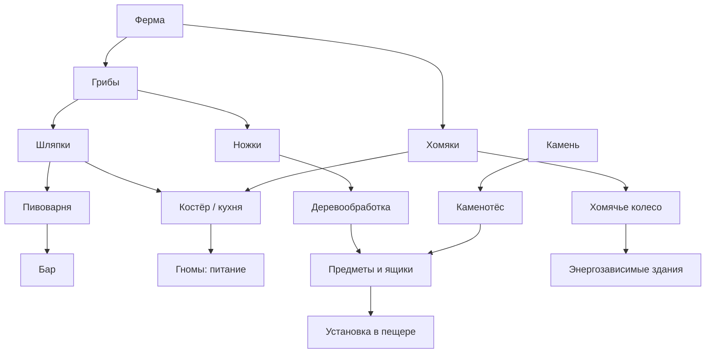
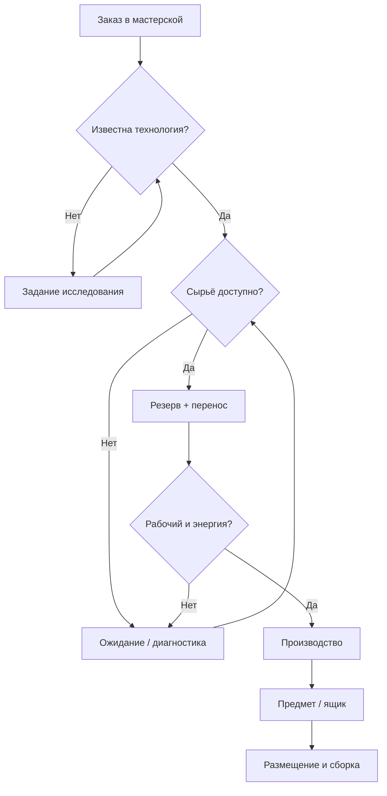

# Diggles: The Myth of Fenris / Wiggles — экономика и производственные цепочки

Исследование для Godot-порта · 19.11.2026 · оригинал 2001–2002 и публичные материалы переиздания 2020 года.

## Методика и границы

Не использовались установленная игра, её файлы, проект пользователя, исполняемые файлы или игровые сохранения. Источники — публичные страницы, опубликованные руководства и обсуждения. Технические предложения ниже не являются результатом декомпиляции. Полный оригинальный manual найти удалось, но его текст в доступной копии заблокирован; из него не извлекаются правила. Видео без проверенного кадра не используется как доказательство. Для текстовых источников вместо выдуманных таймкодов указаны разделы, страницы и короткие фрагменты.

**Статусы:** ✅ подтверждено — официальная документация или согласованное свидетельство наблюдателей; 🟡 вероятно — один фанатский источник, неполный фрагмент или вывод; ⚪ неизвестно — доказательства отсутствуют / противоречат друг другу. Уверенность: В — высокая, С — средняя, Н — низкая. Подтверждение конкретного поведения не доказывает точный внутренний алгоритм.

### Ключевые источники

| ID | Источник и дата | Что доказывает | Вес |
|---|---|---|---|
| S1 | [SEK, Wiggles-Kochstudio: клавиши](https://wiggles.ruka.at/tipstricks/index.php?c=keys), архив разработчиков | Управление производством, сменами, информационными окнами | Первичный |
| S2 | [SEK, Technikbaum](https://wiggles.ruka.at/tipstricks/index.php?c=tree), восстановлен в 2010 | Существование таблицы материалов, энергии, навыков; встроенный SVG не извлечён | Первичный, частичный |
| S3 | [GameStar, So buddeln Sie richtig](https://download.gamestar.de/public/31600/31649/12_2001_tipps_wiggles.pdf#page=1), декабрь 2001, с. 181–183 | Советы 1–27; авторы благодарят разработчиков за помощь | Современное оригиналу наблюдение |
| S4 | [GameSpot, Diggles Review](https://www.gamespot.com/reviews/diggles-review/1900-2857536/), март 2002 | Потребности, возраст, упаковка, одиночная схватка | Современное оригиналу наблюдение |
| S5 | [SNEG, Steam](https://store.steampowered.com/app/1478650/Wiggles/), 14.12.2020 | Общий масштаб, заявленная неизменность gameplay | Издатель переиздания |
| S6 | [Diggles Wiki, Tech Tree](https://diggles.fandom.com/wiki/Tech_Tree) | Названия и связи дерева, извлечённые из индексированного текста | Фанатская реконструкция; открытие страницы заблокировано |
| S7 | [moorih, Tips and Tricks](https://steamcommunity.com/sharedfiles/filedetails/?id=2325510266), 18.12.2020, обновление 28.10.2021 | Экономические советы, опыт, настроение | Практический гайд |
| S8 | [Rafael, руководство на русском](https://steamcommunity.com/sharedfiles/filedetails/?id=3353607951), 2024 | Производственный интерфейс, очереди, энергия, строительство | Практический гайд |
| S9 | [iXBT, Прикладное гномоводство](https://www.ixbt.com/live/games/prikladnoe-gnomovodstvo-razbor-syuzhetnogo-simulyatora-gnomov-diggles-the-myth-of-fenris.html), 2021 | Наблюдения и иллюстрации экономики | Вторичный |
| S10 | [Steam, Wiggles won't work on certain tasks](https://steamcommunity.com/app/1478650/discussions/0/3278065083966341842/), апрель–июнь 2022 | Проблемы поиска ресурсов и зависания производства | Первичные сообщения игроков; не универсальные правила |
| S11 | [Gameplay Tips, Console Commands and Item List](https://gameplay.tips/guides/9173-diggles-the-myth-of-fenris.html), 19.12.2020 | Опубликованные идентификаторы некоторых предметов | Фанатский справочник |
| S12 | [GameSpot, Diggles Preview](https://www.gamespot.com/articles/diggles-preview/1100-2835487/) | Ранняя экономика, пища, опыт, распорядок | Предрелизный материал; требует сверки с релизом |

Издатель сообщает о **семи ресурсах**, 20 инструментах и более 50 производственных объектах/площадках (S5, раздел Develop your colony). Это маркетинговый масштаб, а не доказательство наличия ровно 50 отдельных мастерских. Не путать семь базовых материалов с животными, рудами как отдельными стадиями и готовыми изделиями.

### Короткие контрольные фрагменты доказательств

| Локатор | Фрагмент в оригинале | Что проверять в источнике |
|---|---|---|
| [S1, клавиши](https://wiggles.ruka.at/tipstricks/index.php?c=keys) | `Einfg ... in den Produktionsprozess nehmen`; `F4 Produktionsinfos aufrufen`; `F7 Auftragsliste` | Включение в производственный процесс, окно производства, список заданий |
| [S2, Technikbaum](https://wiggles.ruka.at/tipstricks/index.php?c=tree) | `Habe ich ausreichend Energie?` | Сама таблица заявлена как справочник по энергии и материалам |
| [S3, с. 181, Tipp 7](https://download.gamestar.de/public/31600/31649/12_2001_tipps_wiggles.pdf#page=1) | `automatisch und selbstständig` | Автономная работа и закрепление работника |
| [S3, с. 182, Tipp 11](https://download.gamestar.de/public/31600/31649/12_2001_tipps_wiggles.pdf#page=2) | `fehlende Schlafplätze` | Отсутствие спальных мест и снижение мотивации |
| [S4, абзац об интерфейсе](https://www.gamespot.com/reviews/diggles-review/1900-2857536/) | `pack your structures in boxes` | Упаковка для транспортировки |
| [S4, абзац о ролевой системе](https://www.gamespot.com/reviews/diggles-review/1900-2857536/) | `health, nutrition, alertness, and mood`; `24 days of game time` | Четыре характеристики и срок жизни |
| [S7, Food / Moving](https://steamcommunity.com/sharedfiles/filedetails/?id=2325510266) | `free space in their inventory`; `the resources are still there` | Свободный слот питания, сохранение склада после перевозки |
| [S8, Строительство](https://steamcommunity.com/sharedfiles/filedetails/?id=3353607951) | `Появится цифра 1`; `ящик с символом здания`; `красная молния` | Счётчик заказа, физический выход производства, энергозависимость |
| [S10, ответы апреля 2022](https://steamcommunity.com/app/1478650/discussions/0/3278065083966341842/) | `white fog of war`; `resources might become divided up` | Пределы видимости, конкуренция за сырьё |

## 1. Resource graph

### 1.1. Базовые материалы и способы получения

Названия ниже преимущественно EN/DE, русские названия — рабочие переводы, если не помечено иначе. Идентификаторы — опубликованные фанатами обозначения, не проверенные по данным игры.

| Ресурс | Источник / переход | Назначение | Доказательство | Статус |
|---|---|---|---|---|
| Камень, Stone (`Stein`) | Каменная глыба `Steinbrocken`, добыча | Каменная обработка и стройматериалы | [S11, Resources](https://gameplay.tips/guides/9173-diggles-the-myth-of-fenris.html); [S3, с. 181](https://download.gamestar.de/public/31600/31649/12_2001_tipps_wiggles.pdf#page=1) | ✅ В |
| Ножка гриба, Fungus stem (`Pilzstamm`) | Рубка больших грибов | Деревообработка, сооружения | [S9, Хомячковый двигатель и индустриализация](https://www.ixbt.com/live/games/prikladnoe-gnomovodstvo-razbor-syuzhetnogo-simulyatora-gnomov-diggles-the-myth-of-fenris.html); [S11](https://gameplay.tips/guides/9173-diggles-the-myth-of-fenris.html) | ✅ В |
| Шляпка гриба, Fungus hat (`Pilzhut`) | Рубка грибов; воспроизводство на ферме | Продукты, пиво | [S7, Food/Production](https://steamcommunity.com/sharedfiles/filedetails/?id=2325510266); [S8, Быт](https://steamcommunity.com/sharedfiles/filedetails/?id=3353607951) | ✅ В |
| Железная руда → железо (`Eisenerzbrocken`, `Eisen`) | Добыча глыбы → переработка в Smeltery / Furnace | Металлические изделия и здания | [Experience, Metals](https://diggles.fandom.com/wiki/Experience); [S6](https://diggles.fandom.com/wiki/Tech_Tree) | 🟡 С |
| Золотая руда → золото (`Golderzbrocken`, `Gold`) | Добыча → Furnace | Поздняя техника, сюжетные предметы | [Experience, Metals](https://diggles.fandom.com/wiki/Experience); [обсуждение о настроении, 2022](https://steamcommunity.com/app/1478650/discussions/0/4739473745781974744/) | 🟡 С |
| Кристальная руда → кристалл (`Kristallerzbrocken`, `Kristall`) | Добыча → Sanding Site (огранка) | Поздние здания и оружие | [S6](https://diggles.fandom.com/wiki/Tech_Tree); [S3, с. 183, Tipp 22](https://download.gamestar.de/public/31600/31649/12_2001_tipps_wiggles.pdf#page=3) | 🟡 С |
| Уголь (`Kohle`) | Добыча глыб `Kohlebrocken` | Топливо; есть сюжетное применение | [Coal](https://diggles.fandom.com/wiki/Coal); [S3, Tipp 17](https://download.gamestar.de/public/31600/31649/12_2001_tipps_wiggles.pdf#page=2): 30 единиц для сюжетной помпы | ✅ В для существования; точные производственные рецепты ⚪ |
| Хомяк, Hamster | Поимка; Farm | Пища, езда, энергоснабжение | [S3, Tipp 2, 9](https://download.gamestar.de/public/31600/31649/12_2001_tipps_wiggles.pdf#page=1); [S9](https://www.ixbt.com/live/games/prikladnoe-gnomovodstvo-razbor-syuzhetnogo-simulyatora-gnomov-diggles-the-myth-of-fenris.html) | ✅ В |
| Червь/личинка, Grub | Farm в дереве технологий | Пища | [S6, Farm → Grub](https://diggles.fandom.com/wiki/Tech_Tree); [категория Item](https://diggles.fandom.com/wiki/Category%3AItem), названия Grub soup и Slimy grubcakes | 🟡 С |
| Вода | Водяные жилы/затопленные участки; не доказано, что вода является переносимым предметом | Водяное колесо, преграда, сюжет | [S3, Tipp 12](https://download.gamestar.de/public/31600/31649/12_2001_tipps_wiggles.pdf#page=2); [Kochstudio, ответ Arthur](https://wiggles.ruka.at/forum/viewtopic.php?t=114) | ✅ В для среды; ⚪ перенос воды |

**Вероятная интерпретация семи материалов:** камень, две части гриба, железо, золото, кристалл, уголь — ровно семь категорий, если руда и переработанный материал считаются стадиями. Сам список издателем не раскрыт; число и трактовка отдельно.

### 1.2. Направленные цепочки

Связи на схеме — направления преобразования/использования, не доказательство количества входов. Основания: [S3, Tipp 2–4](https://download.gamestar.de/public/31600/31649/12_2001_tipps_wiggles.pdf#page=1), [S6](https://diggles.fandom.com/wiki/Tech_Tree), [S7, Production](https://steamcommunity.com/sharedfiles/filedetails/?id=2325510266), [S9](https://www.ixbt.com/live/games/prikladnoe-gnomovodstvo-razbor-syuzhetnogo-simulyatora-gnomov-diggles-the-myth-of-fenris.html). Металлическая ветка ниже в матрице зданий.

### 1.3. Пища и другие изделия

| Предмет / группа | Производственный источник / употребление | Доказательство | Статус |
|---|---|---|---|
| Grilled fungus (жареный гриб) | 1 шляпка → Fireplace, кухни разных эпох; не требует изобретения по wiki | [Grilled fungus](https://diggles.fandom.com/wiki/Grilled_fungus); [S8, Быт](https://steamcommunity.com/sharedfiles/filedetails/?id=3353607951) | ✅ В для блюда, 🟡 С для числа |
| Grilled hamster | 1 хомяк → костёр; порог 4 Food по wiki | [Grilled hamster](https://diggles.fandom.com/wiki/Grilled_hamster), [Fireplace](https://diggles.fandom.com/wiki/Fireplace); [S8](https://steamcommunity.com/sharedfiles/filedetails/?id=3353607951) | ✅ В для блюда, 🟡 С для порога |
| Mushroom bread, Grub soup, Slimy grubcakes, Hamster shake | Существуют в фанатском каталоге еды; конкретные рецепты не извлечены | [Item](https://diggles.fandom.com/wiki/Category%3AItem) | 🟡 С |
| Beer | Brewery → Bar; вход грибной продукт, полный рецепт не проверен | [S7, Production](https://steamcommunity.com/sharedfiles/filedetails/?id=2325510266); [Beer](https://diggles.fandom.com/wiki/Beer) | ✅ В для цепочки; ⚪ точный рецепт |
| Healing potion, Small Healing Potion | Brewery; лечебные предметы | [S6, Brewery](https://diggles.fandom.com/wiki/Tech_Tree) | 🟡 С |
| Mushroom liquor, Aphrodisiac, Invulnerability potion, Large Healing Potion | Laboratory | [S6, Laboratory](https://diggles.fandom.com/wiki/Tech_Tree) | 🟡 С |
| Potion of Fertility, Invisibility, Youth; CPR | Temple | [S6, Temple](https://diggles.fandom.com/wiki/Tech_Tree) | 🟡 С; эффект/рецепт не проверен |
| Pannier / Big pannier | Log / Sawmill; расширение переноса | [S6](https://diggles.fandom.com/wiki/Tech_Tree); [S3, Tipp 4](https://download.gamestar.de/public/31600/31649/12_2001_tipps_wiggles.pdf#page=1) | ✅ В для назначения, 🟡 С для источника |
| Riding hamster | Carpenter; ускорение перемещений | [S6](https://diggles.fandom.com/wiki/Tech_Tree); [S3, Tipp 9](https://download.gamestar.de/public/31600/31649/12_2001_tipps_wiggles.pdf#page=1) | ✅ В для назначения |
| Chainsaw, Jackhammer, Hoverboard | По фанатскому дереву Sawmill / Turner; точное применение и пороги проверить | [S6](https://diggles.fandom.com/wiki/Tech_Tree); [S8](https://steamcommunity.com/sharedfiles/filedetails/?id=3353607951) | 🟡 С; есть несовпадения поздних названий/мастерских |
| Club, Stone sling, Squishing trap | Stonemason | [S12, пример stone mason](https://www.gamespot.com/articles/diggles-preview/1100-2835487/); [S6](https://diggles.fandom.com/wiki/Tech_Tree) | ✅ В |
| Wooden Shield, Twohand Axe | Forge | [S6](https://diggles.fandom.com/wiki/Tech_Tree) | 🟡 С |
| Sword, Arrow & Bow, Metal shield | Blacksmith | [S6](https://diggles.fandom.com/wiki/Tech_Tree) | 🟡 С |
| Crystal shield, Lightsword, Rifle | Arsenal | [S6](https://diggles.fandom.com/wiki/Tech_Tree) | 🟡 С |
| Diving Bell | Forge; возможность установки снаряжения под водой | [S6](https://diggles.fandom.com/wiki/Tech_Tree); [Arthur, ответ 2013](https://wiggles.ruka.at/forum/viewtopic.php?t=114) | 🟡 С |
| Одежда, шапки профессий | Шапка исследователя при изобретении описана в S8; самостоятельная цепочка изготовления одежды не выявлена | [S8, Развитие](https://steamcommunity.com/sharedfiles/filedetails/?id=3353607951); [S5](https://store.steampowered.com/app/1478650/Wiggles/) | 🟡 С для визуального признака; ⚪ одежда как товар |
| Упакованное здание | Изготавливается в мастерской, переносится, устанавливается; может быть упаковано повторно | [S4, раздел об интерфейсе](https://www.gamespot.com/reviews/diggles-review/1900-2857536/); [S8, Строительство](https://steamcommunity.com/sharedfiles/filedetails/?id=3353607951) | ✅ В |

Критическое ограничение рецептов: в индексированном wiki-тексте вместо изображений материалов видны лишь множители `x2`, `x4,x1` и т. д. По одному числу нельзя определить вид сырья. Не переносить эти количества в JSON рецептов без визуальной проверки оригинальной таблицы.

## 2. Building matrix

Строки с S6 описывают **ребро фанатского дерева**, которое может означать, что ветка открывается/изготавливается в соответствующей мастерской. Это не означает полный список рецептов, а социальные здания не обязательно производят переносимый товар.

| Здание / категория | Производит / хранит / перерабатывает / обслуживает | Источник и проверяемый локатор | Статус |
|---|---|---|---|
| Fireplace (Feuerstelle) | Базовая еда, Tent, Log, Stonemason; стартовая мастерская | [Fireplace](https://diggles.fandom.com/wiki/Fireplace), секции продукции; [S4](https://www.gamespot.com/reviews/diggles-review/1900-2857536/) | ✅ В для главной роли; 🟡 С для полного списка |
| Log (Hauklotz) | Ladder, Wooden door, Pannier, Brewery, Farm, Carpenter | [S6, Log](https://diggles.fandom.com/wiki/Tech_Tree) | 🟡 С |
| Stonemason (Steinmetz) | Надгробие, пограничный камень, дубинка, рогатка, ловушка, Smeltery, Forge | [S12](https://www.gamespot.com/articles/diggles-preview/1100-2835487/), [S6, Stonemason](https://diggles.fandom.com/wiki/Tech_Tree) | ✅ В для дубинки/рогатки/ловушки; происхождение Boundary stone спорно |
| Boundary stone | Обеспечивает область видимости вокруг места установки, делает ресурсы доступными автоматике | [S3, Tipp 1](https://download.gamestar.de/public/31600/31649/12_2001_tipps_wiggles.pdf#page=1) | ✅ В для эффекта |
| Farm | Варианты выращиваемых объектов: Fungus, Grub, Hamster | [S6, Farm](https://diggles.fandom.com/wiki/Tech_Tree); [S3, Tipp 2](https://download.gamestar.de/public/31600/31649/12_2001_tipps_wiggles.pdf#page=1) | ✅ В для гриба/хомяка; 🟡 С для личинки |
| Brewery | Beer, Small Healing Potion, Healing Potion | [S6, Brewery](https://diggles.fandom.com/wiki/Tech_Tree); [S7](https://steamcommunity.com/sharedfiles/filedetails/?id=2325510266) | ✅ В для пива; 🟡 С для зелий |
| Carpenter | Wheel, Guard house, Riding hamster, Lift, Store, Bar, Joinery, Sawmill | [S6, Carpenter](https://diggles.fandom.com/wiki/Tech_Tree) | 🟡 С |
| Store (Lager) | Выбираемые категории складирования: ящики, еда, части грибов, сырьё/руды, металлы, камень и уголь. Содержимое переносится вместе с ящиком склада | [Store, Storage options](https://diggles.fandom.com/wiki/Store), [S7, Moving to new location](https://steamcommunity.com/sharedfiles/filedetails/?id=2325510266) | ✅ В |
| Joinery | Средневековые, индустриальные и Deluxe варианты кухни, спальни, ванной, гостиной | [S6, Joinery](https://diggles.fandom.com/wiki/Tech_Tree) | 🟡 С |
| Sawmill | Water Wheel, Big Pannier, Chainsaw, School, Dojo, Theater, Brothel, Turner | [S6, Sawmill](https://diggles.fandom.com/wiki/Tech_Tree); [Sawmill](https://diggles.fandom.com/wiki/Sawmill), условие колеса | 🟡 С |
| Turner | Bowling alley, Gym, Hospital, Hoverboard, Jackhammer, Laboratory, Night Club, Temple | [S6, Turner](https://diggles.fandom.com/wiki/Tech_Tree) | 🟡 С |
| Smeltery | Железная руда → железо | [Experience, Metals](https://diggles.fandom.com/wiki/Experience) | 🟡 С |
| Forge | Деревянный щит, двуручный топор, водолазный колокол, металлическая лестница, Blacksmith, Steam Hammer, Steam Engine | [S6, Forge](https://diggles.fandom.com/wiki/Tech_Tree) | 🟡 С |
| Blacksmith | Меч, лук, металлический щит, Arsenal | [S6, Blacksmith](https://diggles.fandom.com/wiki/Tech_Tree) | 🟡 С |
| Arsenal | Кристальный щит, световой меч, винтовка | [S6, Arsenal](https://diggles.fandom.com/wiki/Tech_Tree) | 🟡 С |
| Steam Hammer | Drain, Steam Lift, Furnace, Sanding Site, Metal Door, Crystal Forge | [S6, Steam Hammer](https://diggles.fandom.com/wiki/Tech_Tree); [Steam Hammer](https://diggles.fandom.com/wiki/Steam_Hammer) | 🟡 С |
| Furnace | Железо и золото из руды | [Experience, Metals](https://diggles.fandom.com/wiki/Experience) | 🟡 С |
| Sanding Site | Кристальная руда → кристалл | [Experience, Alchemy](https://diggles.fandom.com/wiki/Experience) | 🟡 С |
| Crystal Forge | Crystal Door, Beam, Elevator, Ladder, Medusa Trap, Reactor | [S6, Crystal Forge](https://diggles.fandom.com/wiki/Tech_Tree) | 🟡 С |
| Hamster Wheel / Water Wheel | Энергия первого класса. Водяное колесо ставится на мелководье | [Arthur, форум 2013](https://wiggles.ruka.at/forum/viewtopic.php?t=114), ответ о Klasse 1 | 🟡 С |
| Steam Engine / Reactor | Энергия второго / третьего класса | [S8, Строительство](https://steamcommunity.com/sharedfiles/filedetails/?id=3353607951); [Laboratory](https://diggles.fandom.com/wiki/Laboratory), category 3 | 🟡 С |
| Laboratory / Temple | Алхимические зелья и поздние услуги | [S6](https://diggles.fandom.com/wiki/Tech_Tree) | 🟡 С |
| Tent / Bedrooms | Сон, отдых; палатка на начальном этапе | [S12, leisure time](https://www.gamespot.com/articles/diggles-preview/1100-2835487/); [S4](https://www.gamespot.com/reviews/diggles-review/1900-2857536/) | ✅ В |
| Kitchen | Приготовление пищи, в отличие от первоначального костра — энергозависимая | [S7, Food](https://steamcommunity.com/sharedfiles/filedetails/?id=2325510266) | 🟡 С |
| Bar / Theater / Night Club / Bowling / Gym | Досуг; бар и театр дают опыт услуг по фанатскому гайду | [S7, Dwarfs mood, Service](https://steamcommunity.com/sharedfiles/filedetails/?id=2325510266); [S5](https://store.steampowered.com/app/1478650/Wiggles/) | ✅ В для досуга, 🟡 С для опыта |
| School / Dojo | Передача знаний / тренировка; точная механика не извлечена | [S7, комментарий автора о School](https://steamcommunity.com/sharedfiles/filedetails/?id=2325510266), [S6](https://diggles.fandom.com/wiki/Tech_Tree) | 🟡 Н–С |

**Противоречие:** S3, Tipp 1 утверждает, что Grenzstein изготавливается на Holzklotz; S6 относит Boundary stone к Stonemason. Это не основание выбирать одну из мастерских без дополнительного скриншота соответствующего меню. Возможны неточность справочника или различия версий.

### 2.1. Отдельные исследовательские пороги (не валидированный баланс)

| Изделие | Условие | Доказательство | Статус |
|---|---|---|---|
| Log | Wood 1 | [Fireplace, Invention: 1 Wood](https://diggles.fandom.com/wiki/Fireplace) | 🟡 С |
| Stonemason | Stones 3 | [Fireplace, Invention](https://diggles.fandom.com/wiki/Fireplace) | 🟡 С |
| Store | Wood 18, Transport 11 | [Store, Invention](https://diggles.fandom.com/wiki/Store) | 🟡 С |
| Sawmill | Wood 30 | [Sawmill, Invention](https://diggles.fandom.com/wiki/Sawmill) | 🟡 С |
| Big Pannier | Wood 15, Transport 15 | [Sawmill, Big pannier](https://diggles.fandom.com/wiki/Sawmill) | 🟡 С |
| Chainsaw | Wood 40, Metals 10, Alchemy 5 | [Sawmill, Chainsaw](https://diggles.fandom.com/wiki/Sawmill) | 🟡 С |

## 3. Worker rules

### 3.1. Работа, логистика и нехватка

| ID | Правило / наблюдение | Доказательство | Статус | Последствие для Godot |
|---|---|---|---|---|
| W01 | Игрок заказывает работу через производственное здание; рабочие выполняют её автономно | [S3, Tipp 7](https://download.gamestar.de/public/31600/31649/12_2001_tipps_wiggles.pdf#page=1): автоматическая работа; [S8, Развитие](https://steamcommunity.com/sharedfiles/filedetails/?id=3353607951) | ✅ В | Задание создаёт здание, а не исключительно выбранный гном |
| W02 | Можно закрепить гнома за конкретной мастерской. Исследование и опыт концентрируются | [S3, Tipp 7](https://download.gamestar.de/public/31600/31649/12_2001_tipps_wiggles.pdf#page=1); [S8, Быт](https://steamcommunity.com/sharedfiles/filedetails/?id=3353607951) | ✅ В | Опциональное поле assigned_workplace; не жёсткая профессия на всю жизнь |
| W03 | Гнома можно включить/исключить из автоматического производства | [S1, Einfg / Entf](https://wiggles.ruka.at/tipstricks/index.php?c=keys) | ✅ В | Флаг auto_work_enabled, независимый от расписания |
| W04 | Ресурсы должны находиться в доступной зоне видимости гнома или здания; пограничный камень увеличивает область | [S3, Tipp 1](https://download.gamestar.de/public/31600/31649/12_2001_tipps_wiggles.pdf#page=1): «Wiggles können nur Dinge benutzen, die sie auch sehen» | ✅ В | Индекс известного сырья; не глобальный поиск по всей карте |
| W05 | Перенос физических предметов занимает время; близость кухни и фермы сокращает транспортные издержки | [S3, Tipp 3–4](https://download.gamestar.de/public/31600/31649/12_2001_tipps_wiggles.pdf#page=1) | ✅ В | HaulJob: дойти, подобрать, доставить; расстояние влияет на пропускную способность |
| W06 | Ручной подбор предмета осуществляется Alt+ЛКМ; F9 сбрасывает все вещи выбранного гнома | [S1, ALT + Linksklick / F9](https://wiggles.ruka.at/tipstricks/index.php?c=keys) | ✅ В | Физический инвентарь и выброс в мир, отдельные от склада |
| W07 | Можно вручную перевозить сырьё и оставлять его вблизи мастерской; упоминается Alt-список точек выкладки | [Arthur, форум 2013](https://wiggles.ruka.at/forum/viewtopic.php?t=114), обсуждение транспорта | 🟡 С | Ручной haul и drop; точный интерфейс очереди проверить |
| W08 | Склад собирает выбранные категории вещей, при упаковке сохраняет содержимое | [Store](https://diggles.fandom.com/wiki/Store); [S7, Moving](https://steamcommunity.com/sharedfiles/filedetails/?id=2325510266) | ✅ В | Хранилище — инвентарь сущности; packing не обнуляет список |
| W09 | Полный инвентарь препятствует самостоятельному подбору еды; даже при наличной еде возможен голод | [S7, Food](https://steamcommunity.com/sharedfiles/filedetails/?id=2325510266); [S9, конец статьи](https://www.ixbt.com/live/games/prikladnoe-gnomovodstvo-razbor-syuzhetnogo-simulyatora-gnomov-diggles-the-myth-of-fenris.html) | ✅ С–В | Проверять свободный слот перед pickup; интерфейс должен показывать причину |
| W10 | Гном может иметь знания, но отсутствовать на работе → жёлтая иконка изобретения | [S3, Tipp 6](https://download.gamestar.de/public/31600/31649/12_2001_tipps_wiggles.pdf#page=1); [S8, Развитие](https://steamcommunity.com/sharedfiles/filedetails/?id=3353607951) | ✅ В | Состояния unlocked/eligible_off_shift/no_skill, а не бинарная доступность |
| W11 | Недостаток материалов и навыков отображается при наведении на рецепты; наличие знака вопроса связано с изобретением | [S8, Развитие](https://steamcommunity.com/sharedfiles/filedetails/?id=3353607951); [S9, производство](https://www.ixbt.com/live/games/prikladnoe-gnomovodstvo-razbor-syuzhetnogo-simulyatora-gnomov-diggles-the-myth-of-fenris.html) | ✅ В для различия состояний; оттенки красный/оранжевый 🟡 |
| W12 | Несколько заказов, счётчики количества; доступно бесконечное производство пищи | [S8, Строительство](https://steamcommunity.com/sharedfiles/filedetails/?id=3353607951); [S10, 17.04.2022](https://steamcommunity.com/app/1478650/discussions/0/3278065083966341842/) | 🟡 С | Очередь/цели, конечные количества и repeat; точный порядок не подтверждён |
| W13 | Сырьё может быть распределено между конкурирующими производствами и не завершать ни одного | [S10, ответ 03.04.2022](https://steamcommunity.com/app/1478650/discussions/0/3278065083966341842/) | 🟡 С | Резервация партии ресурсов; диагностика конкурирующих задач |
| W14 | Сообщены зависания: свободные гномы не выполняют доступную задачу, даже при материалах; на battle map исследование дубинки не стартовало | [S10, 17.04.2022 и 13.06.2022](https://steamcommunity.com/app/1478650/discussions/0/3278065083966341842/), повторный заказ / загрузка помогали отдельным пользователям | ✅ С для сообщения об ошибке, не для её универсальности | В MVP не копировать зависание: watchdog, снятие просроченной резервации, восстановление |
| W15 | Точный порядок выбора работы: приоритет еды, расстояния, старейших заданий или специализации, веса и способ арбитража | [S3](https://download.gamestar.de/public/31600/31649/12_2001_tipps_wiggles.pdf#page=1), [S10](https://steamcommunity.com/app/1478650/discussions/0/3278065083966341842/) не раскрывают алгоритм | ⚪ Н | Задать собственную детерминированную политику, маркировать как реконструкцию |

Модификация ProductionStatistics показывает дополнительные поля зарезервированных материалов; автор подчёркивает, что это **расширение интерфейса**, а не доказательство штатного наличия такого поля. [Автор, 01.03.2015](https://wiggles.ruka.at/forum/viewtopic.php?f=10&t=167). Резервации можно использовать как реализационную гипотезу, но не считать их алгоритм восстановленным.

### 3.2. Строительство и энергия

| ID | Правило | Доказательство | Статус |
|---|---|---|---|
| B01 | Сначала изобретение, затем заказ изготовления в существующей мастерской. Иконки новых изделий с вопросительным знаком | [S8, Развитие и Строительство](https://steamcommunity.com/sharedfiles/filedetails/?id=3353607951); [GameStar, ноябрь 2001](https://www.gamestar.de/artikel/wiggles%2C1330202%2Cseite2.html) | ✅ В |
| B02 | Заказ изготовления создаёт ящик, а не немедленно установленное здание | [S4](https://www.gamespot.com/reviews/diggles-review/1900-2857536/); [S8, Строительство](https://steamcommunity.com/sharedfiles/filedetails/?id=3353607951) | ✅ В |
| B03 | Выбор ящика → предпросмотр → свободное место → подтверждение → сборка гномом. Ящик можно взять в инвентарь и устанавливать оттуда | [S8, Строительство](https://steamcommunity.com/sharedfiles/filedetails/?id=3353607951); [S9](https://www.ixbt.com/live/games/prikladnoe-gnomovodstvo-razbor-syuzhetnogo-simulyatora-gnomov-diggles-the-myth-of-fenris.html) | ✅ В |
| B04 | Размеры разных зданий требуют разного пространства; зелёный призрак означает допустимость. Жёлтый/не зелёный — помеха или нехватка места | [S8, Строительство](https://steamcommunity.com/sharedfiles/filedetails/?id=3353607951); [S9](https://www.ixbt.com/live/games/prikladnoe-gnomovodstvo-razbor-syuzhetnogo-simulyatora-gnomov-diggles-the-myth-of-fenris.html) | ✅ В в общем; точные footprint ⚪ |
| B05 | Нужен доступный гном, который занимается физической сборкой; можно демонтировать и перевезти объект | [S4, время сборки/упаковки](https://www.gamespot.com/reviews/diggles-review/1900-2857536/); [S9](https://www.ixbt.com/live/games/prikladnoe-gnomovodstvo-razbor-syuzhetnogo-simulyatora-gnomov-diggles-the-myth-of-fenris.html) | ✅ В |
| B06 | Некоторые здания требуют энергии, поздние категории отличаются | [S2](https://wiggles.ruka.at/tipstricks/index.php?c=tree); [S7, Production](https://steamcommunity.com/sharedfiles/filedetails/?id=2325510266); [S8, Строительство](https://steamcommunity.com/sharedfiles/filedetails/?id=3353607951) | ✅ В для требования; 🟡 С для классов 1–3 |
| B07 | Красная молния над зданием обозначает недостаток энергии | [S8, Строительство](https://steamcommunity.com/sharedfiles/filedetails/?id=3353607951) | 🟡 С |
| B08 | Наличие света факела / каски является обязательным условием установки всех зданий | [S3, Tipp 1](https://download.gamestar.de/public/31600/31649/12_2001_tipps_wiggles.pdf#page=1) подтверждает лишь видимость ресурсов, не освещённость стройплощадки | ⚪ Н | Не смешивать Fog of War, освещение рендеринга и строительную допустимость |
| B09 | Вторично расходовать материалы при распаковке; отдельные работающие строители, навыки монтажа и точное время | Источники [S4](https://www.gamespot.com/reviews/diggles-review/1900-2857536/), [S8](https://steamcommunity.com/sharedfiles/filedetails/?id=3353607951) описывают стадии, но не специфицируют повторную цену и формулы | ⚪ Н | Пока инвариант прототипа: ящик имеет стоимость изготовления, распаковка использует труд; доплата не вводится без доказательства |

### 3.3. Навыки, возраст, здоровье и расписание

| ID | Правило | Доказательство | Статус |
|---|---|---|---|
| C01 | Опыт конкретного гнома растёт от занятий: рубка грибов → дерево, добыча/копание → камень, приготовление пищи → Food, перенос/сборка → Transport | [S3, Tipp 5, 8](https://download.gamestar.de/public/31600/31649/12_2001_tipps_wiggles.pdf#page=1); [S12](https://www.gamespot.com/articles/diggles-preview/1100-2835487/); [Experience, Production fields](https://diggles.fandom.com/wiki/Experience) | ✅ В |
| C02 | Опыт нужен для исследования конкретных технологий; одного обученного гнома достаточно, чтобы пользоваться открытием могли остальные работающие | [S3, Tipp 6](https://download.gamestar.de/public/31600/31649/12_2001_tipps_wiggles.pdf#page=1) | ✅ В |
| C03 | Требуется ли совместить несколько порогов в одном гноме? Форум утверждает, что да | [Wiggles Forum, Entwicklung geht nicht weiter](https://wiggles.ruka.at/forum/viewtopic.php?p=4223) | 🟡 С |
| C04 | При достижении суммарного потолка опыт может уменьшаться в других полях. 100 на поле, 100/120/.../200 суммарно по поколениям — данные фанатских гайдов | [S4, абзац role-playing system](https://www.gamespot.com/reviews/diggles-review/1900-2857536/); [S7, Experience](https://steamcommunity.com/sharedfiles/filedetails/?id=2325510266) | ✅ В для потолка/потери; 🟡 С для чисел |
| C05 | Рабочее и личное время регулируются индивидуально; можно сдвигать график на час | [S1, BildHoch / BildRunter](https://wiggles.ruka.at/tipstricks/index.php?c=keys); [S4](https://www.gamespot.com/reviews/diggles-review/1900-2857536/) | ✅ В |
| C06 | Совет 6 часов труда + 6 отдыха — стратегия игрока, не доказательство жёсткого дефолта или длины суток | [S7, Working time](https://steamcommunity.com/sharedfiles/filedetails/?id=2325510266) | 🟡 С для практики, ⚪ дефолт |
| C07 | Низкое настроение от чрезмерного труда/плохого сна уменьшает мотивацию работников | [S3, Tipp 11, с. 182](https://download.gamestar.de/public/31600/31649/12_2001_tipps_wiggles.pdf#page=2) | ✅ В, конкретный коэффициент ⚪ |
| C08 | Состояние гнома включает здоровье, питание, бодрость, настроение; нужно кормить и давать досуг | [S4, абзац role-playing system](https://www.gamespot.com/reviews/diggles-review/1900-2857536/) | ✅ В |
| C09 | Разнообразие блюд, досуга, качества жилья/сна/ванной влияет на настроение; уровень цивилизации повышает требования | [S7, Dwarfs mood](https://steamcommunity.com/sharedfiles/filedetails/?id=2325510266) | 🟡 С; формула и веса ⚪ |
| C10 | Продолжительность жизни — 24 игровых дня; смена поколений и частичная наследственность опыта/свойств | [S4](https://www.gamespot.com/reviews/diggles-review/1900-2857536/); [GameStar, ноябрь 2001](https://www.gamestar.de/artikel/wiggles%2C1330202%2Cseite2.html) | ✅ В для возраста в обзоре; наследование точных полей/коэффициенты ⚪ |
| C11 | Совпадающий отдых пары способствует появлению потомства | [S12](https://www.gamespot.com/articles/diggles-preview/1100-2835487/); [S7, Offspring](https://steamcommunity.com/sharedfiles/filedetails/?id=2325510266) | ✅ С–В |
| C12 | Прямой приказ копать может продолжаться после конца смены | [S8, Копание](https://steamcommunity.com/sharedfiles/filedetails/?id=3353607951) | 🟡 С; не распространять на все приказы |
| C13 | Точный эффект травмы, болезни, возраста ребёнка/старика на скорость труда, сон, перенос и исследование | [S4](https://www.gamespot.com/reviews/diggles-review/1900-2857536/) подтверждает здоровье лишь как показатель | ⚪ Н |

### 3.4. Кампания и режим сражения (skirmish)

| Аспект | Кампания | Сражение | Доказательство и статус |
|---|---|---|---|
| Цель | Путешествие по четырём мирам, сюжетные задания и Фенрис | Отдельная одиночная схватка | [S3, с. 182–183](https://download.gamestar.de/public/31600/31649/12_2001_tipps_wiggles.pdf#page=2); [S4](https://www.gamespot.com/reviews/diggles-review/1900-2857536/): «single-player skirmish option» — ✅ В |
| Старт и перенос | Костёр в ящике; игроки описывают перевозку складов между мирами | Стартовый состав, запасы и технологии не доказаны | [S9](https://www.ixbt.com/live/games/prikladnoe-gnomovodstvo-razbor-syuzhetnogo-simulyatora-gnomov-diggles-the-myth-of-fenris.html), [S7, Moving](https://steamcommunity.com/sharedfiles/filedetails/?id=2325510266) — ✅ С для кампании, ⚪ для battle |
| Изобретения | Развитие по мере роста навыков и доступности материалов | В skirmish упоминается исследование дубинки в Stonemason | [S10, ответ 17.04.2022](https://steamcommunity.com/app/1478650/discussions/0/3278065083966341842/) — ✅ С для существования механики; идентичность дерева ⚪ |
| Пища / труд / сон / транспорт | Основные механики зафиксированы в обзоре | Не подтверждена идентичность всех параметров кампании | [S4](https://www.gamespot.com/reviews/diggles-review/1900-2857536/), [S10](https://steamcommunity.com/app/1478650/discussions/0/3278065083966341842/) — 🟡 С для частичного совпадения; точные параметры ⚪ |
| Генерация ресурсов | Миры различаются и содержат особые материалы и сюжетные потребности; пример 30 угля для помпы или 6 хомяков отшельнику | Специальная генерация ресурсов, гарантии доступности, экономика ИИ неизвестны | [S3, Tipp 14, 17](https://download.gamestar.de/public/31600/31649/12_2001_tipps_wiggles.pdf#page=2) — ✅ В для сюжетных расходов; ⚪ battle |
| Мультиплеер | Не нужен для кампании | Релиз 2002 обозреватель описывает как одиночную схватку, не сетевую игру | [S4](https://www.gamespot.com/reviews/diggles-review/1900-2857536/) — ✅ В для описанного релиза; не экстраполировать на гипотетические сетевые режимы |

Не зафиксированы старт с пятью гномами на каждой стороне, одинаковые рецепты, отсутствие старения, повышенная скорость производства или особый экономический бонус ИИ. Ни один из этих пунктов не следует зашивать как оригинальное правило.

## 4. MVP для Godot

Это **спецификация проекта**, а не утверждения об алгоритме SEK. Цель — воспроизвести подтверждённую последовательность действий и оставить неподтверждённый баланс в данных.

### 4.1. Модель состояния

| Сущность | Минимальные поля |
|---|---|
| ItemDefinition | id, kind, stack_limit (настраиваемый), allowed_inventory; ссылка на evidence |
| ItemInstance | id, definition_id, world_position или container_id, reserved_by |
| RecipeDefinition | inputs[], output(s), station_id, required_skills{}, energy_class, duration, evidence_status |
| TechDefinition | research_station, skill_thresholds, prerequisites, known_by_clan |
| BuildingInstance | state: packed / waiting_placement / placed_pending / assembling / operational / packing; footprint, inventory, orders, energy_status |
| Worker | inventory, skills, schedule, automatic_work, assigned_building, estimated hunger/fatigue/mood/health, current_job, generation |
| WorkOrder | recipe, requested_count/repeat, progress, assigned_worker, reserved_items, blocked_reason |
| WorldVisibility | области доступности ресурсов от гномов, зданий и пограничных камней, отдельно от графического света |

### 4.2. Поток производства

Заказ должен сохраняться при отсутствии сырья/работника. Зарезервированные объекты остаются в мире и не дублируются. После отмены или невозможности пройти — освобождаются. Без таймера-блокировки гном не должен вечно держать ресурсы другого задания. Это предлагаемая реализация, а не реконструкция внутреннего планировщика.

### 4.3. Набор для прототипа небольшой боевой карты

**P0:** камень, ножка/шляпка гриба, хомяк, два блюда, складируемый ящик, костёр, палатка, Log, Stonemason, Farm, Store, пограничный камень, рогатка. Для всех сущностей хранить происхождение и статус рецепта. Если крошечная карта 4×4 не позволяет реалистично разместить все здания, минимальная цепочка — костёр / руда или камень / гриб / ящик / рабочий; расширить пространство для остальных. Не считать 4×4 размером оригинальной battle map.

**P1:** Carpenter, рюкзаки, мастерская и склад с переносом нескольких ресурсов, пивоварня/бар, колесо, кухня, исследование и рост опыта.

**P2:** руда и переработка, металлическая и кристальная ветви, энергия классов 2/3, семействo социальных зданий, поколение/школа, сюжетные специфические ресурсы.

Планировщик MVP: явный ручной приказ > необходимое действие самосохранения > закреплённая мастерская > доступные автоматические задания; среди равных — достижимая цель и стабильный ID. Это **проектный выбор**, приоритеты оригинала не установлены. Не считать «ближайший предмет» или FIFO абсолютным оригинальным правилом.

### 4.4. Проверочные сценарии

| Сценарий | Ожидаемое поведение прототипа | Основание |
|---|---|---|
| Игрок заказывает один жареный гриб без видимого гриба | Заказ ждёт; после обнаружения и доставки продукт появляется физически | W01, W04–05 |
| Гном с заполненным инвентарём пытается есть | Pickup не проходит; показать заблокированное состояние и возможность освободить слот | W09 |
| Квалифицированный исследователь отдыхает | Иконка отражает доступность навыка вне смены; работа ждёт | W10 |
| Изготовить палатку и перенести её на другой уровень | Мастерская выдаёт ящик, гном несёт его, проводится проверка места, затем сборка | B02–05 |
| Склад полон и упакован | Предметы остаются во внутреннем контейнере; после установки возвращаются в склад | W08 |
| Две мастерские нуждаются в одном камне | Только одна резервация; после отмены камень доступен другой | W13, проектная политика |
| Ресурс лежит в белом тумане | Автоматический сбор не выбирает неизвестный ресурс; открытие области меняет доступность | W04 |
| Энергозависимая мастерская без источника | Состояние blocked_energy; изменение энергии возобновляет доступность | B06–07 |
| Технология открылась после обучения | Изобретение сохраняется на уровне клана, другой рабочий может использовать результат | C02 |
| Гном вручную отправлен копать вне графика | Команда сохраняется согласно выбранной политике direct-order; тестировать отдельным флагом | C12, требует дополнительного подтверждения |

Не задавать темп прототипа по оценке GameSpot, согласно которой сборка занимала минуту или больше: это наблюдение обозревателя, не измеренный баланс. Продолжительности вынести в конфигурацию.

## 5. Open questions

| Приоритет | Неизвестное / противоречие | Что нужно публично проверить |
|---|---|---|
| P0 | Полные количества и типы сырья начальных рецептов; выход партии | Скриншоты меню костра, Log, Stonemason и tooltip каждого продукта. В wiki отсутствуют подписи к иконкам ресурсов |
| P0 | Boundary stone производится в Log или Stonemason? | Прямой кадр меню двух мастерских; сравнение версии 2001/2002 и переиздания |
| P0 | Доступность ресурса: известность, текущая видимость, радиусы зданий, динамическое закрытие | Кадры до/после ухода гнома и установки камня; результат заказа |
| P0 | Порядок выбора работника; очередь нескольких рецептов; отмена и повтор | Непрерывное видео, одновременно видны рабочие, задания, ресурсы и результат |
| P0 | Требования к месту: размеры, пол, стены, неровности, высота, соседние объекты, освещение | Сравнение призрака здания на разных участках, отдельно физическая и разведочная видимость |
| P0 | Стартовый комплект и ограничения battle map; унаследованные технологии и рецепты | Запись создания skirmish и первого игрового дня |
| P1 | Форматы упаковки, момент списания материалов, повреждение, перенос содержимого кроме склада | Видео изготовления, упаковки и установки одного здания; отдельно отмена |
| P1 | Число гномов на станцию, ёмкость склада, инвентарь и рюкзаки, допустимые типы предметов | Tooltip, меню, кадры заполнения и выбрасывания |
| P1 | Посев/размножение грибов, личинок, хомяков: скорость, лимиты, затраты | Непрерывная запись фермы от установки до повторного сбора |
| P1 | Энергопотребление/выработка, радиусы и число потребителей; можно ли заменить класс энергии более высоким | Видео отключения и подключения источников каждого класса |
| P1 | Формула ведения опыта, порог открытия, уменьшение другого навыка, наследование | Сравнительные скриншоты до/после серии действий и рождения ребёнка |
| P1 | Точная механика голода, здоровья, сна, возраста и коэффициенты продуктивности | Серии кадров с числовыми показателями и одним и тем же заданием |
| P2 | Рецепты оружия, одежды, специальных инструментов и зелий | Оригинальная таблица технологий/подписанные меню; отличить одежду от анимационной смены шапки |
| P2 | Различие логики экономики игрока и вражеского ИИ в skirmish | Сравнимая видеозапись обеих баз, если UI позволяет наблюдать соперника |

### Материалы для следующего шага (не использованы как доказательство конкретных кадров)

- [Официальная таблица технологий SEK](https://wiggles.ruka.at/tipstricks/index.php?c=tree) — приоритетный источник для ручного просмотра встроенного SVG: материалы, навыки, энергия. В текущем исследовании доступен лишь текст об этих данных.
- [Diggles Manual.pdf, Strategy First, публичная копия Yumpu](https://www.yumpu.com/en/document/view/8271679/diggles-manualpdf-strategy-first) — найдено оглавление, доступ к страницам заблокирован. [Старая ссылка издателя](https://www.strategyfirst.com/app/webroot/files/files/Diggles%20Manual.pdf) также недоступна.
- [Tutorial gameplay](https://www.youtube.com/watch?v=yWBO-XAVzyY), 2020 — потенциальный материал для первых построек. Кадры и таймкоды не проверены.
- [Speedrun World 01](https://www.youtube.com/watch?v=QKd4Z158I0o) — поиск кадров ранней экономики; спидран не гарантирует стандартную стратегию.
- [DigglesModManager, Mod Developing](https://github-wiki-see.page/m/DigglesMods/DigglesModManager/wiki/Mod-Developing) — опубликованное имя `Data/Scripts/misc/techtreetunes.tcl`, подтверждает известное моддерам место настройки дерева, но не содержание оригинального файла. Моды меняют баланс и не являются источником vanilla-рецептов без отделения оригинальных строк.

## Итог

Доказанное ядро экономики — физические предметы и перенос, производство в специализированных местах, личные навыки, автономная работа в смену, изобретения, выпуск упакованных зданий, установка и релокация, фермы и питание, зависимость от видимости и энергии. Не восстановлены полный рецептурный баланс, точный планировщик задач и экономические различия всех режимов. Для Godot наиболее безопасно реализовать доказанный жизненный цикл сущностей, а пороги, рецепты, скорости и параметры поставлять как отдельно проверяемые данные.
