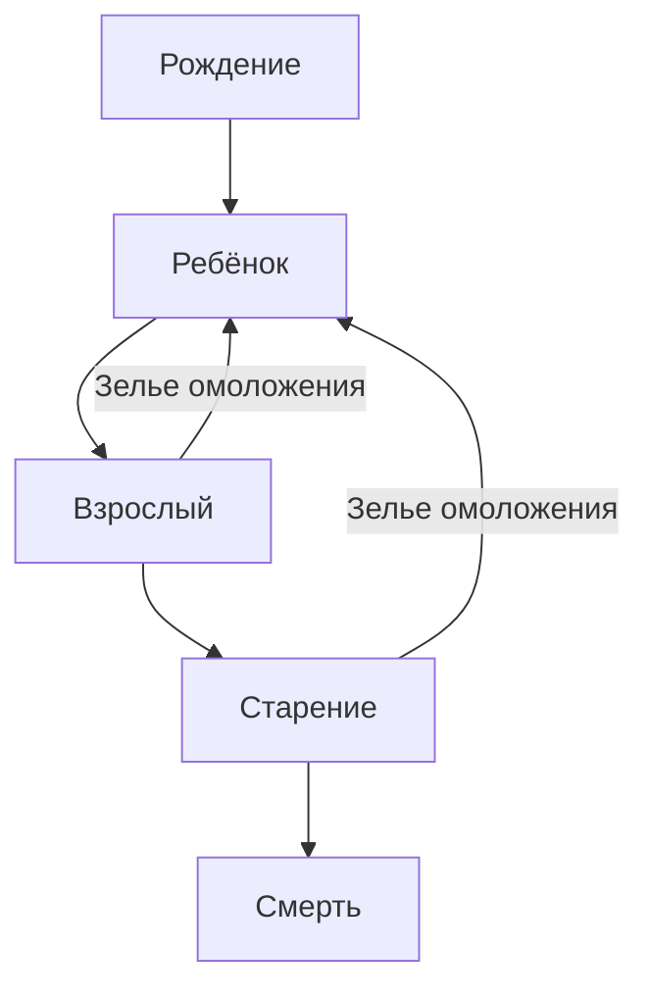
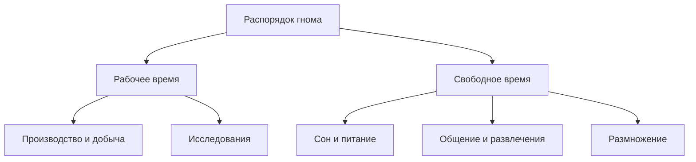
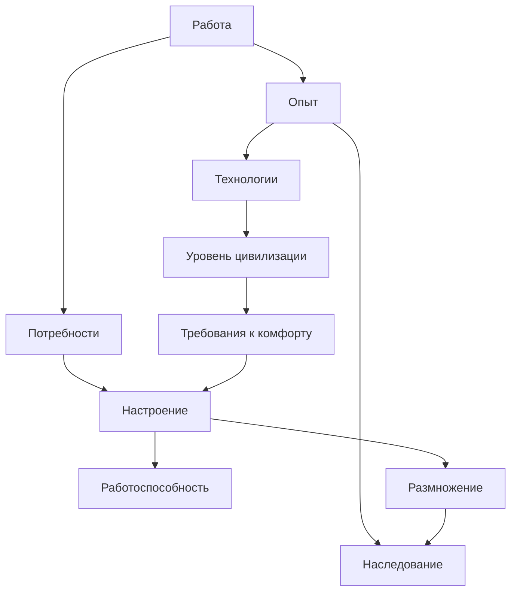

# Diggles: The Myth of Fenris / Wiggles (2001–2002)
## Исследование симуляции жизни гномов

Дата исследования: 19 ноября 2026 г.

Цель — техническая спецификация для Godot-порта. Использованы только публичные материалы; оригинальные файлы игры, EXE и проект порта не исследовались непосредственно. Документация моддеров является свидетельством о содержимом скриптов, но не заменяет независимой проверки исходных файлов.

**Достоверность:** высокая — опубликованная документация, фрагменты параметров или несколько согласующихся наблюдений; средняя — наблюдение или разбор одного исследователя; неизвестно — достаточных данных нет. Предложения по Godot отмечены отдельно.

Издатель переиздания заявляет о сохранении игрового процесса: [Steam, официальный сайт игры](https://store.steampowered.com/app/1478650/Wiggles/). При этом автор BugFix [подтверждает](https://steamcommunity.com/app/1478650/discussions/0/2974028351335842482/?ctp=2&l=english), что несколько исправлений вошли в переиздание. Версии не обязательно идентичны.

## 1. Life cycle — жизненный цикл

| Механика | Доказательство / установленное правило | Уверенность | Источник |
|---|---|---|---|
| Создание семьи | Гномы самостоятельно образуют пары, размножаются при наличии времени и подходящих условий | Высокая | [Издатель](https://store.steampowered.com/app/1478650/Wiggles/) |
| Беременность | Около половины игрового дня (~15 минут без ускорения) по наблюдению игрока | Средняя | [Отзывы об оригинале](https://www.yopi.de/pr/Wiggles_Computerspiele) |
| Детство | Новорождённый находится в отдельном состоянии; существует переход во взрослое состояние | Высокая | [Wiggles Forum](https://wiggles.ruka.at/forum/viewtopic.php?p=202) |
| Возраст взросления | Точное значение не установлено | Неизвестно | — |
| Старение | Существует ограничение MAX_AGE, стандартный параметр 24 | Высокая | [ChangeGameSettings — MAX_AGE](https://github.com/DigglesMods/ChangeGameSettings/wiki#max_age) |
| Смерть от старости | Игроки сообщают о смерти через 24 игровых дня | Средняя | [Steam, 23.12.2020](https://steamcommunity.com/app/1478650/discussions/0/3004429475620235335/) |
| Продолжительность жизни | Около 12 часов реального игрового времени при обычной скорости | Средняя | [Отзывы об оригинале](https://www.yopi.de/pr/Wiggles_Computerspiele) |
| Наследование опыта | Часть накопленного опыта родителей передаётся ребёнку | Высокая | [GameStar, 01.11.2001](https://www.gamestar.de/artikel/wiggles%2C1330202%2Cseite2.html) |
| Наследование внешности | Механизм, коэффициенты и набор наследуемых признаков не установлены | Неизвестно | — |
| Омоложение | Зелье преобразует гнома в ребёнка, сохраняя характеристики, навыки, имя и расписание | Высокая | [Опубликованный метод gnome_to_baby](https://wiggles.ruka.at/forum/viewtopic.php?t=62) |
| Школа | Здание присутствует; игроки сообщают об ускорении обучения молодых гномов | Средняя | [Список объектов](https://wiggles.ruka.at/forum/viewtopic.php?t=2), [обсуждение](https://wiggles.ruka.at/forum/viewtopic.php?t=58) |

### Численность населения

В оригинале существует зависимость целевой численности от уровня цивилизации. Документация [ChangeGameSettings](https://github.com/DigglesMods/ChangeGameSettings/wiki#pop_soll) приводит стандартный параметр POP_SOLL = 22 и график зависимости. Число 22 нельзя безоговорочно трактовать как абсолютный технический предел.

Приблизительные точки, считанные с графика: уровень цивилизации 0,0–0,1 → 5; 0,25 → 10; 0,4 → 15; 0,6 и выше → 22. Точный алгоритм интерполяции и округления не установлен.

### Жизненный цикл (концептуальная модель)



Это схема наблюдаемого поведения, не восстановленная таблица внутренних состояний.

### Ошибки возраста и беременности

[BugFix Wiki](https://github.com/DigglesMods/BugFix/wiki) описывает:

- Ограничение атрибута GnomeAge значением 1 000 000 игровых секунд (~278 часов), после достижения которого дети могут рождаться с ненулевым возрастом.
- Двойное объявление evt_zwerg_birth вместо evt_zwerg_birth_forced в z_spare_reprod.tcl. Авторы добавили защиту от повторных родов. Причинная связь с бесконечной беременностью не доказана окончательно.

В порте эти ошибки воспроизводить не требуется.

## 2. Needs matrix — матрица потребностей

### Базовые характеристики

Опубликованные фрагменты Data/Scripts/misc/genattribs.tcl:

| Атрибут | Назначение | Диапазон | Стартовое значение |
|---|---|---|---:|
| atr_Hitpoints | Здоровье | 0–1 | 1 |
| atr_Nutrition | Сытость | 0–1 | 0,9 |
| atr_Alertness | Бодрость | 0–1 | 0,9 |
| atr_Mood | Настроение | 0–1 | 0,8 |
| atr_ExpMax | Суммарный предел опыта | 0–2 | 1 |

Источник: [Scriptování ve hře Wiggles — часть 1, 2012](https://www.wiggles.funsite.cz/archives/197). Средняя уверенность: другой [моддер](https://wiggles.ruka.at/forum/viewtopic.php?p=916) приводит начальное значение atr_Mood = 1; возможно различие версий. Первоначальный диапазон 0–1 согласуется в обоих фрагментах.

### Влияние действий

| Фактор | Эффект | Уверенность | Источник |
|---|---|---|---|
| Голод | Снижает работоспособность | Средняя | [GameStar, 2001](https://www.gamestar.de/artikel/wiggles%2C1330202%2Cseite2.html) |
| Сон | Отдых, восстановление бодрости; точные коэффициенты неизвестны | Высокая | [GameStar, 2001](https://www.gamestar.de/artikel/wiggles%2C1330202%2Cseite2.html) |
| Избыточная работа | Ухудшает настроение | Высокая | [GameStar, декабрь 2001, совет 11](https://download.gamestar.de/public/31600/31649/12_2001_tipps_wiggles.pdf) |
| Разнообразие еды | Улучшает удовлетворённость | Высокая | [cech12, 21.12.2020](https://steamcommunity.com/app/1478650/discussions/0/2974028351335842482/?ctp=2&l=english) |
| Разнообразие развлечений | Влияет на настроение | Высокая | [Разбор кода CD-версии](https://wiggles.ruka.at/forum/viewtopic.php?t=326) |
| Отсутствие спальных мест | Ухудшает настроение и мотивацию | Высокая | [GameStar, совет 11](https://download.gamestar.de/public/31600/31649/12_2001_tipps_wiggles.pdf) |
| Уровень цивилизации | Повышает требования к комфорту | Высокая | [cech12](https://steamcommunity.com/app/1478650/discussions/0/2974028351335842482/?ctp=2&l=english) |
| Низкое настроение | Возможны отказ от работы, забастовка | Средняя | [Wiggles Forum](https://wiggles.ruka.at/forum/viewtopic.php?t=58) |
| Хорошие условия жизни | Способствуют размножению | Высокая | [Издатель](https://store.steampowered.com/app/1478650/Wiggles/) |

### Точный пример: пиво

В документации модов опубликованы эффекты исходного stt_Bier_reaction из sparetimetunes.tcl:

| Атрибут | Изменение на шкале 0–1 | В пунктах шкалы 0–100 |
|---|---:|---:|
| atr_Hitpoints | -0,01 | -1 |
| atr_Mood | +0,30 | +30 |
| atr_Nutrition | +0,03 | +3 |
| atr_Alertness | -0,10 | -10 |

Источники: [DigglesMods, раздел Powertrank](https://github-wiki-see.page/m/DigglesMods/DigglesModManager/wiki/Mods-%28de%29), [исходная публикация от 2013 г.](https://wiggles.ruka.at/forum/viewtopic.php?p=273). Высокая уверенность. Сам Powertrank — модификация, не предмет оригинала.

### Расчёт настроения

Моддер указывает строку set moodfactor 0.003 в z_spare_main.tcl (~строка 937 в Bild-Hit-версии). С уменьшением величины требования гномов становятся мягче. Единица измерения и формула не установлены.

- [Wiggles Forum, сообщение Struzzy от 12.02.2014](https://wiggles.ruka.at/forum/viewtopic.php?p=178).
- [Steam, разбор причин низкого настроения](https://steamcommunity.com/app/1478650/discussions/0/4739473745781974744/).
- [Steam, Tips and Tricks — Dwarfs mood](https://steamcommunity.com/sharedfiles/filedetails/?id=2325510266).

По наблюдениям сообщества, влияют качество и разнообразие еды, качество сна, жилых помещений, ванных и история посещения заведений. Прямой коэффициент для каждого фактора не найден.

### Выбор еды и сна

| Правило | Статус | Источник |
|---|---|---|
| Гному нужно свободное время для полноценного восстановления | Подтверждено | [GameStar](https://www.gamestar.de/artikel/wiggles%2C1330202%2Cseite2.html) |
| Для самостоятельного питания может требоваться свободная ячейка инвентаря | Вероятно | [Tips and Tricks, Food](https://steamcommunity.com/sharedfiles/filedetails/?id=2325510266) |
| Еда разного качества и разнообразие блюд имеют значение | Подтверждено в общих чертах | [cech12](https://steamcommunity.com/app/1478650/discussions/0/2974028351335842482/?ctp=2&l=english) |
| Точный алгоритм выбора блюда или кровати | Неизвестно | — |
| Точные пороги голода, сна и периодичность обновления | Неизвестно | — |

### Здоровье и лечение

| Механика | Статус | Источник |
|---|---|---|
| Физический урон и лечебные зелья | Подтверждено | [GameSpot preview](https://www.gamespot.com/articles/diggles-preview/1100-2835487/) |
| Больница | Наличие объекта подтверждено | [Консольные идентификаторы](https://wiggles.ruka.at/forum/viewtopic.php?t=2) |
| Смерть от старости | Подтверждено | [ChangeGameSettings](https://github.com/DigglesMods/ChangeGameSettings/wiki#max_age) |
| Смерть от голода | Вероятно | [Наблюдения игроков](https://steamcommunity.com/app/1478650/discussions/0/4739473745781974744/) |
| Исцеление обычным зельем на 40 HP | Кандидат для проверки | [Фан-вики](https://diggles.fandom.com/wiki/Healing_potion) |
| Инфекции, переломы, отдельные части тела | Не установлено | — |
| Естественное восстановление здоровья | Формула неизвестна | — |

## 3. Social interactions — социальные взаимодействия

| Механика | Наблюдаемое правило | Уверенность | Источник |
|---|---|---|---|
| Любовь и семья | Самостоятельное образование пары | Высокая | [Издатель](https://store.steampowered.com/app/1478650/Wiggles/) |
| Совместный досуг | Гном предпочитает заведение, выбранное партнёром | Высокая | [Разбор кода](https://wiggles.ruka.at/forum/viewtopic.php?t=326) |
| Размножение | Совпадение свободного времени партнёров и наличие места для нового гнома | Средняя | [Steam: How to get more wiggles?](https://steamcommunity.com/app/1478650/discussions/0/3017941618723626817/) |
| Общение | Имеет отдельные процедуры поиска собеседника | Высокая | [Разбор кода](https://wiggles.ruka.at/forum/viewtopic.php?t=326) |
| Совместные занятия | Карты, мяч, боулинг | Средняя | [GameStar](https://www.gamestar.de/artikel/wiggles%2C1330202%2Cseite2.html), [издатель](https://store.steampowered.com/app/1478650/Wiggles/) |
| Семейные связи | Отдельное представление семьи в статистике | Высокая | [DwarfStatistics wiki](https://github-wiki-see.page/m/DigglesMods/DigglesModManager/wiki/Mods-%28de%29) |
| Отношения между родственниками | Игроки расходятся в описании допустимости; возможна зависимость от численности | Низкая | [Обсуждение](https://steamcommunity.com/app/1478650/discussions/0/3017941618723626817/) |
| Дружба, ревность, развод, родительская забота | Отдельные числовые шкалы и алгоритмы не подтверждены | Неизвестно | — |

### Индивидуальные предпочтения

Из sparetimetunes.tcl по [опубликованной таблице](https://wiggles.ruka.at/forum/viewtopic.php?p=916):

| Наиболее развитый навык | Предпочтительные развлечения |
|---|---|
| Питание | Дискотека, бар |
| Деревообработка | Бар, боулинг |
| Камнеобработка | Бар, фитнес |
| Металлургия | Боулинг, дискотека |
| Транспортировка | Дискотека, театр |
| Энергетика | Театр, бар |
| Обслуживание | Театр, фитнес |
| Боевые искусства | Фитнес, боулинг |

Разбор кода также подтверждает зависимость двух предпочтений от максимального навыка. Отдельная модель психологических черт не установлена.

### Алгоритм выбора развлечения

[Saibantes, 27–28 марта 2021: анализ оригинальной CD-версии](https://wiggles.ruka.at/forum/viewtopic.php?t=326).

- z_spare_fun.tcl: sparetime_place_find, pathcost, jm (меньше — лучше), sparetime_recent_fun.
- z_spare_talk.tcl: sparetime_talk_find, sparetime_talk_start.
- Гном учитывает развлечение, выбранное партнёром.
- Обнаружены вероятные ошибки ранжирования: выбор более удалённых заведений и нелюбимых типов развлечений.
- При выборе развлечения предполагалось учитывать историю, но исследователь обнаружил ссылку на sparetime_recent_places вместо sparetime_recent_fun.
- По наблюдениям исследователя оценка разнообразия также может штрафовать повторное посещение; её расчёт не совпадает с алгоритмом выбора заведения.
- Отмечались зависания при попытке начать разговор с занятым гномом и при резервировании боулинга.

Высокая уверенность в наличии процедур по результатам опубликованного разбора; конкретный алгоритм требуют сверить с файлами выбранной версии.

## 4. Decision priorities — принятие решений

### Распорядок дня

У каждого гнома задаются рабочее и свободное время. Шесть часов работы и шесть часов отдыха — рекомендация игроков, а не установленное значение по умолчанию. [Steam: Tips and Tricks — Working time](https://steamcommunity.com/sharedfiles/filedetails/?id=2325510266).



| Ситуация | Наблюдаемое поведение | Уверенность | Источник |
|---|---|---|---|
| Рабочая фаза | Автоматическое выполнение доступных работ | Высокая | [GameStar, совет 7](https://download.gamestar.de/public/31600/31649/12_2001_tipps_wiggles.pdf) |
| Свободная фаза | Отдых, тренировки, развлечения, размножение | Высокая | [GameStar, ноябрь 2001](https://www.gamestar.de/artikel/wiggles%2C1330202%2Cseite2.html) |
| Закрепление за зданием | Гном специализируется на его работе | Высокая | [GameStar, совет 7](https://download.gamestar.de/public/31600/31649/12_2001_tipps_wiggles.pdf) |
| Низкое настроение | Возможен отказ от работы | Средняя | [Wiggles Forum](https://wiggles.ruka.at/forum/viewtopic.php?t=58) |
| Отключение автоматической работы | Помогает предотвратить самовольный уход в поселение при ручном управлении | Высокая | [GameStar, совет 25](https://download.gamestar.de/public/31600/31649/12_2001_tipps_wiggles.pdf) |
| Частое ручное управление | Может ухудшить настроение | Средняя | [cech12](https://steamcommunity.com/app/1478650/discussions/0/2974028351335842482/?ctp=2&l=english) |
| Неотложная потребность против приказа игрока | Точный порядок прерывания и пороги неизвестны | Неизвестно | — |

### Обновление потребностей

[Сообщение моддера от 13.01.2021](https://steamcommunity.com/app/1478650/discussions/0/3017941618723626817/) упоминает функцию обновления характеристик каждую секунду; связанный скриншот кода независимо прочитать не удалось. 1 секунда — гипотеза, не доказанный период.

### Профессиональный опыт

| Производственные навыки | Боевые навыки |
|---|---|
| Питание | Рукопашный бой |
| Деревообработка | Одноручное оружие |
| Камнеобработка | Двуручное оружие |
| Металлургия | Защита |
| Транспортировка | Баллистика |
| Алхимия | — |
| Обслуживание | — |

Также существует сводный показатель боевого опыта, не включаемый в суммарный лимит по наблюдениям игроков. [GOG Forum, Xan0010, 13.12.2020](https://www.gog.com/forum/diggles_the_myth_of_fenris/diggles_mod_manager/post7).

| Правило | Значение | Уверенность | Источник |
|---|---|---|---|
| Опыт растёт при выполнении соответствующей работы | Да | Высокая | [GameStar 2001](https://www.gamestar.de/artikel/wiggles%2C1330202%2Cseite2.html) |
| Книги повышают опыт | Да | Высокая | [GameStar 2001](https://www.gamestar.de/artikel/wiggles%2C1330202%2Cseite2.html) |
| Максимум отдельного навыка | 100 | Средняя | [Tips and Tricks](https://steamcommunity.com/sharedfiles/filedetails/?id=2325510266) |
| Общий предел первого поколения | 100 | Высокая | [ChangeGameSettings](https://github.com/DigglesMods/ChangeGameSettings/wiki#min_exp) |
| Предел второго поколения | 120 | Средняя | [Tips and Tricks](https://steamcommunity.com/sharedfiles/filedetails/?id=2325510266) |
| Максимальный суммарный предел | 200 | Высокая | [ChangeGameSettings](https://github.com/DigglesMods/ChangeGameSettings/wiki#max_exp) |
| При достигнутом пределе рост нового навыка снижает старые | Да | Средняя | [Эксперименты с опытом](https://steamcommunity.com/sharedfiles/filedetails/?id=2885077150), [Tips and Tricks](https://steamcommunity.com/sharedfiles/filedetails/?id=2325510266) |
| Потеря от длительного неиспользования без достижения общего предела | Не подтверждена | Неизвестно | — |

Точная формула прироста, наследования и перераспределения не установлена.

### Планировщик оригинала

По [разбору Saibantes и zed2000](https://wiggles.ruka.at/forum/viewtopic.php?t=326), значительная часть логики досуга реализована на Tcl, а распределение производственных заданий, вероятно, находится в скомпилированном EXE.

Упоминаемые интерфейсы: gnome_idle, prod_gnomeidle, evt_autoprod_*, evt_change_muetze.

Следовательно, только анализа скриптов может не хватить для реконструкции полного планировщика.

## 5. Godot simulation model

Этот раздел — предложенная модель порта, не установленная архитектура оригинала.

### Данные гнома

```gdscript
class_name DwarfData
extends Resource

var dwarf_id: int
var dwarf_name: String
var gender: int
var age: float
var generation: int

var health: float = 1.0
var nutrition: float = 0.9
var alertness: float = 0.9
var mood: float = 0.8

var skills: Dictionary
var experience_limit: float = 1.0

var work_start: float
var work_end: float
var partner_id: int = -1
var parent_ids: Array[int]

var pregnant: bool = false
var recent_food: Array
var recent_activities: Array

var assigned_workplace_id: int = -1
var automatic_work: bool = true
```

### Подсистемы

| Компонент | Ответственность |
|---|---|
| DwarfNeeds | Потребности и эффекты действий |
| DwarfLifecycle | Возраст, рождение, взросление, смерть |
| DwarfSkills | Навыки, предел опыта, наследование |
| DwarfSchedule | Рабочее и свободное время |
| DwarfSocial | Общение, отношения и размножение |
| DwarfAI | Выбор действия и прерывание |
| ColonyCivilization | Уровень цивилизации, требования, целевая популяция |
| ActivityReservation | Резервирование спальных и развлекательных мест |



Предлагаемые состояния действий: IDLE, MOVE, WORK, EAT, SLEEP, SOCIALIZE, ENTERTAINMENT, REPRODUCE, STRIKE, HEAL, DEAD. Состояние возрастной стадии — отдельная переменная.

### Параметры прототипа

| Параметр | Значение | Статус | Источник |
|---|---:|---|---|
| max_age | 24 | Подтверждено | [ChangeGameSettings](https://github.com/DigglesMods/ChangeGameSettings/wiki#max_age) |
| population_target_max | 22 | Подтверждён стандартный параметр | [ChangeGameSettings](https://github.com/DigglesMods/ChangeGameSettings/wiki#pop_soll) |
| initial_experience_cap | 100 | Подтверждено | [ChangeGameSettings](https://github.com/DigglesMods/ChangeGameSettings/wiki#min_exp) |
| max_experience_cap | 200 | Подтверждено | [ChangeGameSettings](https://github.com/DigglesMods/ChangeGameSettings/wiki#max_exp) |
| simulation_tick | 1 секунда | Гипотеза | [Steam](https://steamcommunity.com/app/1478650/discussions/0/3017941618723626817/) |
| game_day_duration | 1800 секунд | Вероятно | [Отзывы](https://www.yopi.de/pr/Wiggles_Computerspiele) |
| pregnancy_duration | 900 секунд | Вероятно | [Отзывы](https://www.yopi.de/pr/Wiggles_Computerspiele) |
| mood_factor | 0,003 | Найден во фрагменте скрипта, единица неизвестна | [Wiggles Forum](https://wiggles.ruka.at/forum/viewtopic.php?p=178) |
| adult_age | TBD | Неизвестно | — |
| strike_threshold | TBD | Неизвестно | — |
| inheritance_factor | TBD | Неизвестно | — |

Рекомендация: хранить подтверждённые и экспериментальные коэффициенты в конфигурации с указанием версии и статуса. Не вводить неподтверждённые потребности вроде отдельной жажды, стресса или сложных психологических черт как элементы оригинала.

### Проверочные сценарии для будущего доступа к оригиналу

1. Зафиксировать динамику всех четырёх жизненных характеристик при простое, работе, сне и еде.
2. Сопоставить время, возраст и скорость игрового времени на обычной и ускоренной скорости.
3. Изолировать влияние еды, качества спальни, типа развлечения и уровня цивилизации.
4. Создать пару с разными расписаниями и сравнить вероятность зачатия при совпадении отдыха.
5. Зафиксировать характеристики обоих родителей и каждого ребёнка.
6. Накопить опыт до суммарного предела; выполнить новую работу и определить, какой навык уменьшается.
7. Выдать ручной приказ голодному, уставшему и бастующему гному, записать моменты прерывания.
8. Проверить влияние расстояния и занятости на выбор мест досуга.

## 6. Open questions — нерешённые вопросы

| Приоритет | Что установить | Где искать |
|---|---|---|
| P0 | Скорость изменения сытости, бодрости и настроения | z_spare_main.tcl |
| P0 | Порог начала сна, еды, забастовки и возврата к работе | z_spare_main.tcl |
| P0 | Приоритет потребностей против ручного приказа | EXE, обработчики событий |
| P0 | Полная формула настроения и уровня цивилизации | z_spare_main.tcl |
| P1 | Возраст взросления, возрастные фазы | zwerg, baby |
| P1 | Формула наследования опыта и роста предела | z_spare_reprod.tcl |
| P1 | Условия зачатия, сроки беременности и родов | z_spare_reprod.tcl |
| P1 | Выбор партнёра и ограничение родства | Скрипты размножения и общения |
| P1 | Выбор еды, кровати, качества сна | sparetimetunes.tcl, скрипты досуга |
| P2 | Наследование внешности | Инициализация персонажей |
| P2 | Дружба, конфликты, индивидуальный характер | z_spare_talk.tcl |
| P2 | Болезни и естественное лечение | Скрипты больницы и здоровья |

## Ключевые технические источники

1. [Code review: die wirren Verhaltensmuster der Wiggles (2021)](https://wiggles.ruka.at/forum/viewtopic.php?t=326) — исследование ИИ оригинальной версии, досуга, разговора, планировщика.
2. [ChangeGameSettings Wiki (2017)](https://github.com/DigglesMods/ChangeGameSettings/wiki) — оригинальные значения возраста, популяции и опыта.
3. [BugFix Wiki (2020)](https://github.com/DigglesMods/BugFix/wiki) — ошибки беременности, возраста и опыта.
4. [Scriptování ve hře Wiggles (2012)](https://www.wiggles.funsite.cz/archives/197) — фрагменты определений атрибутов.
5. [Tipps gegen schlecht gelaunte Wiggles (2013–2014)](https://wiggles.ruka.at/forum/viewtopic.php?t=58) — настроение и предпочтения.
6. [DigglesModManager](https://github.com/DigglesMods/DigglesModManager) — инструментарий моддинга.
7. [Советы GameStar, декабрь 2001 (PDF)](https://download.gamestar.de/public/31600/31649/12_2001_tipps_wiggles.pdf) — наблюдения оригинальной версии с помощью разработчиков.
8. [GameStar, 1 ноября 2001](https://www.gamestar.de/artikel/wiggles%2C1330202%2Cseite2.html) — наблюдения о потребностях и наследовании.
9. [Steam Community: Tips and Tricks](https://steamcommunity.com/sharedfiles/filedetails/?id=2325510266) — практические наблюдения игроков.
10. [Оригинальное англоязычное руководство (зеркало)](https://www.yumpu.com/en/document/view/8271679/diggles-manualpdf-strategy-first) — найдено, но чтение заблокировано проверкой браузера; не использовалось как доказательство конкретных правил.

**Вывод:** характерная симуляция Diggles строится на четырёх жизненных показателях, персональном расписании, семейном цикле, ограниченном суммарном опыте и возрастающих требованиях цивилизации. Необходимо отдельно восстановить пороги, формулы, периодичность и конфликт ручных приказов с автономным поведением.

