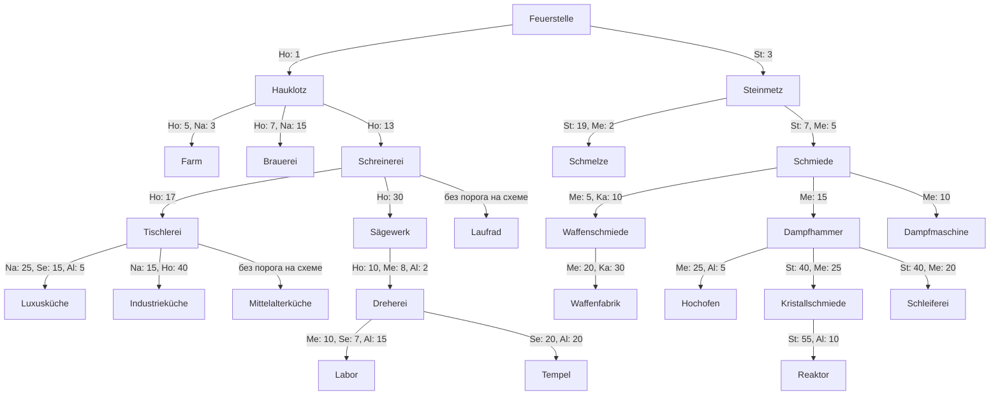
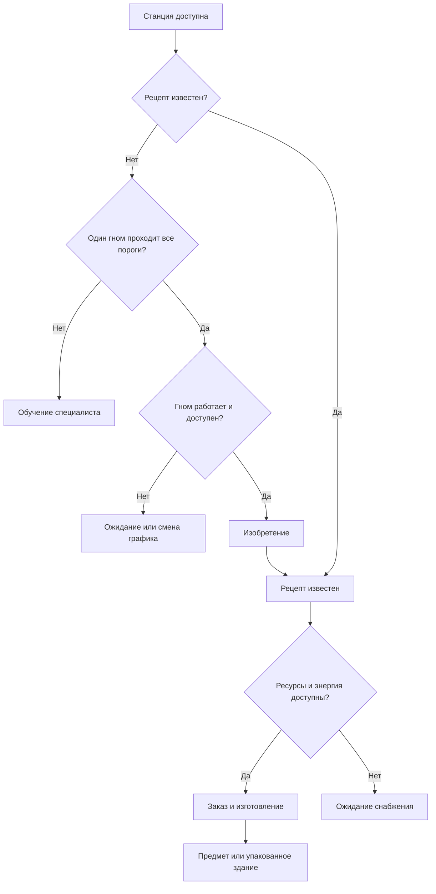

# Diggles / Wiggles (2001–2002): исследование технологической прогрессии

**Дата проверки:** 19.11.2026. **Цель:** воспроизводимая спецификация для независимого Godot-прототипа. Использованы только открытые публикации; оригинальная установка игры и проект не использовались.

## Краткий вывод

Технологическое развитие — не классическая линейная шкала исследований. Основная единица прогрессии — конкретный продукт производственной станции. Гном накапливает личный опыт, после чего при наличии подходящей станции может выполнить изобретение. Другие гномы затем используют уже открытый рецепт. Производство требует отдельного набора материалов и иногда энергии. Это создаёт сразу несколько графов: станция → рецепт; навыки → изобретение; ингредиенты → изготовление; генератор → работа станции. [S1] [S2] [S3] [S4]

Главная находка — **архивный немецкий SVG технологического дерева**, размещённый на восстановленном сайте Kochstudio (сайт первоначально создавался SEK; автор восстановления Arthur сообщил о SVG 30.01.2010). Из XML извлечены **25 производственных групп и 116 записей вида «станция → продукт»**, включая повторяющиеся рецепты, ресурсы и энергию. Это не 116 уникальных изобретений: 104 различных отображаемых названия без множителей выпуска. Полнота доказана только относительно данного SVG, а не всех внутренних объектов/действий всех сборок игры. [S1] [S1a]

### Шкала уверенности

- **В** — высокая: явные значения в исторической таблице, цитируемом исходном фрагменте или согласованных источниках.
- **С** — средняя: наблюдение игрока/моддера, публичная модифицированная копия или неполная сверка с релизной сборкой.
- **Н** — неизвестно: данных недостаточно; не превращать в правило.
- **ПРОЕКТ** — предлагаемое решение Godot, не утверждение об оригинальном движке.

## 1. Technology tree

### 1.1. Как читать дерево

В [S1] верхние узлы (`factoryTop`) — производственные станции, вложенные узлы — продукты станции. Связь здесь означает **место изготовления**, а не обязательно отдельный флаг предыдущего исследования. Чтобы создать новую станцию обычным способом, её необходимо получить у предыдущей (в виде упакованного здания) и развернуть. Наличие чужой/готовой станции или квестового предмета может обходить обычный ресурсный путь; универсальность такого обхода неизвестна. [S1] [S3] [S4] (В для обычного пути, Н для всех обходов).

В графе ниже подписи рёбер — пороги знаний в баллах шкалы SVG. AND означает пороги, которые должен удовлетворять один специалист; это следует из описания индивидуального изобретателя. [S2] (В). Корень Feuerstelle — костёр; повторное производство самого костра не представляет причинного цикла исследования, поскольку существует начальная станция. [S3]




Граф выше — только структурный каркас станций (без бытовых построек, оружия и расходников). Все связи, включая листья, приведены ниже в виде полного списка рёбер с условиями и материалами. Водяное колесо показано в таблице; его собственный выпуск энергии в SVG не выделен отдельной производственной группой (см. Tcl ниже). Не добавлены незафиксированные узлы.

### 1.2. Full edge list: все записи SVG

Это одновременно матрица открытия и ориентированный граф: **каждая строка является ребром от станции-заголовка к указанному продукту**, а все перечисленные навыки и ингредиенты — отдельные условия соответствующего типа. Порядок строк — порядок XML внутри соответствующей станции, не доказанный обязательный порядок изобретения. Источник каждой строки: [S1], XML `g` с `nodeName` станции и подчинённый `g` с `nodeName` продукта. Данные извлечены машинно, без исправления чисел по памяти.

Сокращения навыков: **Ho** — дерево/обработка грибных стволов (Holz); **St** — камень (Stein); **Na** — пища (Nahrung); **Me** — металл (Metall); **Tr** — транспорт (Transport); **Se** — обслуживание (Service); **Al** — алхимия/энергия (в Tcl встречается `exp_Energie`); **Ka** — бой (Kampf). Десятичные коэффициенты Tcl не смешивать с отображаемыми баллами. `—` означает, что SVG не рисует порог, а не независимую проверку каждого значения в оригинальном коде. [S1] [S5] [S6]

Материалы: Pilzstamm — ствол гриба; Pilzhut — шляпка; Stein — камень; Eisenerz / Eisen — железная руда / слиток; Golderz / Gold — золотая руда / золото; Kristallerz / Kristall — кристальная руда / обработанный кристалл; Kohle — уголь; Raupe — гусеница; Hamster — хомяк; Bier — пиво; Zipfelmuetze — колпак. Надпись `(xN)` взята непосредственно с узла и означает указанный выпуск партии; отсутствие надписи не доказывает размер партии. (В для данных SVG, С для соответствия всем версиям игры.)


#### Feuerstelle

| Продукт | Категория | Навыки (AND) | Материалы изготовления | Источник / уверенность |
|---|---|---|---|---|
| Grillpilz (x2) | еда | — | Pilzhut ×1 | [S1] / В* |
| Grillhamster (x2) | еда | Na: 4 | Hamster ×1 | [S1] / В* |
| Zelt | досуг | — | Pilzstamm ×2; Pilzhut ×1 | [S1] / В* |
| Hauklotz | станция | Ho: 1 | Pilzstamm ×4; Pilzhut ×1 | [S1] / В* |
| Steinmetz | станция | St: 3 | Pilzstamm ×2; Stein ×4 | [S1] / В* |
| Feuerstelle | станция | — | Pilzstamm ×2; Stein ×2 | [S1] / В* |

#### Steinmetz

| Продукт | Категория | Навыки (AND) | Материалы изготовления | Источник / уверенность |
|---|---|---|---|---|
| Keule | оружие/защита | St: 1; Ka: 1 | Pilzstamm ×2; Stein ×1 | [S1] / В* |
| Steinschleuder | оружие/защита | St: 4 | Pilzstamm ×1; Stein ×1 | [S1] / В* |
| Grenzstein | строение | — | Stein ×1 | [S1] / В* |
| Grabstein | строение | — | Stein ×3; Zipfelmuetze ×1 | [S1] / В* |
| Plattmachfalle | строение | St: 9; Ka: 2 | Pilzstamm ×1; Stein ×5 | [S1] / В* |
| Schmelze | станция | St: 19; Me: 2 | Pilzstamm ×2; Stein ×5 | [S1] / В* |
| Schmiede | станция | St: 7; Me: 5 | Pilzstamm ×3; Stein ×2; Eisen ×1 | [S1] / В* |

#### Schmiede

| Продукт | Категория | Навыки (AND) | Материалы изготовления | Источник / уверенность |
|---|---|---|---|---|
| Schild | оружие/защита | — | Stein ×1; Eisen ×1 | [S1] / В* |
| Streitaxt | оружие/защита | Me: 4; Ka: 12 | Pilzstamm ×1; Eisen ×2 | [S1] / В* |
| Taucherglocke | предмет/ресурс | Me: 15; Tr: 5 | Pilzstamm ×1; Eisen ×2; Hamster ×1 | [S1] / В* |
| Metallleiter | строение | Me: 10; Tr: 5 | Eisen ×1 | [S1] / В* |
| Waffenschmiede | станция | Me: 5; Ka: 10 | Pilzstamm ×2; Stein ×2; Eisen ×5 | [S1] / В* |
| Dampfhammer | станция | Me: 15 | Pilzstamm ×3; Stein ×3; Eisen ×4 | [S1] / В* |
| Dampfmaschine | станция | Me: 10 | Pilzstamm ×2; Stein ×2; Eisen ×5 | [S1] / В* |

#### Schmelze

| Продукт | Категория | Навыки (AND) | Материалы изготовления | Источник / уверенность |
|---|---|---|---|---|
| Eisen | предмет/ресурс | — | Pilzstamm ×3; Eisenerz ×2 | [S1] / В* |

#### Dampfmaschine

| Продукт | Категория | Навыки (AND) | Материалы изготовления | Источник / уверенность |
|---|---|---|---|---|
| Energie | предмет/ресурс | — | Kohle ×1 | [S1] / В* |

#### Dampfhammer

| Продукт | Категория | Навыки (AND) | Материалы изготовления | Источник / уверенность |
|---|---|---|---|---|
| Abfluss | строение | — | Eisen ×2 | [S1] / В* |
| Metalltür | строение | Me: 18 | Eisen ×3; Kohle ×1 | [S1] / В* |
| Dampfaufzug | строение | Me: 20; Tr: 30 | Eisen ×3; Kohle ×2 | [S1] / В* |
| Hochofen | станция | Me: 25; Al: 5 | Pilzstamm ×2; Stein ×4; Eisen ×5 | [S1] / В* |
| Kristallschmiede | станция | St: 40; Me: 25 | Stein ×2; Eisen ×4; Kristall ×4 | [S1] / В* |
| Schleiferei | станция | St: 40; Me: 20 | Stein ×2; Eisen ×7; Gold ×1 | [S1] / В* |

#### Schleiferei

| Продукт | Категория | Навыки (AND) | Материалы изготовления | Источник / уверенность |
|---|---|---|---|---|
| Kristall | предмет/ресурс | — | Kristallerz ×1 | [S1] / В* |

#### Waffenschmiede

| Продукт | Категория | Навыки (AND) | Материалы изготовления | Источник / уверенность |
|---|---|---|---|---|
| Schwert | оружие/защита | — | Eisen ×3; Kohle ×2 | [S1] / В* |
| Pfeil und Bogen | оружие/защита | Ho: 6; Me: 4; Ka: 7 | Pilzstamm ×2; Eisen ×1 | [S1] / В* |
| Metallschild | оружие/защита | Me: 15; Ka: 15 | Eisen ×3; Kohle ×1 | [S1] / В* |
| Waffenfabrik | станция | Me: 20; Ka: 30 | Eisen ×8; Kohle ×2; Gold ×4 | [S1] / В* |

#### Hochofen

| Продукт | Категория | Навыки (AND) | Материалы изготовления | Источник / уверенность |
|---|---|---|---|---|
| Eisen (x3) | предмет/ресурс | — | Kohle ×2; Eisenerz ×3 | [S1] / В* |
| Gold | предмет/ресурс | Me: 30; Al: 4 | Kohle ×1; Golderz ×1 | [S1] / В* |

#### Kristallschmiede

| Продукт | Категория | Навыки (AND) | Материалы изготовления | Источник / уверенность |
|---|---|---|---|---|
| Kristallstrahl | предмет/ресурс | St: 70; Al: 10 | Eisen ×2; Kristall ×3 | [S1] / В* |
| Kristallleiter | строение | St: 30; Tr: 15 | Kristall ×1 | [S1] / В* |
| Kristalltür | строение | St: 50; Me: 21 | Eisen ×1; Kristall ×3 | [S1] / В* |
| Steinfalle Medusa | строение | St: 40; Ka: 40 | Stein ×1; Gold ×1; Kristall ×2 | [S1] / В* |
| Kristallaufzug | строение | St: 30; Tr: 40; Al: 11 | Eisen ×2; Kristall ×3 | [S1] / В* |
| Reaktor | станция | St: 55; Al: 10 | Stein ×2; Eisen ×4; Kristall ×5; Gold ×4 | [S1] / В* |

#### Reaktor

| Продукт | Категория | Навыки (AND) | Материалы изготовления | Источник / уверенность |
|---|---|---|---|---|
| Energie | предмет/ресурс | — | Kristall ×1 | [S1] / В* |

#### Hauklotz

| Продукт | Категория | Навыки (AND) | Материалы изготовления | Источник / уверенность |
|---|---|---|---|---|
| Holzkiepe | предмет/ресурс | Ho: 6; Tr: 6 | Pilzstamm ×1 | [S1] / В* |
| Leiter | строение | — | Pilzstamm ×2 | [S1] / В* |
| Holztuer | строение | Ho: 8 | Pilzstamm ×3; Stein ×1 | [S1] / В* |
| Farm | станция | Ho: 5; Na: 3 | Pilzstamm ×4 | [S1] / В* |
| Brauerei | станция | Ho: 7; Na: 15 | Pilzstamm ×6 | [S1] / В* |
| Schreinerei | станция | Ho: 13 | Pilzstamm ×7 | [S1] / В* |

#### Waffenfabrik

| Продукт | Категория | Навыки (AND) | Материалы изготовления | Источник / уверенность |
|---|---|---|---|---|
| Büchse | оружие/защита | Me: 40; Al: 10; Ka: 20 | Pilzstamm ×1; Eisen ×3; Kohle ×2 | [S1] / В* |
| Lichtschwert | оружие/защита | Al: 50; Ka: 40 | Eisen ×1; Kristall ×4 | [S1] / В* |
| Kristallschild | оружие/защита | St: 30; Me: 17; Ka: 30 | Gold ×2; Kristall ×3 | [S1] / В* |

#### Farm

| Продукт | Категория | Навыки (AND) | Материалы изготовления | Источник / уверенность |
|---|---|---|---|---|
| Hamster | предмет/ресурс | — | Hamster ×2 | [S1] / В* |
| Pilz | предмет/ресурс | Ho: 12; Na: 9 | Pilzhut ×1 | [S1] / В* |
| Raupe | предмет/ресурс | Na: 18 | Raupe ×1 | [S1] / В* |

#### Brauerei

| Продукт | Категория | Навыки (AND) | Материалы изготовления | Источник / уверенность |
|---|---|---|---|---|
| Bier | еда | — | Pilzstamm ×1; Pilzhut ×2 | [S1] / В* |
| Kleiner Heiltrank | предмет/ресурс | Na: 8; Ka: 5 | Pilzstamm ×1; Pilzhut ×2; Raupe ×1 | [S1] / В* |
| Heiltrank | предмет/ресурс | Na: 20; Se: 5; Ka: 5 | Pilzhut ×1; Raupe ×2; Golderz ×1 | [S1] / В* |

#### Schreinerei

| Продукт | Категория | Навыки (AND) | Материалы изготовления | Источник / уверенность |
|---|---|---|---|---|
| Reithamster | предмет/ресурс | Ho: 11; Tr: 12 | Hamster ×1; Pilzhut ×1; Pilzstamm ×1 | [S1] / В* |
| Bar | досуг | Ho: 25; Na: 5 | Pilzstamm ×6; Pilzhut ×2 | [S1] / В* |
| Wachhaus | строение | Ho: 5; Ka: 1 | Pilzstamm ×2 | [S1] / В* |
| Aufzug | строение | Ho: 25; Tr: 10 | Pilzstamm ×4 | [S1] / В* |
| Lager | строение | Ho: 18; Tr: 11 | Pilzstamm ×8; Pilzhut ×1 | [S1] / В* |
| Tischlerei | станция | Ho: 17 | Pilzstamm ×4; Stein ×1; Pilzhut ×1 | [S1] / В* |
| Sägewerk | станция | Ho: 30 | Pilzstamm ×5; Stein ×1; Eisen ×2 | [S1] / В* |
| Laufrad | станция | — | Pilzstamm ×3; Hamster ×1 | [S1] / В* |

#### Sägewerk

| Продукт | Категория | Навыки (AND) | Материалы изготовления | Источник / уверенность |
|---|---|---|---|---|
| Große Holzkiepe | предмет/ресурс | Ho: 15; Tr: 15 | Pilzstamm ×2 | [S1] / В* |
| Kettensäge | предмет/ресурс | Ho: 40; Me: 10; Al: 5 | Pilzstamm ×1; Eisen ×2 | [S1] / В* |
| Theater | досуг | Ho: 27; Se: 3 | Pilzstamm ×5; Pilzhut ×3; Hamster ×2 | [S1] / В* |
| Bordell | досуг | Ho: 23; Se: 6 | Pilzstamm ×2; Eisen ×3; Gold ×3; Hamster ×3 | [S1] / В* |
| Schule | строение | Ho: 30; Se: 5 | Pilzstamm ×6; Pilzhut ×2; Stein ×1 | [S1] / В* |
| Dojo | строение | Ho: 35; Ka: 10 | Pilzstamm ×6; Stein ×3 | [S1] / В* |
| Wasserrad | строение | — | Pilzstamm ×3; Stein ×3 | [S1] / В* |
| Dreherei | станция | Ho: 10; Me: 8; Al: 2 | Pilzstamm ×5; Stein ×2; Eisen ×4 | [S1] / В* |

#### Dreherei

| Продукт | Категория | Навыки (AND) | Материалы изготовления | Источник / уверенность |
|---|---|---|---|---|
| Presslufthammer | предмет/ресурс | — | Stein ×1; Eisen ×2 | [S1] / В* |
| Hoverboard | предмет/ресурс | Tr: 54; Al: 14 | Pilzstamm ×1; Eisen ×2; Kristall ×2 | [S1] / В* |
| Bowlingbahn | досуг | St: 40; Se: 11 | Pilzstamm ×4; Stein ×3; Kristall ×2 | [S1] / В* |
| Disco | досуг | Me: 13; Se: 13; Al: 13 | Eisen ×3; Gold ×4; Kristall ×4 | [S1] / В* |
| Fitnessstudio | досуг | Me: 5; Se: 15 | Pilzstamm ×2; Stein ×2; Eisen ×4 | [S1] / В* |
| Krankenhaus | строение | Na: 20; Se: 17 | Stein ×3; Eisen ×3; Gold ×1; Kristall ×3 | [S1] / В* |
| Labor | станция | Me: 10; Se: 7; Al: 15 | Stein ×2; Eisen ×4; Gold ×3; Kristall ×7 | [S1] / В* |
| Tempel | станция | Se: 20; Al: 20 | Stein ×5; Gold ×6; Kristall ×2 | [S1] / В* |

#### Laufrad

| Продукт | Категория | Навыки (AND) | Материалы изготовления | Источник / уверенность |
|---|---|---|---|---|
| Energie | предмет/ресурс | — | Pilzhut ×1 | [S1] / В* |

#### Labor

| Продукт | Категория | Навыки (AND) | Материалы изготовления | Источник / уверенность |
|---|---|---|---|---|
| Pilzschnaps | предмет/ресурс | — | Pilzhut ×2; Raupe ×1; Hamster ×1 | [S1] / В* |
| Großer Heiltrank | предмет/ресурс | Se: 9; Ka: 25; Al: 20 | Raupe ×3; Bier ×1; Gold ×2 | [S1] / В* |
| Liebestrank | предмет/ресурс | Na: 16; Se: 30 | Raupe ×3; Bier ×1 | [S1] / В* |
| Unverwundbarkeitstrank | предмет/ресурс | Ka: 50; Al: 10 | Hamster ×1; Eisen ×2; Gold ×4; Kristall ×2 | [S1] / В* |

#### Tempel

| Продукт | Категория | Навыки (AND) | Материалы изготовления | Источник / уверенность |
|---|---|---|---|---|
| Unsichtbarkeitstrank | предмет/ресурс | Se: 40; Ka: 5 | Hamster ×1; Gold ×5; Kristall ×3 | [S1] / В* |
| Jungbrunnentrank | предмет/ресурс | Na: 29; Al: 17 | Hamster ×1; Eisenerz ×1; Gold ×2; Kristall ×1 | [S1] / В* |
| Fruchtbarkeitstrank | предмет/ресурс | Na: 24; Se: 34; Al: 14 | Hamster ×1; Raupe ×3; Gold ×2 | [S1] / В* |
| Wiederbelebung | предмет/ресурс | Tr: 15; Se: 20; Al: 35 | Hamster ×1; Gold ×4; Kristallerz ×2; Zipfelmuetze ×1 | [S1] / В* |

#### Tischlerei

| Продукт | Категория | Навыки (AND) | Материалы изготовления | Источник / уверенность |
|---|---|---|---|---|
| Mittelalterbad | досуг | — | Pilzstamm ×3; Stein ×2 | [S1] / В* |
| Mittelalterwohnzimmer | досуг | — | Pilzstamm ×5; Pilzhut ×2 | [S1] / В* |
| Mittelalterschlafzimmer | досуг | — | Pilzstamm ×4; Pilzhut ×1; Hamster ×2 | [S1] / В* |
| Industriebad | досуг | Ho: 30; Na: 20 | Pilzstamm ×2; Stein ×2; Eisen ×2 | [S1] / В* |
| Industriewohnzimmer | досуг | — | Pilzstamm ×3; Pilzhut ×2; Stein ×4; Eisen ×1 | [S1] / В* |
| Industrieschlafzimmer | досуг | Ho: 50 | Pilzstamm ×4; Hamster ×3; Eisen ×3 | [S1] / В* |
| Luxusbad | досуг | St: 55; Al: 7 | Stein ×2; Eisen ×1; Kristall ×3 | [S1] / В* |
| Luxuswohnzimmer | досуг | St: 30; Se: 9; Al: 9 | Pilzstamm ×2; Pilzhut ×1; Kristall ×4 | [S1] / В* |
| Luxusschlafzimmer | досуг | St: 48; Se: 8 | Pilzstamm ×1; Hamster ×2; Kristall ×4 | [S1] / В* |
| Luxusküche | станция | Na: 25; Se: 15; Al: 5 | Stein ×1; Eisen ×4; Gold ×4; Kristall ×4 | [S1] / В* |
| Industrieküche | станция | Na: 15; Ho: 40 | Pilzstamm ×2; Stein ×4; Eisen ×2 | [S1] / В* |
| Mittelalterküche | станция | — | Pilzstamm ×4; Stein ×3 | [S1] / В* |

#### Mittelalterküche

| Продукт | Категория | Навыки (AND) | Материалы изготовления | Источник / уверенность |
|---|---|---|---|---|
| Grillpilz (x3) | еда | — | Pilzhut ×1 | [S1] / В* |
| Grillhamster (x3) | еда | Na: 4 | Hamster ×1 | [S1] / В* |
| Raupensuppe (x2) | еда | Na: 14 | Raupe ×1 | [S1] / В* |
| Feuerstelle | станция | — | Pilzstamm ×2; Stein ×2 | [S1] / В* |

#### Industrieküche

| Продукт | Категория | Навыки (AND) | Материалы изготовления | Источник / уверенность |
|---|---|---|---|---|
| Grillpilz (x3) | еда | — | Pilzhut ×1 | [S1] / В* |
| Grillhamster (x3) | еда | Na: 4 | Hamster ×1 | [S1] / В* |
| Raupensuppe (x2) | еда | Na: 14 | Raupe ×1 | [S1] / В* |
| Pilzbrot (x4) | еда | Na: 25 | Pilzhut ×1 | [S1] / В* |
| Raupenschleimkuchen (x2) | еда | Na: 30 | Pilzhut ×1; Raupe ×1 | [S1] / В* |

#### Luxusküche

| Продукт | Категория | Навыки (AND) | Материалы изготовления | Источник / уверенность |
|---|---|---|---|---|
| Raupensuppe (x2) | еда | Na: 14 | Raupe ×1 | [S1] / В* |
| Pilzbrot (x4) | еда | Na: 25 | Pilzhut ×1 | [S1] / В* |
| Raupenschleimkuchen (x2) | еда | Na: 30 | Pilzhut ×1; Raupe ×1 | [S1] / В* |
| Gourmetsuppe (x3) | еда | Na: 35 | Pilzhut ×1; Hamster ×1; Raupe ×1; Golderz ×1 | [S1] / В* |
| Hamstershake (x2) | еда | Na: 40 | Hamster ×1 | [S1] / В* |

\* Высокая уверенность в точности переноса отображаемой таблицы, но **не** в том, что каждый рецепт идентичен каждой версии оригинала. См. конфликты ниже. В частности, часть изобретений с числами на схеме может быть уже открыта в отдельных сценариях или в таблице `preinv` конкретной версии.

### 1.3. Межотраслевые зависимости

Следующая таблица — вывод из конкретных записей SVG, не новое самостоятельное условие открытия. Стрелка описывает поставку материала.

| Ресурс | Подтверждённый способ получить | Примеры зависимых построек/рецептов | Источник |
|---|---|---|---|
| Железо | Schmelze: 3 ствола + 2 руды; Hochofen: 2 угля + 3 руды → 3 железа | Schmiede, Sägewerk, Dampfmaschine, Waffenschmiede, Dreherei | [S1], В |
| Золото | Hochofen: Me 30 + Al 4; 1 уголь + 1 золотая руда | Schleiferei, Waffenfabrik, Labor, Tempel, Disco | [S1], В |
| Кристалл | Schleiferei: 1 кристальная руда | Kristallschmiede, Reaktor, Luxusküche, Labor, Hoverboard | [S1], В |
| Хомяк | Farm: 2 хомяка в рецепте разведения; также ловля | Reithamster, Laufrad, Taucherglocke, еда, зелья | [S1] [S3], В |
| Гусеница | Farm: Na 18; гусеница в качестве входа | Raupensuppe, лечение, алхимические зелья | [S1], В; Н механика размножения |
| Пиво | Brauerei: 1 ствол + 2 шляпки | Großer Heiltrank, Liebestrank | [S1], В |

Пример: наличие Dampfhammer и навыков St 40, Me 25 ещё не обеспечивает Kristallschmiede — требуется обработанный кристалл, а его обычный производитель Schleiferei сам требует железо и золото. Это **материальный мост**, а не обязательно связь в журнале исследования. [S1] (В).

## 2. Unlock conditions

### 2.1. Структура публичных Tcl-данных

В опубликованной ветке [S5] приводится большой **изменённый** `Data/Scripts/misc/techtreetunes.tcl`: автор специально очищал `tttinvent`. Использовать из него пороги как исходные нельзя. Однако комментарии и отдельные поля раскрывают структуру конфигурации. Независимая инструкция [S6] объясняет те же поля; репозиторий менеджера модов [S7] подтверждает формат точечных патчей.

| Поле | Значение | Доказательство / уверенность |
|---|---|---|
| `tttmaterial_*` | Список единиц входных предметов; повторы означают количество | [S5] Feuerstelle: 2 ствола, 2 камня; [S1], В |
| `tttinvent_*` | Пары идентификатор навыка / минимальное значение | [S8] `Lager`: Holz 0.179, Transport 0.109; [S5] [S6], В |
| `tttgain_*` | Прирост опыта за производственную операцию | [S5] Feuerstelle: Holz 0.01, Stein 0.01; [S6], В по полю, С по моменту применения |
| `tttinfluence_*` | Порог линейного влияния навыка на темп изготовления | [S5], комментарий после блока Feuerstelle, С; конкретная функция неизвестна |
| `tttitems_*` | Доступные продукты/действия данной станции | [S5] [S6] [S7], В |
| `tttpreinv_*` | Уже известные станцией продукты/действия | [S5] [S6], В по семантике, С по спискам версии |
| `tttenergyclass_*` | Минимальный класс требуемой энергии либо класс источника | [S5] Feuerstelle 0; Schmelze 1; Dampfhammer 2; Luxusküche 3, С для значений |
| `tttenergycons_*` | Энергия, расходуемая на производственную операцию | [S5] [S6], С |
| `tttenergyyield_*` | Выход энергии источника на топливо либо время | [S5] [S6], С |
| `tttnumber2produce_*` | Размер выпуска партии | [S5] Grillpilz 2; [S1] [S6], В по семантике |

**Важное различие:** материалы изготовления не следует автоматически превращать в затраты исследования. Источники подтверждают пороги изобретения и материалы производства, но отдельная цена/расход материалов при исследовании, включая необходимость иметь их поблизости для старта, не установлена. [S2] [S5] [S6] (Н).

### 2.2. Изобретение и доступность

| Состояние / переход | Подтверждение | Уверенность |
|---|---|---|
| Станция построена → её меню содержит рецепты | GameSpot описывает костёр, Hauklotz и Steinmetz с собственными наборами работ; `tttitems` | [S3] [S5], В |
| Недостаточно опыта → технологическая ветка блокируется | GameStar, совет 5; переобучить конкретного гнома | [S2], В |
| У подходящего гнома рабочее время выключено → жёлтый значок изобретения | GameStar, совет 6 | [S2], В |
| Подходящего гнома привести к станции и включить рабочее время → он исследует рецепт | GameStar, совет 6 | [S2], В |
| После изобретения другие работники могут применять открытый рецепт | GameStar, совет 6 | [S2], В |
| Сообщение об изобретении в строке новостей | GameSpot, обзор 2002 г. | [S4], В |
| Точный момент начала исследования (проверка на каждом тике, по событию, случайность, очередь) | Нет действительного обработчика изобретений в доступных источниках | Н |
| Сохранение знания при смерти, перепаковке либо уничтожении всех экземпляров станции | Использование другими гномами доказано, долговременная область хранения флага неизвестна | [S2], Н |

### 2.3. Предоткрытые рецепты и энергия (публичная модифицированная копия)

Ниже отдельный слой доказательств **С**, файл [S5] (24.03.2013, сообщение catweazle). Автор изменял требования, поэтому списки `preinv` и энергетические данные следует верифицировать в чистой версии. Они полезны как конкретные точки проверки, а не как замена архивному дереву.

| Станция | `preinv` в публикации | Класс / расход энергии |
|---|---|---|
| Feuerstelle | Grillpilz, Zelt, Feuerstelle | 0 / 0 |
| Hauklotz | Leiter | 0 / 0 |
| Steinmetz | Grenzstein | 0 / 0 |
| Farm | Hamster | не указан в цитируемом фрагменте |
| Brauerei | Bier | 0 / 0 |
| Schreinerei | Laufrad | 0 / 0 |
| Schmiede | Schild | 0 / 0 |
| Schmelze | Eisen | 1 / 10 |
| Sägewerk | Wasserrad | 1 / 80 |
| Tischlerei | четыре средневековые комнаты (кухня, ванная, гостиная, спальня) | 1 / 100 |
| Waffenschmiede | Schwert | 1 / 50 |
| Dampfhammer | Abfluss | 2 / 100 |
| Dreherei | Presslufthammer | 2 / 200 |
| Mittelalterküche | Grillpilz_, Feuerstelle | 1 / 10 |
| Industrieküche | Grillpilz__ | 2 / 20 |
| Luxusküche | пусто | 3 / 20 |
| Hochofen | Eisen_ | 2 / 20 |
| Schleiferei | Kristall | 2 / 30 |
| Waffenfabrik | Buechse | 3 / 100 |
| Kristallschmiede | Kristalltuer | 2 / 150 |
| Labor | Pilzschnaps | 3 / 100 |
| Tempel | Unsichtbarkeitstrank | 3 / 100 |
| Disco | _Auflegen | 3 / 3 |

Источники энергии из того же [S5]: Laufrad — класс 1, 200 единиц за шляпку гриба; Wasserrad — класс 1, 0.5 единицы/сек в воде; Dampfmaschine — класс 2, 400 единиц за уголь; Reaktor — класс 3, 500 единиц за кристалл. Независимое наблюдение [S9] подтверждает равный класс хамстерового и водяного колёс. Радиусы и правила распределения, накопления и приоритета источников не установлены. (С; радиусы Н.)

### 2.4. Расхождения и точность

| Находка | Действие при переносе |
|---|---|
| Lager: SVG Ho 18, Tr 11; исходные строки, опубликованные моддером [S8], 0.179 и 0.109. При масштабе 100 получаются 17.9 и 10.9. | Хранить raw отдельно от UI-округления; не считать 18.00 и 11.00 точными внутренними порогами. В для этих двух строк, Н для округления всего дерева. |
| [S5] `preinv_Waffenfabrik` содержит Buechse, `preinv_Kristallschmiede` содержит Kristalltuer, `preinv_Tempel` — Unsichtbarkeitstrank; SVG даёт всем пороги. | Отдельно хранить порог и список предизобретений; не решать конфликт угадыванием. С. |
| [S5] очищает `tttinvent` намеренно; в нём есть и варианты рецептов пищи, которых на SVG нет в конкретных станциях. | Не расширять дерево модом. Очищенный порог не является оригинальным нулём. В. |
| В комментарии к Feuerstelle в [S5] говорится об одном стволе и камне, однако список содержит по два, как и SVG. | Доверять структурированному списку и согласованной схеме, не устаревшему комментарию. В. |
| В [S5] встречаются `Dampflore`, `TitanicPumpe`, `Schwefelbruecke`, действия охраны, уроков и сцены, не являющиеся узлами дерева SVG. | Не считать их исследуемыми технологиями без подтверждения обычного способа открытия. Н. |

## 3. Progression rules

### 3.1. Личный опыт и поколения

| Правило | Доказательство / источник | Уверенность |
|---|---|---|
| Каждый гном обучается повторением работы; улучшение специализирует гнома и ускоряет работу | GameStar, ноябрь 2001, раздел Sim Wiggle; [S10]; GameSpot [S4] | В |
| Разные пороги одного рецепта должны выполняться одним гномом | GameStar, совет 6 о конкретном специалисте, [S2]; список пар в [S8] | В |
| Дерево тренируется рубкой грибов; камень — копанием; пища — приготовлением; транспорт — переноской; металлы — обработкой руд; сервис — обслуживанием; алхимия — высокими технологиями/составами | [S2] совет 8; [S11] [S12] поля опыта | В для дерева; С для остальных обобщений |
| Предел отдельного навыка 100 баллов. Общий предел первого поколения 100, потом 120, далее +20 до 200 | [S11] [S12], скриптовая строка `def_attrib atr_ExpMax 0 2 1` приведена как исходная в [S5] | С; точное правило при смешении поколений Н |
| При исчерпании общей ёмкости обучение новой области отнимает опыт из другой | [S4] [S11] [S12]; Steam-руководство утверждает, что убывает наименее развитая область | В для факта перераспределения, С для выбора навыка |
| Родители передают ребёнку часть свойств и специализации | [S10] раздел Sim Wiggle, [S13] сводка; нет доступной формулы процента или выбора родителя | В для наследования, Н для расчёта |
| Найденные книги обучают гномов | [S10]; фан-вики Books [S14] сообщает об одноразовом чтении и +1–4 баллах | В/С соответственно |
| Школа представлена в дереве (Ho 30, Se 5); в [S5] есть её действие `_Unterricht` | [S1] [S5] | В для существования, Н для формулы обучения и передачи опыта |
| Обучение за счёт исследовательских очков всего клана, автоматическое наследование конкретного рецепта ребёнком | Источниками не установлено | Н |

Механика навыков должна учитывать именно **личную пригодность к изобретению**, а не сумму баллов разных особей. Пример: Hoverboard на станке Dreherei требует Tr 54 + Al 14, значит нужны обе специализации у одного гнома. Запасная подготовка гномов снижает вероятность потери кандидата до завершения изобретения. [S1] [S2] [S4] (В / рекомендация).

### 3.2. Кланы

Моддер cech12, 13.03.2019, публикует четыре строки `ttt_*_clanexp` из конца `techtreetunes.tcl`. Это прямая цитата конфигурации через публикацию (не верифицированный дамп оригинальной сборки). [S15] (В для опубликованных значений; С для всех изданий).

| Клан | Множители прироста навыка (остальные ×1) | Пример влияния на исследования |
|---|---|---|
| Wiggles / Diggles | ×1.0 | базовая скорость специализации |
| Voodoo / Peacer | Nahrung ×1.3; Holz ×1.1; Kampf ×0.9 | легче набрать пищевые и древесные пороги, медленнее боевые |
| Knocker | Stein ×1.2; Metall ×1.1 | быстрее навыки для металлургии/камня |
| Brain | Energie ×1.2; Service ×1.1 | быстрее соответствующие алхимические/сервисные пороги |
| Vampyr / Vampyres | Kampf ×1.2; Nahrung ×0.8 | быстрее боевые пороги, медленнее пищевые |

Эффект на скорость достижения порога — логическое следствие множителей, при одинаковых исходных условиях. Доказательств различных деревьев/исключительных технологий кланов нет. [S15] Числа не являются множителями порогов или начальных характеристик. Мод `ChangeCampaignClan` позволяет выбирать один из этих пяти кланов в кампании, но автор прямо ограничивает эффект внешностью; из данного мода нельзя выводить, что в кампании действуют указанные коэффициенты выбранного визуального облика. [S16] (В для описания мода, Н для кланового переопределения режима кампании.)

### 3.3. Миры и глубина

Последовательность кампании подтверждена руководством GameStar (12/2001, прохождение): Urwald → Schwefelwelt → Kristallwelt → Lavawelt. [S2] (В). Публичный русский гайд описывает типичную привязку ресурсных находок к мирам: [S17] (С, не точные таблицы генерации).

| Мир (порядок) | Главный ресурс по гайду | Практический эффект на граф |
|---|---|---|
| 1 Urwald / лес | Грибы, камень | Костёр, Hauklotz, Steinmetz, ферма; металл ограничивается находками |
| 2 Schwefelwelt / сера | Железо | Доступнее железные цепочки, металлургия, механизация |
| 3 Kristallwelt | Кристальная руда | Устойчивый доступ к кристаллическим цепочкам при наличии станков и других материалов |
| 4 Lavawelt | Золото | Упрощение снабжения дорогих поздних рецептов |

Уголь, согласно [S17], встречается в разных мирах. Более ранние находки готового золота в бочках или у троллей описаны игроком [S18]; это аргумент против жёсткой блокировки рецепта по номеру мира, но не доказательство полной доступности всех технологий на первой карте. Мод DroppingResources меняет выпадение ресурсов так, чтобы оно коррелировало с уровнем цивилизации; RareResources добавляет преобразование обычных материалов в руды. [S18] [S19] (С для описания оригинального распределения, В для описания модов). Не включать рецепты этих модов в vanilla-граф.

**Не установлено:** отдельные технологические флаги по глубине/миру, принудительная смена эпох по координатам, вероятности выпадения руд, возможность достижения всех поздних технологий в мире №1. Нет оснований закодировать `world_index >= 3` для Kristallschmiede только потому, что в третьем мире больше кристаллов.

### 3.4. Кампания и режим сражения

- Кампания: стартовый костёр и базовые производственные цепочки; переход между четырьмя мирами определяется сюжетными задачами. [S2] [S3] (В).
- Свободный режим предоставляет выбор клана, по сообщениям в [S15] (С). Существование свободного режима дополнительно описано в [S13]. Оригинал не включает сетевой мультиплеер по обзору GameStar [S20] (В); боевую карту не следует автоматически считать сетевой игрой.
- Публичная изменённая копия Tcl содержит препроцессорные `FULL`/`ELSE` варианты `tttitems` для нескольких станций. Это подтверждает возможность разных наборов по варианту сборки, но не их привязку к режимам кампании/сражения. [S5] (В/Н).
- Не найдено достаточного доказательства отдельных порогов технологий, стартовых флагов, стартовых навыков, лимитов эпох и ускорения изобретений в battle-картах. Для Godot хранить override режима независимо от общей базы, не задавая оригинальные значения наугад.

### 3.5. Тупики и восстановление

| Проблема | Доказанный/практический выход | Источник |
|---|---|---|
| Ни один гном не достиг нужных порогов | Выделить специалиста, назначить повторяемую подходящую операцию; например, рубку грибов | [S2], В |
| Единственный квалифицированный гном отдыхает | Найти его, привести к месту изобретения, временно перевести в рабочую фазу и после вернуть отдых | [S2], В |
| Общий опыт исчерпан, соседние навыки падают | Сменить профиль работ, выращивать новое поколение с большей ёмкостью; не обучать всех всему | [S4] [S11] [S12], С для стратегии |
| Нужные материалы/станки или энергия отсутствуют | Проверить транзитивную цепочку входов и производство энергии; искать ресурс в текущем или последующем мире; переносить уже изготовленные здания при возможности | [S1] [S3] [S5] [S17], В/С |
| Умер специалист до изобретения | Подготовить другого; после открытия известно, что остальные могут пользоваться рецептом | [S2] [S4] [S21], В/С |
| Технологии и цивилизационный уровень опередили быт | Голод и сниженное настроение ухудшают работу; игроки сообщают о нарастании штрафа при высоком цивилизационном уровне и дефиците золота; поддерживать питание, отдых, жильё | [S2] совет 11; [S18], В для общего эффекта, С для цивилизационного штрафа |
| Невозможно повысить транспортный опыт | В публичном BugFix отдельно описана ошибка расчёта транспортного опыта; проверить версию игры, не принимать её за штатное правило | [S22], В для существования патча |

Модовый выход: [S7] демонстрирует изменение дерева, [S5] — удаление порогов как чит, [S19] — новые рецепты руд. Это **не оригинальная механика**, не включать их в режим точного воспроизведения. [S23] предупреждает, что изменённый tech tree несовместим с сохранениями другого дерева; после установки предлагается новая игра.

## 4. Godot data model

**ПРОЕКТ:** предлагаемая модель, основанная на установленных связях, а не реконструкция реализации SEK на уровне кода.

### 4.1. Данные

Разделить сущность предмета/постройки и конкретный рецепт (например, Grillpilz на костре и на средневековой кухне — разные рецепты с одним типом выхода, разными партиями). ID стабильные; германские имена из схемы — labels, не всегда настоящие Tcl ID. В Tcl некоторые варианты имеют суффиксы `_`, `__`, `___`.

```yaml
recipe:
  id: feuerstelle.hauklotz  # предлагаемый ID
  station_id: Feuerstelle
  output_id: Hauklotz
  kind: building_crate
  invent_threshold_display:
    wood: 1
  invent_threshold_raw: null    # не найден в неизменённом Tcl
  inputs:
    Pilzstamm: 4
    Pilzhut: 1
  output_count: null           # SVG не указывает множитель
  preinvented: null            # не принимать отсутствие порога за нулевой raw
  energy_class: 0              # кандидат из опубликованного Tcl станции
  energy_consumption: 0
  xp_gain: null
  permitted_worlds: null
  permitted_modes: null
  source: https://wiggles.ruka.at/tipstricks/techtree.svg
  confidence: high_for_svg
```

| Ресурс Godot | Поля / роль |
|---|---|
| ItemDef | id, категория, локализованные имена, тип упакованного здания |
| RecipeDef | station, output, inputs[], count, пороги навыков в двух шкалах, preinv, gain, influence, энергия, evidence[] |
| StationDef | recipe_ids[], правила размещения, класс/выход/расход и радиус энергии (если известен) |
| DwarfState | experience[skill_id], total_cap, clan_id, generation, work_phase, active_action |
| ClanDef | experience_gain_multipliers, mode-specific overrides (только подтверждённые) |
| KnowledgeState | discovered_recipe_ids, inventor_id, timestamp, scope; scope должен быть заменяемым, пока оригинальная область хранения не установлена |
| WorldDef | ресурсы, настройки генерации, сюжетные триггеры; ограничения рецептов nullable |
| Evidence | URL, locator, version, reliability, kind (release_chart / original_excerpt / mod / observation / inference) |

### 4.2. Независимые условия и события



Событийная схема — проектная реализация. Для MVP пересчёт пригодности по `skill_changed`, `station_available`, `work_phase_changed`, `recipe_discovered`; не заявлять, что это периодичность оригинала. Флаг доступности исследования и флаг готовности производства разнести. Отсутствие данных не превращать в `false`, нулевое значение или запрет.

Рекомендуемые проверки: границы порогов (включая raw 0.179), специалист с двумя навыками в отличие от двух отдельных гномов, смена рабочего графика, уже известный рецепт, смерть до/после открытия, перенос станции, класс энергии, повторяющиеся рецепты одного предмета, модификация дерева и несовместимое сохранение. Строить расширяемый граф с циклами (костёр → костёр, повторное разведение); проверка DAG нужна лишь для нового пути построек после исключения повторяемых рецептов. Для незаполненных полей использовать `null` и отдельный экспериментальный профиль, не подменяя их «vanilla».

## 5. Open questions

1. Найти неизменённые оригинальные `techtreetunes.tcl`, `techtree.tcl` и обработчик изобретения для конкретного релиза 2001/2002; сверить 116 записей, raw-пороги, `preinv`, все энергетические параметры. Публичная копия [S5] модифицирована.
2. Уточнить: `>=` или `>` при внутреннем сравнении навыка; точная шкала округления; начальный опыт; правила перераспределения общего опыта и наследования.
3. Измерить длительность изобретения, необходимость ручного заказа, наличие/роль материалов и энергии для самого исследования, частоту проверки и вероятность возникновения.
4. Проверить область знания: клан, игрок, станция, экземпляр? Как ведёт себя знание при смерти изобретателя, уничтожении/перепаковке станции, переходе мира, загрузке сохранения, независимом втором экземпляре?
5. Установить функцию школы, влияние учителя, характер, настроение, книги и предметы на приобретение навыка; уточнить максимальную сумму и наследование при разных поколениях.
6. Восстановить параметры free/battle-режима: стартовый tech state, карта, клан, ограничения, отличия от кампании; проверить, одинаковы ли пороги.
7. Установить точные таблицы ресурсов по уровням, глубине и сценариям, пределы доступных технологий без перехода, исключения (находки, торговля, квестовые награды).
8. Проверить конфликты `preinv` с SVG, размеры партий, точные Tcl-ID и скрытые/сценарные станции; не добавлять их автоматически в основной граф.
9. Определить формулу влияния опыта на длительность производства, скорость обучения при насыщении, энергораспределение, условия снижения настроения из-за цивилизации.
10. Добыть доступный скан официального руководства Strategy First: [S24] обнаружен, но полный текст не открылся; первоначальная ссылка издателя [S25] сейчас возвращает HTML вместо PDF. Не использовать фрагменты недоступного руководства как прочитанные доказательства.

## Источники и локаторы

Все ссылки публичные, проверка 19.11.2026. Изложение пересказано; значения и имена полей сохранены для технической воспроизводимости.

| ID | Источник и место проверки | Статус |
|---|---|---|
| S1 | [Wiggles – TechTree, XML SVG](https://wiggles.ruka.at/tipstricks/techtree.svg); `nodeName`, `knowledge`, `material`, вложенные блоки `g`; [страница-обёртка](https://wiggles.ruka.at/tipstricks/techtree.html) | историческая восстановленная схема; структурные данные извлечены целиком |
| S1a | [Wiggles-Kochstudio](https://wiggles.ruka.at/), сообщения 08.10.2001 и 30.01.2010 | происхождение сайта и восстановление SVG |
| S2 | [GameStar, Wiggles — So buddeln Sie richtig, 12/2001](https://download.gamestar.de/public/31600/31649/12_2001_tipps_wiggles.pdf), советы 5, 6, 7, 8, 11 и кампания | современное игре руководство, с благодарностью разработчикам |
| S3 | [GameSpot, Diggles Preview](https://www.gamespot.com/articles/diggles-preview/1100-2835487/), абзац об initial structure и производственных зданиях | журналистское наблюдение 2001/2002, предварительная версия |
| S4 | [GameSpot, Diggles Review](https://www.gamespot.com/reviews/diggles-review/1900-2857536/), абзацы о skill caps, news ticker и fireplace | обзор релиза 2002 |
| S5 | [Wiggles Forum — Sammel Thema für kleine Mods](https://wiggles.ruka.at/forum/viewtopic.php?t=71), catweazle 24.03.2013 и Chris1231, `techtreetunes.tcl`, `genattribs.tcl` | изменённая копия, не оригинальный tech tree |
| S6 | [Русскоязычное описание Tcl-полей](https://www.it.minsk.by/826.html), раздел «Взлом» | вторичный источник, семантика полей |
| S7 | [DigglesModManager, Mod Developing](https://github.com/DigglesMods/DigglesModManager/wiki/Mod-Developing), Change Format, Before/After Put; [доступное зеркало](https://github-wiki-see.page/m/DigglesMods/DigglesModManager/wiki/Mod-Developing) | первичная документация моддинг-инструмента; пример Schubkarren — мод |
| S8 | [Wiggles Forum — Waffen, Werkzeug und Tränke einlagern](https://wiggles.ruka.at/forum/viewtopic.php?t=27), фрагмент оригинальной секции `Lager`, Chris1231 | оригинальные значения в цитате моддера |
| S9 | [Wiggles Forum — Fortgeschrittene Fragen zum Spiel](https://wiggles.ruka.at/forum/viewtopic.php?t=114), ответ Arthur о Wasserrad | наблюдение/свидетельство |
| S10 | [GameStar, Wiggles im Test, Seite 2](https://www.gamestar.de/artikel/wiggles,1330202,seite2.html), Sim Wiggle | современное игре наблюдение о наследовании, книгах, специализации |
| S11 | [Diggles Wiki — Experience](https://diggles.fandom.com/wiki/Experience), Production fields / Experience | доступна индексированная версия; непосредственное открытие Fandom ограничено |
| S12 | [Steam Guide — Tips and Tricks](https://steamcommunity.com/sharedfiles/filedetails/?id=2325510266), Experience / Fields of Experience | практический фан-гайд |
| S13 | [Wiggles, немецкая Википедия](https://de.wikipedia.org/wiki/Wiggles), Die Wiggles / Spielmechanik и сноски | вторичная сводка, не источник точных игровых чисел сам по себе |
| S14 | [Diggles Wiki — Books](https://diggles.fandom.com/wiki/Books) | индексированный фан-источник; С |
| S15 | [Wiggles Forum — Die verschiedenen Wiggle Clans](https://wiggles.ruka.at/forum/viewtopic.php?t=270), cech12 13.03.2019, `ttt_*_clanexp` | прямые опубликованные Tcl-строки |
| S16 | [DigglesMods — ChangeCampaignClan](https://github.com/DigglesMods/ChangeCampaignClan/wiki) | первичная документация мода |
| S17 | [Steam Guide — The Diggles, Советы/Прохождение](https://steamcommunity.com/sharedfiles/filedetails/?id=3353607951), рекомендации по мирам | фан-гайд, распределение ресурсов |
| S18 | [Steam — A solution to the mood problem](https://steamcommunity.com/app/1478650/discussions/0/4739473745781974744/), сообщения 23.12.2021, soutrain | наблюдение игрока, ресурсно-цивилизационная зависимость и мод |
| S19 | [DigglesMods — RareResources](https://github.com/DigglesMods/RareResources/wiki) | первичная документация мода; не vanilla |
| S20 | [GameStar 11/2001, стратегия](https://download.gamestar.de/public/31600/31684/11_2001_strategie.pdf), обзор Wiggles, отсутствие multiplayer | современный игре обзор |
| S21 | [Steam — Diggles, положительные отзывы](https://steamcommunity.com/app/1478650/positivereviews/?browsefilter=toprated), наблюдение об обучении замены погибшему специалисту | отзыв игрока |
| S22 | [DigglesMods — BugFix](https://github.com/DigglesMods/BugFix), описание transport experience calculation error | первичная документация модификации |
| S23 | [DigglesModManager — список модов](https://digglesmods.github.io/DigglesModManager/), предупреждение о несовместимых techtree-savegames | первичная документация |
| S24 | [Diggles Manual.pdf — Strategy First, републикация](https://www.yumpu.com/en/document/view/8271679/diggles-manualpdf-strategy-first), 19.01.2013 | индекс руководства найден, полный текст недоступен |
| S25 | [Первоначальная ссылка издателя из GOG Wishlist](https://www.strategyfirst.com/app/webroot/files/files/Diggles%20Manual.pdf), [контекст ссылки](https://www.gog.com/wishlist/games/diggles_the_myth_of_fenris) | PDF по адресу не получен |


[S1]: https://wiggles.ruka.at/tipstricks/techtree.svg
[S2]: https://download.gamestar.de/public/31600/31649/12_2001_tipps_wiggles.pdf
[S3]: https://www.gamespot.com/articles/diggles-preview/1100-2835487/
[S4]: https://www.gamespot.com/reviews/diggles-review/1900-2857536/
[S5]: https://wiggles.ruka.at/forum/viewtopic.php?t=71
[S6]: https://www.it.minsk.by/826.html
[S7]: https://github.com/DigglesMods/DigglesModManager/wiki/Mod-Developing
[S8]: https://wiggles.ruka.at/forum/viewtopic.php?t=27
[S9]: https://wiggles.ruka.at/forum/viewtopic.php?t=114
[S10]: https://www.gamestar.de/artikel/wiggles,1330202,seite2.html
[S11]: https://diggles.fandom.com/wiki/Experience
[S12]: https://steamcommunity.com/sharedfiles/filedetails/?id=2325510266
[S13]: https://de.wikipedia.org/wiki/Wiggles
[S14]: https://diggles.fandom.com/wiki/Books
[S15]: https://wiggles.ruka.at/forum/viewtopic.php?t=270
[S16]: https://github.com/DigglesMods/ChangeCampaignClan/wiki
[S17]: https://steamcommunity.com/sharedfiles/filedetails/?id=3353607951
[S18]: https://steamcommunity.com/app/1478650/discussions/0/4739473745781974744/
[S19]: https://github.com/DigglesMods/RareResources/wiki
[S20]: https://download.gamestar.de/public/31600/31684/11_2001_strategie.pdf
[S21]: https://steamcommunity.com/app/1478650/positivereviews/?browsefilter=toprated
[S22]: https://github.com/DigglesMods/BugFix
[S23]: https://digglesmods.github.io/DigglesModManager/
[S24]: https://www.yumpu.com/en/document/view/8271679/diggles-manualpdf-strategy-first
[S25]: https://www.strategyfirst.com/app/webroot/files/files/Diggles%20Manual.pdf
[S1a]: https://wiggles.ruka.at/