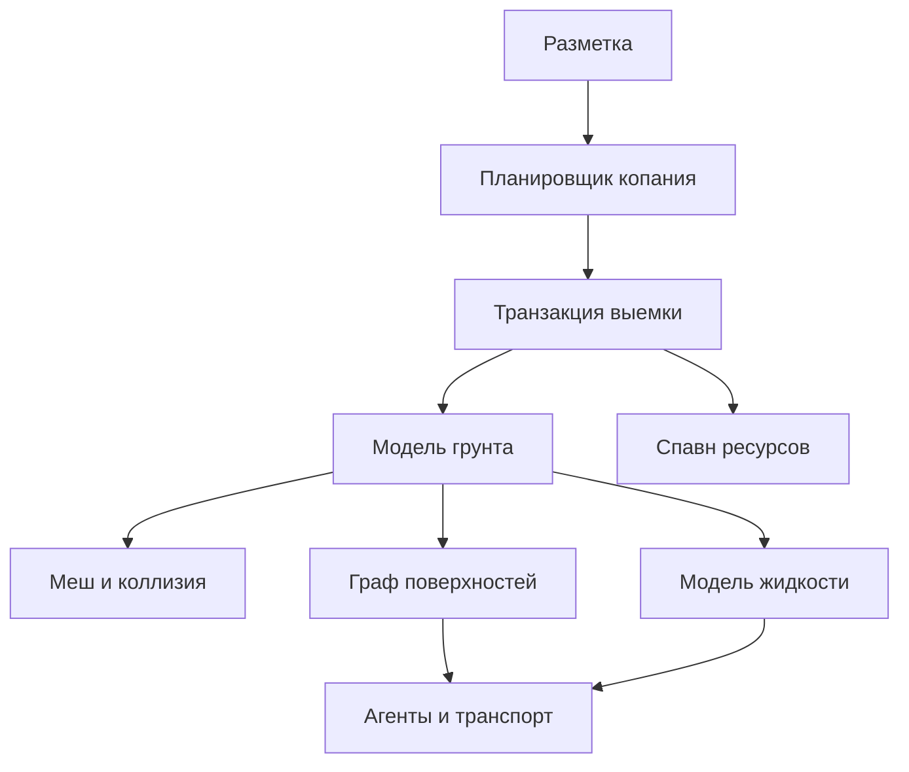

# Diggles / Wiggles (2001–2002): игровое пространство, грунт и навигация

**Техническое исследование для Godot-порта.** 19 ноября 2026 г. Только публично доступные источники; оригинальный EXE, ресурсы и проект не исследовались непосредственно. Данные переиздания 2020 г. помечены отдельно. Это спецификация наблюдаемых интерфейсов и поведения, а не декомпиляция движка.

## Резюме

Наиболее обоснованная модель — **двумерная адресация ландшафта и путей в плоскости X/Y при трёхмерных позициях объектов, визуальной глубине и геометрии пещер**. В Tcl API имеются отдельные команды разметки копания, поиска следующей позиции, изменения грунта, проверки проходимости, задания стоимости навигации и транспорта. Однако формула преобразования блока в геометрию, внутренняя структура BlockDB, масштаб блока, способ поиска пути и точная гидродинамика публично не подтверждены.

Оригинал имеет собственный C++-движок и Tcl-слой: это непосредственно описал директор разработки SEK-Ost Карстен Ортбандт в 2001 г. [S1]. Поэтому интерфейс Tcl — ценный контракт реконструкции, но не доказательство внутреннего устройства C++.

**Уровни уверенности:** В — высокая (прямой интерфейс, документация разработчика, воспроизводимый исходный фрагмент); С — средняя (свидетельство автора инструмента, эксперимент игрока, вывод из нескольких интерфейсов); Н — низкая (гипотеза, предварительное сообщение или не полностью проверенное свидетельство); ? — неизвестно. Уверенность в существовании API не распространяется автоматически на его внутреннюю реализацию.

## 1. World geometry

### 1.1. Координаты и размеры

| ID | Свойство оригинала | Доказательство / источник | Уверенность | Предложение для Godot (не оригинальный алгоритм) |
|---|---|---|---|---|
| W01 | Размер карты задаётся парой ширина/высота; карта имеет смещение. | [S2], `map create`, `map move`, `map getoffset`, `get_map_width`, `get_map_height`, `sm_create_map`. | В | `MapBounds` с целочисленными координатами X/Y и origin отдельно от рендера. |
| W02 | Y соответствует направлению углубления в карте. | [S2], `sm_add_temp` задаёт miny/maxy как минимальную/максимальную глубину, `sm_get_zone y`. | В для семантики Y, знак и ноль не установлены | Выбрать Y карты вниз; единственное преобразование `map_to_world`. |
| W03 | Сущности используют координаты X/Y/Z и отличаются позиция объекта и позиция его основания. | [S2], `set_pos`, `set_posbottom`, `vector_pack`, отдельные 2D/3D расстояния. | В | Хранить якорь ног/основания отдельно от центра модели; добавить независимую глубину Z. |
| W04 | В навигации существует дискретная единица «блок». | [S2], `get_pathlength`, `set_pf_influence` с целочисленной областью в координатах блоков. | В | Навигационная решётка с конвертируемым размером клетки; не считать её единицей Godot автоматически. |
| W05 | Измерение высоты/профиля ландшафта доступно по X/Y. | [S2], `get_hmap x y`, `get_material vector`. | В для API, С для трактовки глубины | Поле профиля/поперечного сечения и таблица материалов. Не утверждать, что hmap — именно Z, пока не исследована функция. |
| W06 | Пример существующей карты: 64×64 при загрузке стартового меню; в опубликованном логе присутствует закомментированный 128×128. | [S3], фрагмент systeminit вокруг `map create`, стартовые позиции с дробными компонентами, объектный Z=10. | В для данного лога, не размер всей кампании | Поддержать произвольные размеры; отдельная малая тестовая карта. |
| W07 | В публичном чешском разборе скриптов кампании фигурирует вызов `map create 512 640`. | [S4], индексируемый фрагмент; страница не загрузилась целиком. | С, точная стадия/версия не проверены | 512×640 можно использовать как нагрузочный тест, не как константу формата. |
| W08 | Физический размер блока, абсолютная глубина по Z, знаки осей, диапазоны Z для коридора и пещеры. | Прямых чисел с однозначной привязкой не найдено. W06 — координаты одного объекта, а не масштаб. | ? | Параметры `unit_scale`, `depth_profile` оставлять настраиваемыми. |

**Вывод, а не установленное устройство памяти:** 2.5D-подход значительно лучше соответствует API, чем произвольный трёхмерный воксельный мир. Но X/Y-функции могут быть фасадом над более сложной геометрией. Нельзя считать доказанными единичную глубину мира, обязательную кубическую сетку или ровно один доступный слой Z.

### 1.2. Материал, геометрия и генерация

| ID | Правило | Доказательство / источник | Уверенность | Godot |
|---|---|---|---|---|
| W09 | Движок различает камень, два типа песка/земли и состояние отверстия. | [S2], `get_material` коды 0, 1/2, 3; последнее состояние названо scapehole. | В для кодов; значение scapehole требует теста | `MaterialId` и состояние выемки раздельно; сохранить сырой код при импорте. |
| W10 | Каменные/гранитные области препятствуют прокладке туннелей. | [S2], `sm_draw_stone` (границы и прямоугольники камня); [S5], геймплейное описание обхода гранита и тупиков. | В для различия материалов, С для абсолютной неразрушаемости во всех условиях | Маска твёрдой породы; экспериментально проверить исключения инструментов, сюжета и генератора. |
| W11 | Коридор и пещера — разные режимы копания: проход и более просторная область для зданий. | [S2], `dig_mark` с режимами 0/1/2; [S5], описание непригодности узкого туннеля для размещения зданий. | В для режимов, С для полного перечня разрешённых объектов | Отдельные профили `Tunnel` и `Cave`; проверка габаритов здания по фактической поверхности и глубине. |
| W12 | Шаблоны карты имеют ширину/высоту, наборы, веса, ограничения и группы. | [S2], `lg_get_temp_size`, `lg_tp_addtemplates`, `lg_set_templateratio`, `lg_set_templatevalue`, `sm_def_temp_group`. | В | `TemplateCatalog` с весами, размерами, занятыми областями и объектными спавнами. |
| W13 | Уникальные сюжетные пещеры допускают диапазон глубины, зависимости от событий, расстояния и соединения. | [S2], `sm_add_temp` (miny/maxy, -events, -mindist, -digconnect, -connect, -exclusive); [S6], конкретная правка параметров шаблона фей в `CampaignInit.tcl`. | В для API, С для конкретного поведения из гайда | `UniqueTemplateRule`, отслеживать занятые зоны и связи. Не угадывать значение числовых аргументов `-nonrelevant` и `-middist`. |
| W14 | Генерация определённых типов пещер управляется отдельно; есть признаки генерации по мере исследования. | [S7], мод автора с переключением генерации в четырёх мирах; [S6], наблюдения последовательности появления пещер после копания; [S8], приём разметки двух клеток. | С для отложенной/событийной генерации; точный триггер неизвестен | Отдельный генератор регионов с событием `terrain_opened`. Сравнить генерацию при первом копании, первом открытии тумана и заранее. |
| W15 | Переходы грунтов отображаются масками наложения. | [S9], эксперимент автора HD-мода: маска `Data/Ground/Msk_AAAB01.tga` и ограничение разрешения 64×64 пикселей. | С (прямое свидетельство моддера) | Атлас масок смешивания материалов; отдельно от топологии. 64×64 — разрешение текстуры, НЕ размер клетки мира. |
| W16 | Точные допустимые профили углов, T/X-стыков, скатов, ступеней и вертикальных шахт не восстановлены. | [S2] подтверждает режимы, глубину разметки и профили, но не таблицы соседства/геометрии. | ? | Таблица переходов между профилями с возможностью добавления экспериментально восстановленных вариантов. |

### 1.3. BlockDB, PMP и форматы карт

| Находка | Что реально установлено | Чего НЕ доказывает |
|---|---|---|
| Русский сторонний редактор и изучение PMP автора Лёв, [S10] | 18.12.2020 автор сообщил о собственном редакторе боевых карт, приложил архив и признал, что PMP расшифрован частично. 20.12.2020 сообщил о наличии исходника у себя, но не о его публикации. | Полную спецификацию PMP, лицензию на код, доказанный способ размещения отдельных блоков. Архив по ссылке не удалось прочитать непосредственно. |
| [Архив исследования PMP](https://yadi.sk/d/CZ92FaeHtmyxX) | Это прямая ссылка автора из [S10]. Содержимое и актуальная доступность не проверены. | Не следует заявлять, что архив изучен или что в нём имеются исходники. |
| Встроенный `-mapedit`, [S11] | Редактор шаблонов с загрузкой PMP, объектами, вращением и их параметрами; пользователь создал карту посредством двух редакторов. | Наличие полного бинарного редактора мировой карты или алгоритма копания. |
| [Немецкий LevelEditor](https://wiggles.ruka.at/downloads/index.php?c=lvled), [руководство](https://wiggles.ruka.at/forum/viewtopic.php?f=10&t=26) | Ссылки подтверждены автором форума в [S10]. Внешний редактор и внутригровой редактор — разные средства. | Открытые исходники редактора: не обнаружены в проверенных результатах. |
| Diggles SDK / barnacle [S12] | Публичный MIT-репозиторий с мостом Tcl/Python/C++; автор описывает загрузку DLL и обращение к существующим командам. | Это не исходный код Diggles и не декомпиляция навигации. |
| Coop-/Multiplayer Mod [S13] | Автор сообщает об инструментировании игровых действий и затруднении перехвата разметки копания, выполняемой EXE. | Полное описание нативной структуры данных, декомпиляция или работающий парсер BlockDB. |
| Diggles3db [S14] | Конвертеры `.3db` относятся к моделям/текстурам и анимациям. | `.3db` — не подтверждённый формат карты; меши не устанавливают правила проходимости. |
| Map save [S2] | В справке `map save` указан файл `d:\mappack.bin`. | Формат файла, успешность команды в конкретной версии или соответствие BlockDB не подтверждены. |
| BlockDB | Целевые запросы `"BlockDB" Wiggles`, `"BlockDB" Diggles`, `"BlockDB" SekOst`, поиски по GitHub и PMP не дали проверенного исследования формата или нативного класса. | Нельзя заимствовать одноимённый BlockDB из ClassiCube/Minecraft или блокчейн-проектов. Не найдено доказательств структуры записи, заголовков, маски соседей, адресов функций или размера блока. |

**Рекомендуемое направление RE:** при будущем появлении разрешённого доступа к оригинальной игре — сохранить публичные ссылки выше, получить маленькие PMP-шаблоны с одной различающейся клеткой, сравнить байты, установить диапазон значений и их связь с отображением. Затем сопоставлять наблюдения с `get_material`, `get_hmap`, `dig_apply`. Не интерпретировать поля по совпадению названий. Для каждого открытия фиксировать версию EXE, SHA-256, смещение, эндийность, входы/выходы и воспроизводимый пример. Сейчас такая проверка не проводилась.

## 2. Terrain deformation

### 2.1. Контракт нативного копания

| ID | Наблюдаемое правило | Доказательство | Уверенность | Godot-предложение |
|---|---|---|---|---|
| T01 | Разметка хранится отдельно от фактически вырытой области. Есть режимы пещера, туннель, отмена. | [S2], `dig_mark`, `is_dig_marked`, `dig_apply`. | В для разделения команд; точное поведение отмены не проверено | Отдельный слой `DigOrders`, не менять меш и коллизии при рисовании кистью. |
| T02 | Разметка принимает X/Y, идентификатор игрока и необязательную глубину. | [S2], `dig_mark player x y mode [depth]`. | В для сигнатуры; значение depth неясно | Хранить `mode`, `player`, `depth_param`; не отождествлять depth с метрами Z. |
| T03 | Есть идентификаторы разметки и ограничение поиска последним ID. | [S2], `dig_next`, `dig_resetid`, `inc_playerdigmarkid`. | В для наличия, С для семантики группировки и порядка | `stroke_id` и `worker_last_id`; не вводить FIFO как якобы доказанный порядок. |
| T04 | Движок рассчитывает следующую позицию копания для рабочего. | [S2], `dig_next vector object [bestidx] [OnlyLastDigID]`, `get_digedge`. | В для API, ? для приоритета | Выбирать только достижимый фронт выемки; временные веса/резервирование документировать как реконструкцию. |
| T05 | Реальное удаление грунта выделено в операцию `dig_apply vector object`. | [S2]. | В для наличия, ? для размера области изменения | Транзакция `apply_excavation`, которая меняет только затронутые клетки; тестировать форму области. |
| T06 | Существуют коррекции позиции для достижения цели копания. | [S2], `vector_fixdig`, `get_digedge`. | В для API; порядок вызова не известен | Выбрать достижимую рабочую точку, затем направить анимацию к границе. |
| T07 | В игре эффективность копания связана со Stone skill; сообщается о застревании кирки. | [S15], индексируемый пользовательский материал страницы переиздания; [S16], свидетельство игрока о высоком навыке. | С для влияния навыка, Н для застревания, ? для формул | Разделить длительность замаха, возможную неудачу и допустимость копания; пока не задавать «оригинальные» числа. |
| T08 | Появление ресурсов при копании существует; в ванильной версии оно связано с миром по свидетельству пользователя мода. | [S17], обсуждение модификации DroppingResources 23.12.2021. | С для спавна и зависимости от мира; ? для вероятностей | Таблица ресурсных выходов по зоне плюс seed; лог каждого выпуска. Не считать ore заранее физическими вокселями, если это не доказано. |
| T09 | Копание имеет отдельное производственное состояние и уведомления. | [S2], `prod_gnome_state ... dig`, `gnome_announce_dig`, `gnome_failed_work`, `sm_dig_message`. | В для интерфейса | Состояния рабочего и события выемки; отделить их от кадров рендера. |
| T10 | Число ударов на блок, точный кадр выемки, форма среза и число добытых объектов на удар. | Публичного трассирования или доказанного алгоритма не найдено. | ? | Ввести анимационный marker `impact`, счётчик progression и таблицу footprint; замеры оригинала должны заменить исходные placeholders. |

### 2.2. Реконструируемая последовательность

На уровне контракта оригинала доказаны отдельные операции Mark, ChooseNext и Apply; **не доказан** точный порядок всех вызовов между ними или что одна операция Apply равна одному взмаху.

Предлагаемый цикл Godot:

```text
разметка игрока -> список целей -> достижимая рабочая позиция
  -> подход/ориентация -> анимация копания -> событие impact
  -> проверка результата -> изменение грунта
  -> ресурс (по таблице и RNG, если положен)
  -> обновление геометрии, опоры, навигации и жидкости
  -> следующая цель либо завершение/отказ
```

Две существенные возможности для калибровки: оригинал может менять геометрию после нескольких ударов или менять её частями; ресурсы могут возникать не одновременно с локальной выемкой. Нужна покадровая привязка удара, частицы, изменения силуэта, появления предмета и результата маршрута. Не использовать эффект частиц как доказательство удаления блока.

### 2.3. Правила топологии (предложение, а не reverse engineering)

Хранить клетку как `{ material, excavation_profile, neighbor_mask, dig_mark_id, generation_state }`. `excavation_profile` — независимый параметр объёма пустоты. Начать с минимального каталога «сплошной грунт, горизонтальный коридор, проход вверх/вниз, поворот, соединение, пещера»; формы склонов, глубину и ориентацию уточнять экспериментально. Стыки должны формировать непрерывную геометрию и поверхность опоры на границах клеток. Применение конфигураций Marching Squares или заранее изготовленных мешей — инженерное решение, не установленный алгоритм Diggles.

## 3. Physics rules

| ID | Правило оригинала / предел знаний | Источник и доказательство | Уверенность | Godot-предложение |
|---|---|---|---|---|
| P01 | Физику отдельного объекта можно включать/менять. | [S2], `get_physic`, `set_physic`; [S11], описание настройки Physics для падения камня в редакторе. | В для интерфейса, С для конкретного эффекта | Различать неподвижные объекты, переносимые предметы и динамические тела; флаг физики. |
| P02 | Существуют отдельные флаги коллизии и скорости, позиции основания, привязка к поверхности. | [S2], `set_collision`, `get_vel`, `get_framevel`, `set_posbottom`, `ground_pos`. | В для API | Отделить коллизию от визуального меша и движение сущности от перемещения предмета. |
| P03 | Предмет после выпадения из инвентаря становится видимым и получает мировую позицию. | [S2], `inv_rem` с необязательной позицией, по умолчанию позиция контейнера. | В для интерфейса; импульс и падение не доказаны | Отдельный переход `Contained -> WorldPlaced/Falling`; затем проверка опоры. |
| P04 | Возможны обвалы? Предрелизный журналистский материал упоминает зависимость обрушений от способа разработки. | [S18], ранний preview 2001 г.; окончательная версия не подтверждена. | Н | Не включать автоматическое обрушение в базовую механику «как в оригинале» до экспериментального подтверждения. |
| P05 | Падение после удаления опоры: точная реакция персонажа, урон, скорость и наличие страховки при лазанье не установлены. | [S2] даёт API физики, а [S19] содержит исправление перемещения гномов после кат-сцены копания, но не механизм падения. | ? | Выделить режим `Falling`, проверку опоры и отдельные параметры урона; в MVP не выдумывать летальный порог. |
| P06 | Построение имеет проверку свободного места и привязку к стене. | [S2], `get_place`, `get_place_info`, `set_placesnapmode`, `check_ghost_coll`. | В для API; точные правила размеров неизвестны | Проверять геометрию, занятость, опору и профиль пещеры до подтверждения. |

### 3.1. Жидкости

| ID | Правило | Источник и доказательство | Уверенность | Godot-предложение |
|---|---|---|---|---|
| F01 | Жидкость имеет измеряемое заполнение по X/Y и высоту; есть проверка погружения точки. | [S2], `get_fill`, `get_waterheight`, `isunderwater`. | В для интерфейса | Поле объёма/высоты заполнения для клеток плоскости карты, запрос поверхности по мировой позиции. |
| F02 | API различает 0 — отсутствие, 1 — воду, 2 — серу, 3 — лаву, 4 — lavawater. | [S2], `get_ftype`. | В для enum; состав lavawater и свойства не известны | Сохранить все сырые коды; не выдумывать химические реакции или свойства серы. |
| F03 | Источник имеет тип, объём, высоту, локальную позицию и скорость выпуска. | [S2], `set_fsource`, параметры `-type`, `-volume`, `-height`, `-pos`, `-vpf`, `rem_fsource`. | В для интерфейса, ? для единиц времени | `FluidSource` с независимыми входными данными; запрет неверного смешения кадра и тика физики. |
| F04 | Объекты могут ограничивать поток жидкости прямоугольной областью и коэффициентом. | [S2], `set_fstopper` и `rem_fstopper`. | В для интерфейса; значение коэффициента неизвестно | Связать двери/перегородки с картой пропускной способности потока. |
| F05 | Выемка прохода и открытие дверей влияют на доставку воды в сюжетной головоломке. Гномы могут получать вред при погружении. | [S16], обсуждение `Help fairies`, сообщения 18.12.2020, 29.08.2021, 01.03.2024; [скриншот игрока](https://steamcommunity.com/sharedfiles/filedetails/?id=2588431191), указан в обсуждении, отдельно изображение не анализировалось. | С; условия, числа, особые сюжетные скрипты не установлены | Модель потока с проницаемостью открытых клеток и вредом от жидкости; сценарий «соседний закрытый водоём -> открыть/прорыть -> отток». |
| F06 | Возможно особое поведение движения при ношении корзины в воде. | [S16], единичное сообщение от 29.08.2021 о смене анимации плавания на ходьбу при экипировке. | Н | Отдельный тест экипировки; не вводить это как намеренную механику. |
| F07 | Закон сохранения объёма, скорость растекания, давление, границы выхода за карту, насосы, реакция лавы и воды. | Сигнатуры API не раскрывают формул; код solver не найден. | ? | Начать с консервативной дискретной модели ёмкости и потоков, заменить по замерам. Визуальная вода за сценой не обязательно часть симуляции. |

## 4. Navigation algorithms

### 4.1. Доказанные возможности интерфейса

| ID | Правило | Источник и доказательство | Уверенность | Godot-предложение |
|---|---|---|---|---|
| N01 | Движок строит путь для конкретного объекта между двумя точками с возвращением успеха. | [S2], `path objref from to [maxflood]`. | В для контракта; ? для A*, BFS, Dijkstra и эвристики | Сервис `find_path(agent, start, goal, budget)`, путь из типизированных переходов. |
| N02 | Стоимость и флаги прямоугольника влияния объекта задаются в координатах блоков. | [S2], `set_pf_influence`. | В для API, ? для флагов | Локальный слой динамической стоимости и запретов, отдельно от статической топологии. |
| N03 | Расстояние текущего маршрута можно запросить в блоках. | [S2], `get_pathlength`. | В | Хранить длину пути в дискретных единицах, стоимость и физическое расстояние отдельно. |
| N04 | Способность лазать входит в параметры поиска пути конкретного объекта. | [S2], `get_climbability`, `set_climbability`. | В | Профили агента с `can_climb`; фильтровать соответствующие рёбра. |
| N05 | Движок различает стоячее и висящее состояние гнома. | [S2], `get_gnomeposition`, значения 0/1. | В для возвращаемых состояний, ? для детального перехода | Отдельные режимы locomotion Stand/Climb/Hang; переходы синхронизировать с точками контакта. |
| N06 | Можно получить достижимую позицию рядом с заданной; свободная позиция не всегда проверяется на коллизии. | [S2], `vector_fix`, `get_place_long` с необязательными флагами walkable. | В | `project_to_accessible` и проверка коллизии — отдельные шаги. Не подменять маршрут телепортацией. |
| N07 | Есть специальная логика двери и возможность пропускать по владельцу/друзьям/классам. | [S2], `create_doorlogic`, `set_doorproperties`. | В для API | Условные рёбра с предикатом доступа. |
| N08 | Лестница и лифт — специализированные средства перемещения, а не просто декорации. | [S2], `create_ladderlogic`, `set_ladderrange`, `create_elevatorlogic`, `set_elevatorproperties`, `delete_transportlogic`. | В | Добавлять/удалять транспортные рёбра между доступными выходами с проверкой ограничения длины. |
| N09 | Параметры лифта включают максимальный диапазон, тип разгона, скоростные параметры, торможение и число пользователей. | [S2], `set_elevatorproperties objref maxrange accelerationtype acceleration/speed brakeacceleration maxusers`. | В для аргументов; значения и единицы не установлены | Лифт — автомат состояний ожидание/посадка/движение/выход с ёмкостью и расписанием. |
| N10 | Результат движения различает ошибку (0), прерывание (1), незавершённость (2), отсутствие прохода (3) и достижение цели (4). | [S2], `get_walkresult` (`WS_ERROR`, `WS_WALKABORTED`, `WS_NOTFINISHED`, `WS_NOPASSAGE`, `WS_TARGETREACHED`). | В для enum | Воспроизвести семантику статусов; отличать временную задержку от невозможности маршрута. |
| N11 | Существует возможность выбора направления случайного маршрута в сторону от другого объекта. | [S2], `get_pathrandflags` для `path_rand`; `get_escape_pos`. | В для API, ? для метода выбора | Генератор достижимых случайных целей с ограничением направления для бегства. |
| N12 | Попытки подхода к отдельным предметам иногда приводят к ошибочному подъёму у задней стены в модифицированной игре. | [S20], отчёт моддера о недоступности некоторых предметов после обычного выпадения; автор обсуждения предполагает дефект native Pathfinder. | Н для причин; С для наблюдения в конкретном моде | Тестировать точку взаимодействия отдельно от центра предмета, обязательно проверять достижимость по Z. |
| N13 | Появившиеся туннели позволяют потенциально связывать пещеры; конкретный момент инвалидирования и пересчёта маршрутов не доказан. | [S2], отдельные `dig_apply` и `path`; [S5], описание соединения пещер туннелями. | С для поведения, ? для алгоритма | При изменении топологии инвалидировать проходящие через изменённые клетки рёбра/пути. Вызвать поиск заново при следующем движении. |
| N14 | Политика разъезда/очереди гномов, вытеснение и deadlock; размер прохода для тролля, хомяка или переносимого объекта. | Не найдено прямой таблицы размеров, коллизий и правил толпы. [S2] подтверждает объектно-зависимые параметры и пространственный `obj_query`, но не радиусы навигации. | ? | Ввести профили clearance, проход шириной в одну сущность и систему ожидания как гипотезы реализации, не оригинальные правила. |

### 4.2. Чего нельзя заключать из `maxflood`

Название параметра может быть намёком на flood-стадию поиска, ограничение области или бюджет обхода. Неизвестны единицы, нулевое значение, структура очереди, стоимость диагонали, порядок соседей, эвристика, кеширование и иерархический поиск. Из `get_pathlength` нельзя заключить, что используется кратчайший путь исключительно по числу блоков. Наличие `set_pf_influence` допускает взвешенную стоимость, но не устанавливает сам алгоритм.

### 4.3. Предлагаемая топология проходов

Для Godot рационально построить ориентированный граф опорных точек в X/Y и ограничений глубины Z. Вершина — доступная позиция ног или контакта, а рёбра — `walk`, `slope`, `climb`, `ladder`, `elevator`, `door`, `swim` (последний при подтверждении нужных правил). Для каждого ребра хранить `required_capability`, `clearance`, `cost`, `transport_id`, `terrain_revision`. Возможность прыжка/одностороннего падения — не включать в плановый маршрут без подтверждения.

Выбор A* по взвешенному графу — временная реализация, которую можно менять без перестройки карты, если доказательства оригинала потребуют другой стратегии. Эвристику задавать как нижнюю границу стоимости, а не просто евклидово расстояние при наличии лифта.

## 5. Godot architecture

Ниже архитектурный проект, **не установленный код оригинала**. Детали исходной игры хранятся в виде доказанных параметров, неподтверждённых правил и настраиваемых значений.



| Компонент | Ответственность | Опорный факт | Предложение |
|---|---|---|---|
| WorldGrid | Материал, профиль выемки, регион, версия | W01–W05, W09 | Packed typed arrays или C++/GDExtension при необходимости. Индексы X/Y независимы от физических единиц. |
| TemplateCatalog / RegionGenerator | PMP-импорт в будущем, логические шаблоны, уникальные зоны | W12–W14 | Внутренний собственный формат до подтверждения PMP; генерировать маленькими регионами, фиксировать seed и журнал размещения. |
| DigOrderSystem | Кисть, режим, игрок, stroke ID | T01–T03 | Хранить данные разметки независимо от геометрии. |
| ExcavationSystem | Фронт работ, результат удара, локальная транзакция | T04–T10 | События `DigImpact`, `TerrainChanged(region, revision)`, `ResourceSpawned`; параметризовать профиль выемки. |
| ChunkMeshBuilder | Построение боковых стен/дна/задней стены и смешение материалов | W03, W11, W15 | `ArrayMesh`, чанки выбранного экспериментально размера, переобработка изменённых частей и швов. |
| SupportQuery | Опора, допустимая позиция предмета, габариты | P01–P06 | Привязка к поверхности/mesh collision и явный `GroundAnchor`. |
| NavigationGraph | Достижимые точки, типы переходов, стоимости | N01–N11 | Собственный семантический граф, не просто полный 3D NavMesh. |
| TransportSystem | Лестница/лифт/дверь, разрешение доступа | N07–N09 | Динамические связи, занятость кабины и ожидание. |
| FluidGrid | Объём, источник, блокатор, погружение | F01–F07 | Локальное обновление активных областей, отдельный шаг визуализации воды и правило опасности. |
| ActorMotor | Ходьба, лазанье, висение, выполнение пути/статусы | N04–N10 | Контроллер, который воспроизводит траекторию и анимацию из графа, без неограниченного бокового 3D-обхода. |

### 5.1. Порядок изменения мира

1. На фиксированном тике подтвердить выбранную выемку и проверить текущую ревизию, достижимость и материал.
2. Обновить данные карты и собрать `dirty_region` с соседними клетками, затронутыми профилем.
3. Обновить опору, коллизию и граф проходов по изменённой области; визуальную перестройку допускается делать отдельно, без рассинхронизации физики.
4. Активировать перерасчёт жидкости на открытых границах и обработать объекты, утратившие опору.
5. Создать ресурсы по правилам спавна; восстановить или завершить операции рабочих.

Эта последовательность — рабочий проект. Порядок, число ударов и момент появления предметов в оригинале требуют измерения. Для навигации не перестраивать всю карту при каждом ударе: локальные версии рёбер, поиск на запрос и запасная полная перестройка для проверки корректности. Не выдавать чанки, размеры, частоту тиков, алгоритмы воды или кэши за оригинальные.

### 5.2. Приоритеты MVP

- P0: разметка и отмена, два профиля выемки, неразрушаемый камень в обычном сценарии, подход к доступной границе, фактическое изменение грунта, соединение двух пещер, статус недостижимости.
- P0: лестницы и доступные опоры, перестройка локального графа, устойчивость размещения предметов, проверка габаритов пещеры.
- P1: лифты и двери с условными связями, различная проходимость существ, динамические жидкости с блокаторами, базовые ресурсные выходы по регионам.
- P2: уточнение углов, скатов, глубины, фактического алгоритма поиска и эмпирических формул, PMP/BlockDB только после доказательства формата.
- Не включать механический обвал, сложную симуляцию давления или произвольное воксельное 3D до подтверждения требований оригинала.

## 6. Test scenarios

Это **протокол будущей проверки**, не результаты тестирования оригинала. В каждом сценарии сохранять версию, исходное состояние, кадры, команды, координаты, статусы и время. При возможности — демонстрация на оригинале и повторение в прототипе.

| Тест | Постановка и измерение | Что нужно установить |
|---|---|---|
| G01: масштаб | Одна клетка разметки, соседняя клетка, объект известного размера; несколько позиций X/Y/Z. | Размер и шаг блока, преобразование в мировые единицы, направление осей. |
| G02: профили | Туннель и пещера в одинаковом грунте, одинаковая линия. | Высота, глубина, доступность пола/задней стены, допустимые постройки. |
| G03: соседство | Последовательности H→V, L, T, X, диагональ, две соседние пещеры; повторить в обратном порядке. | Зависимость формы от соседей и порядка копания. |
| G04: камень | Разметить область на стыке земли/гранита, повторить лучшим инструментом. | Отказ до разметки или во время работы; абсолютность запрета. |
| D01: удар | Покадрово записать один участок от начала замаха. | Число ударов, кадр выемки, момент частиц и спавна. |
| D02: добыча | Одинаковые штрихи в разных мирах, минимум 100 успешных изменений на выборку. | Вероятности, сочетание типов, зависимость от навыка/инструмента; считать знаменатель. |
| D03: конкуренция | Два гнома копают две соседние цели одного ID, потом разные ID. | Резервирование, порядок выбора, двойная выемка, смена рабочего. |
| D04: отмена | Снять разметку до подхода, до удара, в процессе выемки. | Что прекращается; возвращается ли грунт; требуется ли ручной приказ. |
| D05: генерация | Повторить один seed с короткими и длинными полосами раскопки. | Триггер генерации, влияние разметки и света, порядок появления шаблонов. |
| P01: опора | Положить камень и коробку, убрать поверхность под ними. | Падают ли, смещаются ли, пробивают ли другие объекты. |
| P02: свод | Удалить опоры под большим перекрытием и повторить без сторонних модов. | Существуют ли механические обвалы в финальной версии. |
| P03: персонаж | Удаление грунта у ног/рук, на высоте и в разных состояниях. | Падение, переход в висение, урон, восстановление. |
| N01: поверхности | Задать путь на одинаковом расстоянии на полу, скате, стене и потолке. | Какие поверхности доступны гному и другим видам. |
| N02: выбор пути | Два маршрута: короткий вертикальный и длинный горизонтальный; поставить лестницу. | Предпочтение, стоимость переходов и изменение выбранного маршрута. |
| N03: динамический путь | Персонаж не имеет прохода; выкопать соединение, не давая повторного приказа. | Автоматическое возобновление или необходимость нового приказа; задержка обновления. |
| N04: транспорт | Удалить лестницу/лифт до подхода, во время перемещения и после. | Отмена, повторный путь, падение, статус результата. |
| N05: лифт | Группа превышает вместимость кабины, две последовательные заявки с разных этажей. | Очередность, ожидание, вместимость и порядок остановок. |
| N06: толпа | Два гнома идут навстречу в узком туннеле, затем 10–20 гномов. | Проход друг сквозь друга, ожидание, локальный обход, таймаут. |
| N07: размер | Узкая шахта/коридор; гном, хомяк, тролль и крупный предмет/коробка. | Порог габаритов, возможность ездового существа и переноски. |
| F01: сообщающиеся пещеры | Две камеры с водой на разных уровнях; выкопать узкий, затем широкий проход. | Момент начала потока, уровень равновесия, расход, сохранение объёма. |
| F02: дверь/насос | Закрыть и открыть перегородку между заполненными камерами. | Проницаемость, момент начала потока, воздействие насосов. |
| F03: погружение | Гном с разной экипировкой в воде/серной жидкости/лаве. | Вред, скорость, анимация и доступность маршрута. |
| F04: стык жидкостей | Соединить две разные жидкости; отдельно проверить границу карты. | Типы взаимодействия, изменение грунта, граничные условия. |

Формат журнала: `test_id, build, seed, tick/frame, agent_class, position_xyz, map_xy, material_before/after, dig_mode, dig_id, impact, walk_result, path_length, fluid_type, fill, spawned_objects, evidence_url`. Поля, недоступные наблюдателю, оставлять пустыми, не заполнять догадками.

## 7. Open questions

| Приоритет | Неизвестное | Что решит вопрос |
|---|---|---|
| P0 | BlockDB: принадлежность оригинальному движку, формат, таблицы типов/вариантов, размер записи и расположение. | Первичный публичный технический документ, исходный парсер с образцом файла или разрешённая дизассемблированная функция с входами/выходами. |
| P0 | Масштаб блока, Z-глубина разных профилей и направление координат в EXE. | Малые эталонные шаблоны + измерение координат. |
| P0 | Порядок модификации клеток, правила поворотов/развилок, форма выемки. | Сравнение ландшафта до/после в тестах G02–G04. |
| P0 | Вычисление `dig_next` и параметров `depth`, `bestidx`, `OnlyLastDigID`. | Трасса нескольких разметок и инспекция нативной регистрации команд. |
| P0 | Алгоритм `path`, значение `maxflood`, веса, соседи, инвалидирование пути, результат при блокировке. | Дифференциальные тесты N02–N06; документированная нативная функция. |
| P1 | Связь добычи с грунтом: хранимая руда или генерация на событии, шанс и расход. | Серии успешных ударов по материалам и зонам, скрипты ресурса, лог создания объектов. |
| P1 | Крупные существа, предметы и толпа. | Сравнение нескольких видов и ширин/глубин проходов. |
| P1 | Обвалы, гравитация, урон при падении. | Проверка финальной версии P01–P03; не опираться только на preview. |
| P1 | Реальный алгоритм воды и параметры `fstopper`; различие 2D-наполнения и визуальной глубины. | Измерения F01–F04, публичное описание solver или восстановленные нативные функции. |
| P2 | Лицензия PMP-редактора и соответствие CD, Steam, GOG. | Прочитать архив автора и установить происхождение каждого файла; не переносить код и ресурсы без проверки. |

## Sources / карта доказательств

Ссылки ниже — прямые публичные URL, указатели на команды и сообщения позволяют найти материал внутри страницы. Источники сообщества не приравнены к документации производителя. Не проверенные непосредственно архивы и видео помечены отдельно.

- **S1.** Carsten Orthbandt, Director Development, SEK-Ost, *Game Scripting with Tcl*, II. European Tcl/Tk User Meeting, 2001: [сборник докладов PDF](https://www.eurotcl.eu/presentations/EuroTcl2001-AllPresentations.pdf), разделы 1, 2, 4.3–4.4 (в поисковой текстовой версии строки 3101–3150, 3402–3418). Первичный источник о разделении Tcl/C++ и реализации UI в C++.
- **S2.** [Wiggles Tcl Commands](https://wiggles.ruka.at/tipstricks/wiggles_tcl.html). Публичный справочник команд оригинального движка. Искать по точным идентификаторам из таблиц; основные текстовые диапазоны: dig 1649–1690, material 2909–2915, path 5722–5729, map 5174–5199, climb/door/elevator 6637–6719, fluid 2615–2668 и 6855–6877, `set_pf_influence` 7217–7222, story map 7926–8133. Дата и происхождение конкретного снимка справочника не установлены; это не исходник C++.
- **S3.** [DigglesMods/RareResources, issue #1](https://github.com/DigglesMods/RareResources/issues/1), 2018. Полный опубликованный журнал запуска, фрагмент `systeminit.tcl` около создания карты и `MapTemplateSet` (строки 308–412). Первичное свидетельство конкретной модифицированной установки.
- **S4.** [Scriptování ve hře Wiggles část.2](https://www.wiggles.funsite.cz/archives/201), 2012, чешский разбор скриптов; найденный фрагмент `map create 512 640`. Страница полностью не открылась, поэтому число не принято за общий размер оригинала.
- **S5.** [GameSpot, Diggles Preview](https://www.gamespot.com/articles/diggles-preview/1100-2835487/). Публичный геймплейный отчёт о тупиках, обходе гранита, различии туннелей и пещер. Сведения о наблюдаемом поведении, не описание внутреннего алгоритма.
- **S6.** [Rafael, The Diggles — советы и прохождение](https://steamcommunity.com/sharedfiles/filedetails/?id=3353607951&l=english), раздел «В поисках Фей» и фрагмент `CampaignInit.tcl` около строки 686. Авторское наблюдение по современной версии; параметры уникального шаблона иллюстрируют работу генератора.
- **S7.** [DigglesMods/SwitcherGeneratorDungeon](https://github.com/DigglesMods/SwitcherGeneratorDungeon). Первичное описание мода переключения генерации пещер четырёх миров, GPL-3.0. Не оригинальный исходник генератора.
- **S8.** [Useful Tips and Tricks, Digging](https://gameplay.tips/guides/9172-diggles-the-myth-of-fenris.html), 19.12.2020. Свидетельство игрока о разметке маленькими участками и взаимодействии с генерацией, не подтверждённая формула.
- **S9.** [ZarfaZ/DigglesHDmod](https://github.com/ZarfaZ/DigglesHDmod), README, Known bugs. Авторское наблюдение об ограничении масок перехода грунта 64×64 px.
- **S10.** [Лёв, I have my own map editor and some research for pmp file format](https://steamcommunity.com/app/1478650/discussions/0/4993894146669813334/), 18–20.12.2020. Описание и ссылки автора; подтверждает неполноту исследования PMP, а не публикацию исходника.
- **S11.** [Tutorial Map-Editor](https://wiggles.ruka.at/forum/viewtopic.php?p=867), 2015, фрагмент об объектной физике; [New maps?](https://steamcommunity.com/app/1478650/discussions/0/5544461758378744401/), 2021, сообщения Лёва и Echidna об использовании двух редакторов. Форумный URL частично доступен через поисковый индекс.
- **S12.** [Diggles SDK — barnacle](https://github.com/ede-krcv/barnacle), MIT; [публикация автора](https://wiggles.ruka.at/forum/viewtopic.php?f=10&p=1907&sid=a0653cb6fdddde316f6ddf4dc2637dbb&t=315), 08.07.2020. API-мост, не движок.
- **S13.** [Wiggles Coop-/Multiplayer Mod](https://wiggles.ruka.at/forum/viewtopic.php?f=10&sid=bc47f8cb5da26293157d1ba38779ce0c&t=2374). Публично индексируемое авторское описание перехвата Tcl и проблемы разметки на уровне EXE; сам репозиторий и полный форумный текст не прочитаны.
- **S14.** [Diggles3db](https://github.com/djunkles/Diggles3db); [обсуждение авторов](https://wiggles.ruka.at/forum/viewtopic.php?p=4228), включая сообщение 17.10.2025 о [Diggles3db-Converter](https://github.com/Zimennik/Diggles3db-Converter). Формат 3D-моделей, не доказанный формат местности.
- **S15.** [Diggles — Steam](https://store.steampowered.com/app/1478650/Wiggles/?curator_clanid=6887496). Поисковый индекс страницы содержал пользовательское описание каменного навыка и застревания кирки; при повторном открытии этот динамический фрагмент не обнаружен. Не официальная формула и не подтверждение числовых параметров оригинала.
- **S16.** [Help fairies](https://steamcommunity.com/app/1478650/discussions/0/4993894146671382195/), 2020–2024, сообщения игроков и ссылка на скриншот о воде, дверях, копании, лестнице и лифте. Современная версия.
- **S17.** [A solution to the mood problem](https://steamcommunity.com/app/1478650/discussions/0/4739473745781974744/), комментарий soutrain от 23.12.2021, редакция 14.05.2024; мод DroppingResources и сравнение его поведения с обычным. Первичное наблюдение игрока; мод не считается ванильным.
- **S18.** [GameSpot, First look: Wiggles](https://www.gamespot.com/articles/first-look-wiggles/1100-2684366/), ранний анонс механики обвалов. Требует проверки финального релиза.
- **S19.** [Changelog — WinterDwarf](https://steamcommunity.com/app/1478650/discussions/0/2996547001745534197/?ctp=1&l=german), официальный список изменений, сборка 2.1.1.10, 26.12.2020. Доказательство исправления конкретного перемещения после кат-сцены; не физика обвала.
- **S20.** [Waffen, Werkzeug und Tränke einlagern, стр. 2](https://wiggles.ruka.at/forum/viewtopic.php?f=10&sid=7154f61c79b6cbf76960347f9006103b&start=10&t=27), обсуждение модов о неправильном подходе к предмету. Причина — предположение автора сообщения, не декомпиляция.

Дополнительная точка входа для покадрового анализа: [видео Diggles, 07:40](https://www.youtube.com/watch?v=3lIN37JyNTU&t=460s), ссылка из [вопроса автора попытки воспроизведения 2016 года](https://gamedev.stackexchange.com/questions/118107/what-technique-should-i-use-to-implement-the-following-type-of-diggable-terrai). Сам вопрос не является источником алгоритма Diggles; предложенные в ответах методы не подтверждают оригинальную реализацию. Кадры видео независимо не проанализированы, таймкод служит зацепкой для будущего теста.

**Итог:** при реализации первичного прототипа следует воспроизвести семантику нативных операций, но сохранить заменяемыми топологию клетки, правила разрушения, выбор маршрута, физику и жидкостный решатель. Полное соответствие оригиналу нельзя заявлять до появления доказательств по открытым вопросам.
