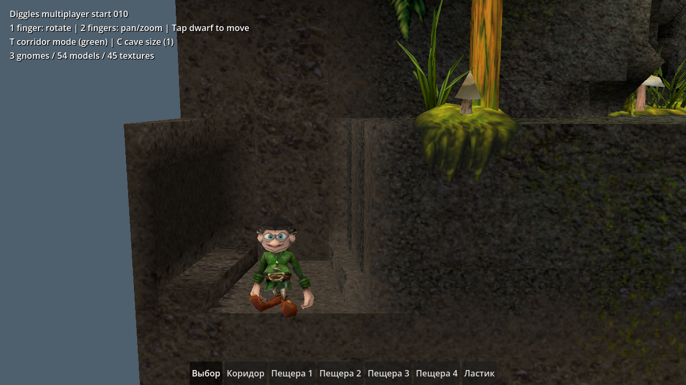
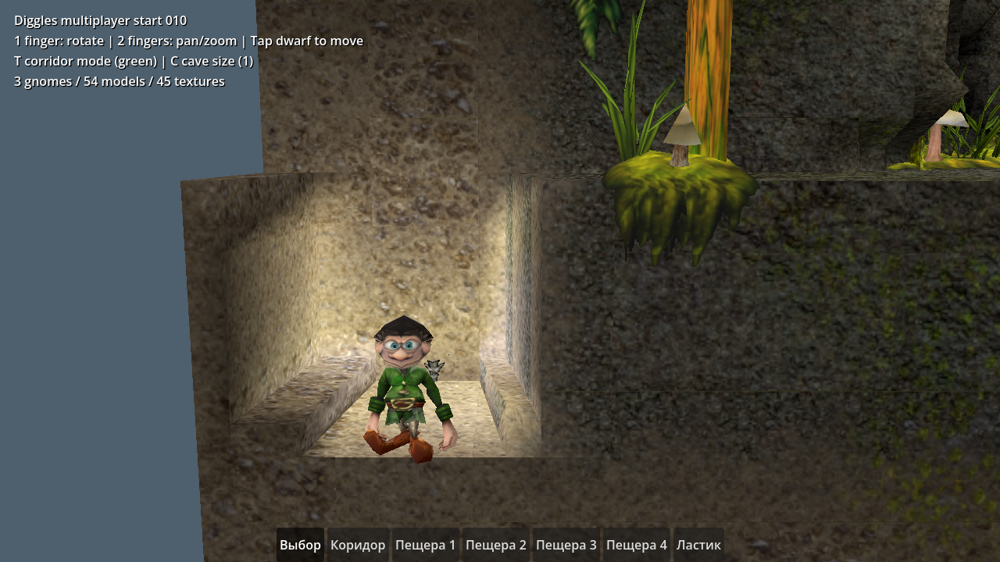

# Автоматические факелы в сцене Godot — 18.11.2026

В `multiplayer_test` включена цепочка **гном → исходный кандидат → очередь → проверка размещения → Misc_Light → свет грунта**. На реально изменённом BlockDB коридоре появляется исходная модель факела; новый источник меняет diffuse/secondary вершины. Геометрия, collision shapes и сохранённое открытие правой пещеры при этом не меняются. APK не пересобирался.

## Подключённый контракт

| Источник | Реализация |
| --- | --- |
| `Zwerg` autolight / EXE5CC163 | Кандидаты исходят от текущих взрослых гномов с autolight; tick>10, tick%4==1 и соответствующий остаток objectID. |
| EXE5CD520 | Два MSVC rand15 draw, Y первым; source float32 XY, raw BDB sample, максимум центра/четырёх соседей ниже15, Z напрямую, максимум14. Unknown sample откладывает решение. |
| EXE5912A0 /5D44F6 | Pending dedup строго Manhattan<10, без сброса counter/изменения XYZ. Попытка создания ровно на проходе3, purge на6. |
| EXE590E60 | World margin2, исходный нижний Y-порог, source material-low в округлённой coarse cell, horizon registry для low3, проверка registered lights. Перед consumer creation также margin1 sample. |
| Tcl `Info_Fog_Urw_c` → `horizon_set` | Импортированный marker из scene profile даёт фактический центр и size30. Его registry сохраняется после удаления marker. Это оформление горизонта; произвольных кругов наблюдения у гномов/столба не введено. |
| `set_light_begin` / world constructor | Порог чистого мира−10000 прочитан из EXE и экспортирован; Campaign33 сюда не переносится. |
| EXE5CC202..5CC43B | Периодический Z-snap min пяти raw samples +f32 .01, затем независимый release по source low2 coarse flags и действительным frame bounds. XY/Euler не подгоняются. |
| `licht.3db::fackel.standard` | Экспортированы оба кадра, bounds и исходная текстура. Default mode **ANIM_STILL / frame0**, подтверждён defaultanim callback и consumer; два кадра не означают автоматический loop. |
| `Misc_Light` / emitter.tcl | Offset `(0,−.5,1)`, radius6, RGB(.9,.9,.8), исходная class-color conversion и native terrain illumination. Модели получают существующий Godot light adapter. |

Отдельно исправлено смешение двух часов: object-manager вызван в `0x6B4BA1` **до** catch-up цикла, writer simulation tick находится в `0x6B4C94`, шаг game time0.1. Поэтому consumer идёт по внешним проходам, а tick меняется по игровому времени. Тест специально создаёт факел за три прохода при одном неизменном tick13; принудительная обработка consumer на10Гц не используется.

Материал/low2 берётся из уже восстановленного PMP loader (`native_terrain_state.cell.material_low`); полный неизвестный coarse byte не выдумывается. Initial horizon из импортированного a_0 переводится тем же source offset, что и кандидат. Другой authored start marker b_1 находится далеко от текущего crop и не меняет решения внутри него; full generated-world registry пока не загружается.

## Стоимость обновления света

При сборке terrain кешируются компактные исходные позиции BDB, raw sphere normals и base byte. При создании/перемещении факела вычисляются новые diffuse/secondary **только для вершин в сфере влияния прежнего/нового света**. Изменяются color/custom0 buffers затронутых ArrayMesh; UV, vertices, surface material, MeshInstance и collision resources сохраняются. Стабильный факел не повторяет обновление каждый кадр.

В проверочном коридоре:4 реальные BDB-мутации,16056 terrain vertices; пересчитаны961 вершина в77 существующих buckets. Это около6% вершин. Один диагностический headless запуск дал около28мс на три прохода вместе с созданием/relighting; это не FPS/Android benchmark. Кеш добавляет примерно28 bytes на вершину до накладных расходов контейнеров. Число факелов/источников в уже освещённом проходе остаётся1.

## Проверки и изображения

`automatic_torch_runtime_self_test.gd`:30 headless checks /32 с двумя OpenGL captures. Проверяет раздельные часы, STILL frame0, source Z-snap/release, обновление light record, паузу, исходную текстуру, реальное создание в выкопанном проходе, изменение vertex colors, сохранение всей геометрии/node/collision identity, отсутствие дубликатов и ненужных обновлений света. `native_torch_policy_self_test.gd`:17 checks, включая strict borders, cutoff direction, missing data, horizon low3 и отсутствие искусственного radius+4 расширения.

Регрессии: terrain render556; manual region27; excavated walk37; wall dig22; parallel workers21. Прежние pure producer/queue33 и snap/frame70 сохранены. Все3 сцены smoke3s, lint0 errors/0 warnings. В финальных engine logs ошибок/предупреждений нет. Source checks: torch facts22 spans; visual asset9 spans; gates audit19 spans и исходные Tcl/manifests. [Машинная сводка](automatic-torches-runtime-2026-11-18/validation.json).

До появления факела:

После создания:

Исходные доказательства: [registry/cutoff](torch-placement-gates-2026-11-18.md), [модель и STILL](torch-visual-2026-11-18.md), [producer/queue](automatic-torches-2026-11-18.md), [snap/rect](torch-placement-2026-11-18.md).

## Границы и следующий шаг

Это исходные правила в новом single-player Godot host context. В нём отдельный воспроизводимый MSVC stream с seed1 и стабильные ID на основе source ordinal. RNG stream/реальные ID исторического оригинального запуска не захвачены; exact placement replay того запуска не заявляется. Native player/editor/update gates соответствуют активной сцене и её паузе; полной системы native object manager/network/сохранений здесь ещё нет. Spatial light index заменён полным проходом по известным зарегистрированным lights с тем же predicate. За пределами импортированных terrain samples решение остаётся неизвестным, мир не заполняется предположительно.

**Частицы пламени ещё не реализованы.** Оригинальная команда сохранена без угадывания параметров: `class_particle 2 {0 -0.1 0.2} {0 0 0} 32 1 0 0 -1`. Металлическая модель не анимируется произвольно вместо огня. Общий native particle pipeline нужен также для пыли/сколов при копании — это следующий крупный шаг. Полный FOW/LOS и влияние столба наблюдения исследуются отдельно; прямой autolight producer от столба исходниками пока не подтверждён. Полная lighting fidelity моделей/fog/stage states и поведение AI остаются в очереди.
