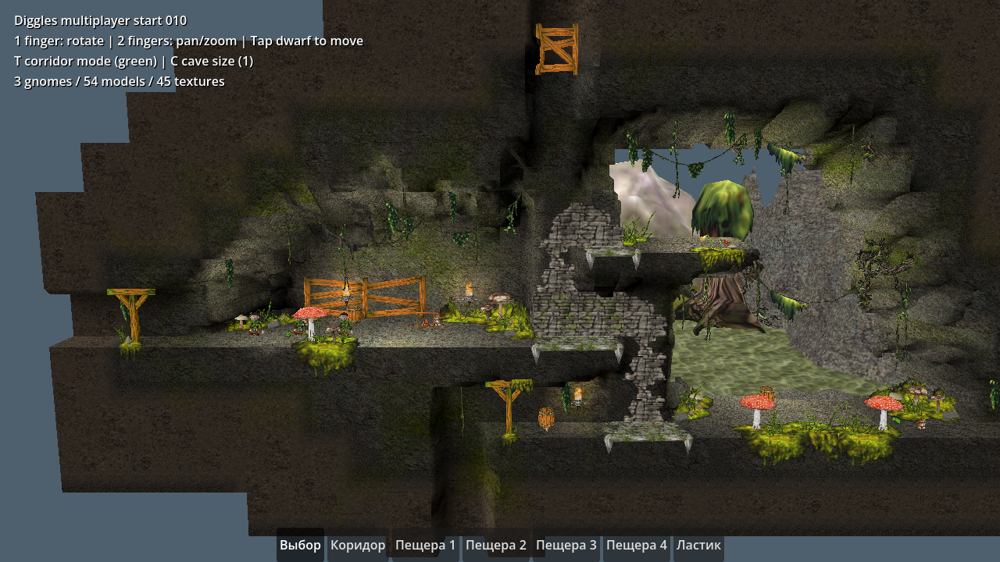
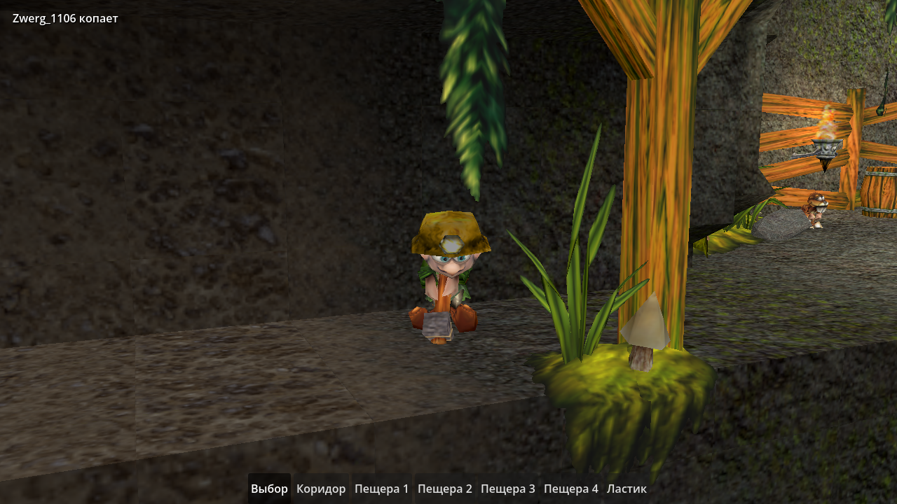

# Движение, забой и огонь — 18.11.2026

Продолжение последнего запроса с восемью замечаниями. Исправлены воспроизводимые причины обхода через передний край и остановки бокового забоя на стене. Подключены исходное пламя, нормали моделей и анимации застрявшей кирки. Полный native pathfinder, свет моделей/видимость и правило появления досок остаются отдельными незавершёнными зависимостями.

## Результат по замечаниям

| № | Наблюдение | Текущее состояние |
| --- | --- | --- |
| 1 | Один боковой удар на стене, затем ожидание | Исправлены проверка будущей опоры и поиск известного достижимого забоя. Один приказ проходит12 настоящих мутаций боковой ветки. |
| 2 | Нет огня факелов | Type2-пламя работает у исходных чаш и новых автофакелов. Атлас/движение частиц прочитаны из оригинала; материал и внешний cadence имеют явные пределы. |
| 3 | Яркая каменная плитка | Текстуры совпадают с исходными. Исправлено чтение нормалей моделей. Произвольное затемнение не вводилось; общий свет моделей ещё отличается. |
| 4 | Перед шахтой/после неё идёт к камере | Убрано безусловное назначение передней Z-позы всем floor-waypoints. Проверен путь на двух уровнях через реально выкопанную шахту туда/обратно без выхода на Z14.5. |
| 5 | Освещение отличается | Причины сопоставлены с исходниками и кадрами; полный model-light/fog/FOW путь не перенесён. Нет заявления о визуальном совпадении. |
| 6 | Доски в коридорах | Найдены деревянные части исходных lining-моделей, включая задние варианты. Тождество с досками на скриншоте и автоматический corridor producer пока не установлены. |
| 7 | Застрявшая кирка при низком опыте | Подключены настоящие29/31-кадровые клипы и sockets. Проверены исходные условия и порядок prelude→обычный удар. |
| 8 | Лазание по краю шахты | Подключён исходный выбор cell representative перед host-поиском. На валидном тестовом shaft маршрут проходит центральные samples; полного Calc1 и гарантии геометрической оси любой шахты пока нет. |

## Почему путь уходил к камере

Прежний `SurfaceWalk.plan` присваивал каждому floor-node `floor_depth(dx)`:12.5/14.5. Эти константы действительно есть в EXE, но относятся к fallback. Перед ним исходный код вычисляет глубину сегмента по двум BDB probes при определённых условиях, а terminal waypoint сохраняет requested target XYZ. Безусловный fallback заставлял актёра сначала пройти по глубине к переднему краю, затем вернуться к стене.

Нынешний адаптер связывает последовательные floor-runs с actual actor Z, следующей wall Z и явно указанной конечной Z. Интерполяция выполняется по XY-длине с проверкой исходной глубины опоры; неизвестная проба отклоняет проекцию целиком. Клик по глубине пола и рабочая стойка передают свою Z, а не только XY.

Это host embedding исходных navigation samples, а не полная реализация native floor-subaction. Доказательства ветвления, адреса и воспроизводимый аудит: [shaft-path-center-2026-11-18.md](shaft-path-center-2026-11-18.md).

Для центрирования восстановлен primitive `0x5A6350`: `score=8+((flags&2)<<7)-abs(x-4)-abs(y-4)`, строгий максимум в row-major порядке, отдельный full-floor pass вниз. Consumer Calc1 читает выбранные XY из cell+0x12. `NativeWalkmap` кеширует представителя только для полностью известных64 samples без неподдержанных object flags, сбрасывая кеш по revision. Граф соединяет представителей исключительно через доступные samples; при неизвестной сводке остаётся прежний fine-sample fallback.

Поиск связей и их стоимость пока host BFS. Исходный центр map-клетки не обязательно совпадает с геометрической серединой произвольного сечения шахты. Отдельное правило «прибить X к оси любой шахты» источниками не подтверждено.

## Почему останавливался боковой забой

Старая проверка требовала `wall_depth_before == wall_depth_after`. При правильном отступании стены следующий шаг изменяет эту глубину, сохраняя пригодную опору. Сейчас проверяются известный future navigation bit и `future wall_depth <= stance.z`; внедрение в новый грунт не разрешается.

Дополнительно исходные preferred queries могут остановиться на неизвестных samples окружающего мира, пока локально есть достижимая стойка. Preferred chain сохраняет приоритет. При её отказе добавлен ограниченный поиск **только известных** local wall samples, сохраняющий исходные reach<3, рабочий clip, два из трёх height-neighbors и проверку следующей опоры. Кандидаты реально проходят SurfaceWalk; teleport и подмена неизвестного пустотой отсутствуют. Такой fallback обозначен `host_known_surface_frontier`.

Контрольный пример использует оригинальный raster кисти: двухрядная ветка из шахты,12 отмеченных точек, один приказ на дальний конец. Выполнены12 callback/BlockDB mutations, марки и задача завершены, настенный clip наблюдался, максимальный шаг0.085717 укладывается в movement budget. Однорядный искусственный пример не использован как основание ослабить native body-clearance.

## Пламя и модели

[Отдельный разбор type2](native-flame-2026-11-18.md) содержит первичные адреса, таблицу классов, UV16×16, pool/lifetime и ограничения материала/времени. OpenGL-проверка выявила и позволила исправить ошибку atlas grid. Пламя не создаёт повторных источников освещения и не наследует сжатие model body по Z.

В `brightness[]` модельного экспортёра находятся индексы нормалей `sphere.dat`. Они не являются коэффициентом яркости. Прежнее `/255` для декорации удалено; для `_build_model_meshes` читаются настоящие исходные нормали с тем же отражением Y, что у геометрии. Например,183 — почти +Z нормаль каменной стенки,168 — почти −Y нормаль пола в native coordinates.

Девять masonry fixtures и256 нормалей сверены с оригиналом. Файлы albedo byte-for-byte совпадают, включая кажущееся странным использование wall-named текстуры на полу. Текстуры не затемнялись. Диагностический RGB555 split и stage shader проверены отдельно; **они не подменяют production lighting solver**, который ещё не восстановлен.

По исходному скриншоту свет локальнее и теплее, а нераскрытые участки уходят в чёрное. В текущем Godot заметнее общий свет, яркие модели и более насыщенный фон. Terrain уже использует восстановленные vertex channels/gamma, но модели всё ещё идут через StandardMaterial3D и Godot ambient/directional/Omni adapter. Отсутствующие native model intensity, visibility/fog и terrain-stage состояния нельзя исправить одним затемнением плитки. Разные ракурсы исходного и текущего снимков не являются пиксельным benchmark.

Source audit модели: [model-lighting-feedback-2026-11-18.md](model-lighting-feedback-2026-11-18.md). Этот агентский документ описывает состояние до интеграции нормалей; текущая интеграция описана здесь.

## Застревание кирки

`z_dignwalk.tcl:385–420` проверяет `max((0.2-exp_Stein)*5,0)>0` непосредственно. В обычной наземной кирочной ветке для верхней/нижней позы **нет случайного броска**: при опыте ниже0.2 добавляется accident, front-поза исключена. Airhammer/laser/wall — отдельные ветки.

Перед обычным ударом проигрываются исходные `buddeln_oben_norm_unfall` или `buddeln_unten_unfall`. Завершение accident возвращает обычную работу с повторной оценкой позы и запретом повторной аварии этого шага. Во время prelude нет `dig_execute` и изменения грунта; только следующий обычный удар вызывает существующий accepted-strike adapter. Кирка и каска следуют оригинальным per-frame sockets.

Текущие host-актёры по умолчанию имеют `exp_Stein=0`; полного исходного роста опыта ещё нет. Поэтому нельзя обещать нативную частоту застреваний на протяжении развивающейся игры. Условие выбора исходное; полная tasklist/inventory/skill simulation отсутствует. Частота выборки accident использует извлечённые10 кадров/game second, обычный work сохраняет прежний12-FPS адаптер; окончательная native длительность action/callback не доказана и не выдаётся за восстановленную.

[Source audit условий, clips и callback](dig-extras-2026-11-18.md). До интеграции он фиксировал только raw slots; теперь экспорт дополнен готовыми slot0/4 transforms и подключён к shared mesh cache. Нужные textures кешируются, не загружаются заново для каждого animation frame.

## Доски: найденное и неизвестное

В `auskleidung.3db`135 объектов. Шесть проверенных `urw_caves_1_{a,b,c}_{a,b}` действительно содержат `Holz_Standard_a_256.tga`: передние варианты содержат также каменную облицовку, задние состоят из дерева. Это части lining geometry. Отдельный `brett.standard` из `halbzeuge.3db` остаётся лишь ресурсным кандидатом; оснований спавнить его в туннель нет.

Регистрация `SetCaveSkinClasses`/`add_cave_skin_class` и completed-cave consumer известны из предыдущего чата и сохранённых source audits. Они объясняют облицовку завершённой **пещеры**, но не доказывают правило появления досок в обычном **коридоре** со скриншота. В runtime новое правило досок не добавлено.

Новый read-only каталог: [tunnel-cladding-source.json](feedback-2026-11-18/tunnel-cladding-source.json), воспроизводится `python -B tools/audit_tunnel_cladding.py --check`. Следующий source шаг — установить producer tunnel-support объектов, его зависимость от material/shape/dirty flags, выбор mesh и transform; только затем подключать размещение.

## Проверка и следующий шаг

Все контрольные запуски имеют exit0, финальный pass marker, без ERROR/WARNING. Сохранены журналы и машинный результат: [validation.json](feedback-2026-11-18/validation.json).

| Набор | Проверок |
| --- | ---: |
| Floor depth route / cell representatives / hanging branch | 19 / 11 / 16 |
| Type2 / model material / dig feedback | 51 / 208 (+5 GPU) / 629 |
| Surface walk / surface dig / manual region / excavated walk | 44 / 22 / 27 / 37 |
| Dig queue / parallel work / ordinary dwarf dig | 31 / 21 / 218 |
| Terrain render / automatic torch runtime | 556 / 33 |
| Реальная OpenGL-сцена с3 кадрами | 16 |

Дополнительно: пять read-only source checks, lint0/0, smoke всех трёх сцен0/0. GPU material test проверяет итоговый pixel `(0.3451,0.2,0.2,1)` и компиляцию диагностического shader; это проверка формулы, не совпадение всей игры. Замер создания одного факела в headless fixture не является оценкой FPS телефона.

Ближайшие зависимости: полный Calc1/floor-action вместо host-поиска, model lighting/visibility/fog, native tunnel supports, пыль/сколы на accepted strike, рост опыта/прерывания работы. Утверждённое открытие правой пещеры и нужные полы не менялись. APK и export settings в этом этапе не пересобирались/не менялись.
