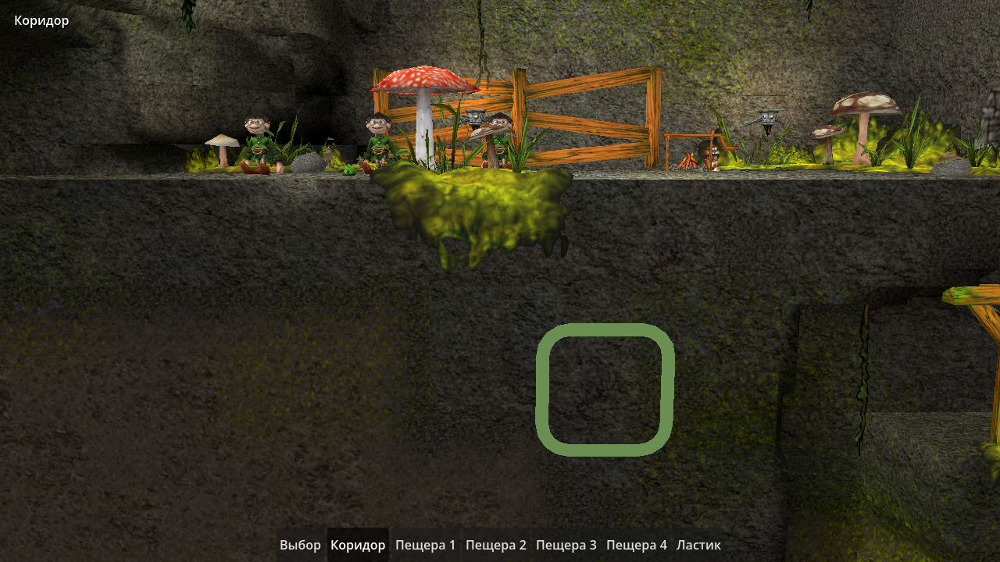
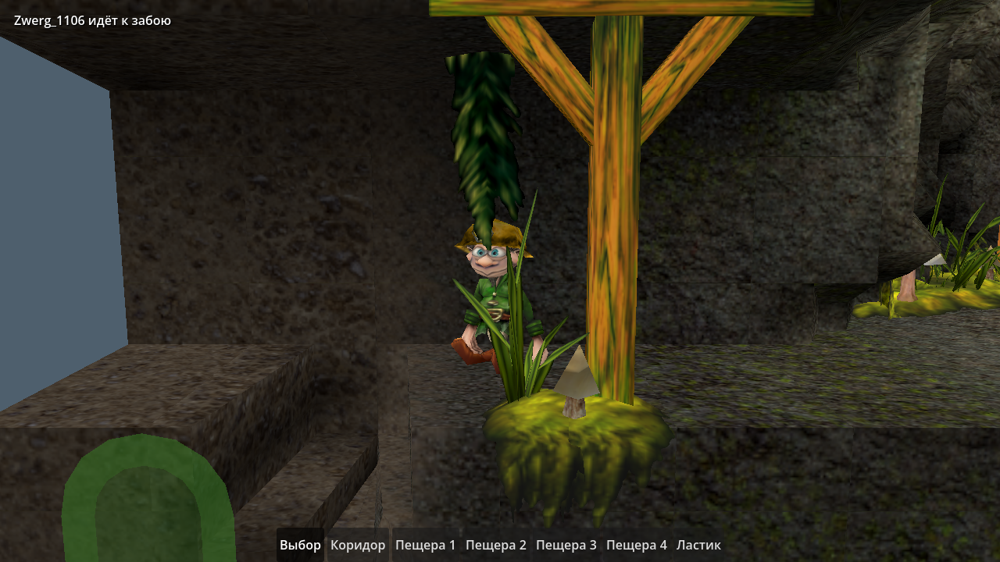
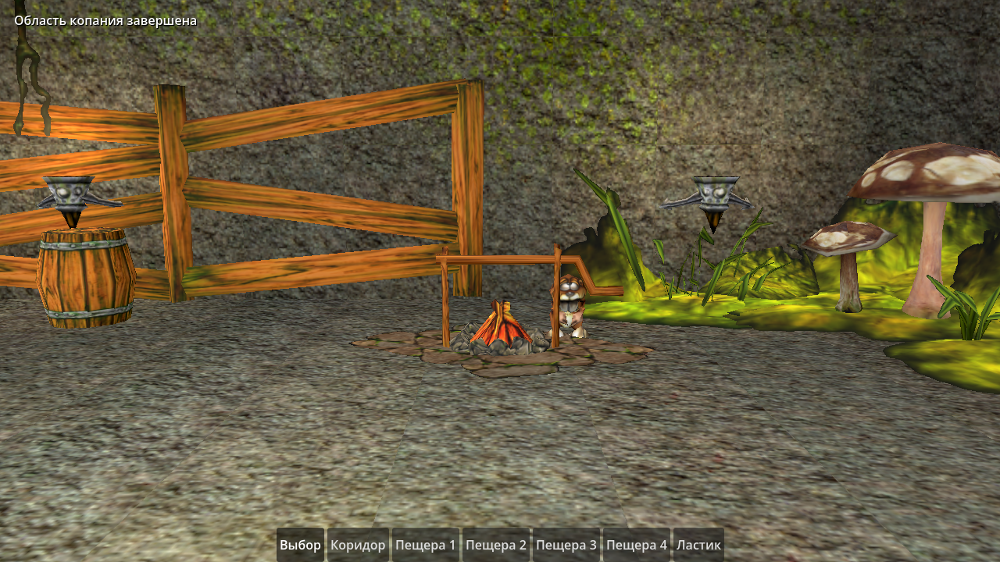

# Ручное копание, маска и стоимость сцены — 18.11.2026

**Следующий этап уже выполнен:** автоматическое создание факелов и динамическое освещение подключены. [Новый отчёт и кадры](automatic-torches-runtime-2026-11-18.md). Указанное ниже ожидание runtime-факелов относится к предыдущему checkpoint.

Активный проект Godot, сцена `multi_start_010`. APK не пересобирался. Контур правой пещеры и правила удаления исходных закрывающих поверхностей этим этапом не менялись.

## Результат по замечаниям пользователя

| Замечание | Текущее поведение |
| --- | --- |
| Тонкая маска, лишнее слово у мыши | Курсорный label скрыт. Hover рисует исходную толстую полосу native atlas между радиусами .30/.49 без центральных fill-fans. Это треугольный контур той же формы, а не тонкие линии. Привязка к сетке сохранена. Названия кнопок инструмента остаются в панели. |
| Нет подхода к нажатой ячейке | Приказ назначает связную область меток. Первый забой выбирается из доступных точек рядом с гномом; недоступная точка клика не блокирует всю область. Реальные проверки stance/path и сохранения будущего пола остаются обязательными. |
| Остановка после одной ячейки | Ручное задание хранится отдельно от текущего забоя. После удара сохраняется original `dig_next`, затем при необходимости выбирается доступный фронт области. Соприкасающиеся corridor3 и cave8..15 входят в одну область. Уже обработанные мостики сохраняются в составе задания. |
| Каска пропадает между ячейками | Каска привязана к ручному заданию, кирка — к фазе удара. При подходе/ожидании каска остаётся; при завершении/смене задания снимается. Положение берётся из исходного head socket каждого кадра. Боевого задания и автоматической боевой каски пока нет. |
| Низкий FPS | Вместо отдельных скрытых деревьев всех кадров — общие ArrayMesh и небольшое число MeshInstance на гнома. 3106 →838 узлов сцены, 365 MeshInstance. Выключен 4× MSAA. Запросы наличия пола индексированы по фактическим X-extents треугольников; previews будущей геометрии кешируются по terrain revision. |
| Основание костра рябит | Доказаны две совпадающие плоскости Y=−14.5. Только плоская визуальная поверхность основания приподнята на .0075; исходный placement костра сохранён. |
| Автоматические факелы | Tcl/EXE/3DB разобраны, producer/queue и wall-snap/frame-rect перенесены в проверяемые helpers. **Автоматическое создание в main пока не включено:** actual placement gates, coarse flags и registry запретных областей ещё требуют интеграции. Произвольный шаг расстановки/FOW-радиус не добавлялся. |

## Что является адаптером

`manual_dig_region.gd` — host scope ручного задания над source mask0xB. Обход четырёх соседей и поддержка коридорных/пещерных меток опираются на source work-mask; ранжирование первого достижимого забоя по расстоянию до актёра — явно выделенный host adapter. Native `get_digedge` с producer owner-byte C+34 и native pathfinder Calc1 целиком ещё не перенесены. Нельзя объявлять этот BFS исходным ИИ.

`dig_next` продолжает применять существующий source ranking/group/retry контракт. Он может выбрать соседнюю другую область по своей native политике; успешно выбранный компонент запоминается в ручном задании. Нет искусственного запрета пересекать границу remembered region.

Если работа остаётся, но доступного забоя нет, задание/каска сохраняются в ожидании. Повторный поиск вызывается при изменении terrain, marks или числа резервирующих работников. На каждом idle-кадре полный поиск не повторяется. Завершённые marks удаляются только при известном Hnext; неизвестный terrain не считается пустотой.

Перенос AI рабочего дня, забастовки, сна, речи, боевых/аварийных прерываний этим этапом не завершён. Изменён именно жизненный цикл ручного копания. Частота work callbacks остаётся ранее описанным host adapter, не доказанным native tick.

## Проверки поведения

Новый `manual_dig_region_self_test.gd`:27 assertions headless /30 с кадрами. При клике в недоступную нижнюю точку области2×3 выбирается другой забой и без повторного приказа выполняются6 настоящих BDB-мутаций. На свежей сцене соприкасающиеся corridor+cave дают3 мутации, убирают marks и достигают cave target7. Каска проверена между мутациями. Недоступная отдельная область сохраняет приказ,50 одинаковых тиков не вызывают повторного поиска. Проверены thick ring без центра и положение основания костра.

Существующие интеграционные проверки после изменений: native dwarf dig218, surface dig22, surface walk44, native dig queue31, parallel work21, corridor input85, gestures55, contour55 (16 masks). Начальный порядок точек в queue integration golden изменён под выбор ближайшего фронта; проверки native ranking/group/retry после первого назначения сохранены. Excavated walk повторно37, включая вход в реально выкопанный нижний проход. Все3 сцены smoke:0 errors/0 warnings. Lint:0 errors/0 warnings.

Чистые source helpers факелов: snap/release/rect70 checks; producer/queue33 checks. Это проверки формул/контрактов и исходных bounds, а не сравнение с исполнением запущенного оригинала. Source exporter18 EXE spans повторно проверяет хеш и Tcl/3DB; generated placements0. Подробности: [автофакелы](automatic-torches-2026-11-18.md), [wall snap](torch-placement-2026-11-18.md).

## GPU и практические пределы

1280×720, GL Compatibility, Vega8, VSync off, неизменная камера. В focused run180 кадров/фаза,90 на стабилизацию, три чередования off/4×:

| Пара | GPU off, мс | GPU4×, мс | Разница, мс |
| --- | ---: | ---: | ---: |
| 1 | 2.908 | 5.761 | 2.853 |
| 2 | 2.947 | 6.397 | 3.450 |
| 3 | 3.368 | 6.699 | 3.331 |

Render memory35350925 против64842125 bytes, −28.125MiB. Число draw calls осталось289; удаление скрытых кадров само по себе их не уменьшает. Полный первый прогон имел колебания нагрузки, поэтому его отдельные GPU-фазы не используются как причинное доказательство ускорения. Детерминированное сокращение дерева сцены и устойчивый MSAA delta подтверждены отдельно. Замера на телефоне нет; desktop цифры не обещают такой же прирост на Android.

Сырые структурированные результаты: [полный прогон](manual-work-2026-11-18/runtime_perf_after.json), [чередование MSAA](manual-work-2026-11-18/runtime_perf_msaa_final.json). SHA script при загрузке/окончании записан в каждом отчёте; внутри прогонов script не менялся. Полный прогон относится к предыдущему снимку до финальных правок отмены/поиска забоя; focused MSAA выполнен уже на текущем main. [Сводка валидации](manual-work-2026-11-18/validation.json) сохраняет это различие явно. Дальнейшие кандидаты — объединение совместимых terrain draw calls и материалов; смешивать все buckets без сохранения variant/part и dirty rebuild нельзя.

## Кадры текущей сцены

Hover, толстый исходный контур без заливки:

Каска между забоями:

Основание костра после разделения плоскостей:

## Ближайший шаг

Подключить automatic-light producer/queue к явному world update, восстановить producers coarse cell+18, нижнего Y-порога и registry0x4753F0. Затем использовать источник `licht.3db::fackel.standard`, native Z-snap, исходный light class и обновление vertex lighting только затронутых участков. FOW столба исследовать отдельно: прямой вызов autolight от него не доказан. После этого — расписание/прерывания ИИ и эффект копания по исходным particle-командам.
