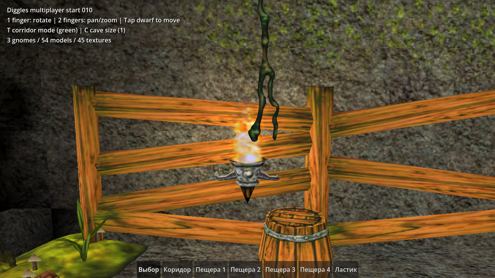

# Исходное пламя: type2 — 18.11.2026

Пламя подключено в multiplayer-сцене к трём исходным чашам и создаваемым `Misc_Light`. Используются оригинальный атлас, восстановленные правила частиц и геометрия экранных ромбов. Это перенос type2 с явно указанными адаптерами рендеринга и внешнего времени, а не завершённый перенос всей системы частиц.

## Первичные источники

Установленный `Diggles.exe`, SHA-256 `58a01d3d80670a6042c66a82684397c98e39c503e00a6e2c2c511f338a30ed74`. Экспортёр проверяет хеш перед чтением адресов. Полные инструкции, байты, адреса констант и хеши Tcl/текстуры сохранены в `godot/models/native_flame.json`.

| Источник | Подтверждённое правило |
| --- | --- |
| `Scripts/classes/items/emitter.tcl`, `Misc_Light` | `class_particle 2 {0 -0.1 0.2} {0 0 0} 32 1 0 0 -1` |
| `Scripts/classes/deco/dummy_trollhausen.tcl` | У `Dummy_Feuerkelch_a/b` отдельные offsets, pool64, births2 |
| `0x492190`, `0x492F80` | LCG и резервирование одного слота пула |
| `0x4932E5..0x493521` | Type2 spawn: начальные позиции/скорости и случайный вариант строки |
| `0x493F24`, `0x4A1C50..0x4A2D25` | Обновление, drift, возраст, цвет, вращение, нелинейный выбор кадра |
| `0x499216..0x49927B`, jump tables | Type2 сохраняет исходный grid16 |
| `0x497C60..0x498352` | Проекция, экранные ромбы и UV |
| `Texture/Misc/particle_a_128d.tga` | Исходный атлас128×128, ячейки8×8 пикселей |

В атласе 16×16 ячеек. Пламя занимает первые восемь столбцов трёх строк. Число animation columns=8 не является размером всей сетки. Ошибка смешения этих величин была обнаружена OpenGL-кадром: вместо огня получались фиолетовые частицы соседнего участка атласа. После исправления UV получено тёплое пламя; каналы исходного цвета не переставлялись для подгонки вида.

Возраст живёт32 обновления, выбор столбца — `trunc((31-trunc(age*age/32))/4)`. Это не линейная flipbook-анимация. Пул факела имеет31 доступный слот, чаши —63; фактическое число живых частиц зависит от рождения/удаления в текущем проходе. Нельзя требовать постоянного заполнения всех слотов.

Размер выводится из исходной формулы проекции: множитель100, reference viewport800×600, деление на clipW. Адаптер вычисляет локальные полуразмеры по текущей матрице камеры Godot, без подобранного масштаба пламени.

## Интеграция

`native_flame_emitter.gd` не имеет собственного `_process`: caller задаёт проход обновления и оси камеры. В multiplayer один проход выполняется на активный кадр. В исходном type2 dispatch scale=1.0; подмена его `delta` в секундах неверна. Историческая частота кадров оригинала и все visibility/pause gates не восстановлены.

Emitter располагается рядом с моделью под `scene_root`. Его transform учитывает исходный rotation/reflection и не наследует сжатие глубины body-меша. Для новых факелов позиция синхронизируется после исходного Z-snap. Новых источников света частицы не создают: существующие class lights продолжают освещать модели/грунт.

Рождение включено для видимого anchor, удалённый anchor освобождает эффект. Полные native owner/fog/distance gates отсутствуют. У костра `Feuerstelle` эффект type2 не назначен автоматически: в просмотренном определении класса такого прямого объявления нет.

Материал Godot: unlit, alpha mix, depth test, без depth write, texture×diffuse+secondary, gamma1.3. Это явный адаптер: shader16 наследует shader6, но полный набор исходных blend/depth/fog states пока не восстановлен. Каждый emitter использует отдельный seed от стабильного ordinal. Рекуррентная формула исходная; interleaving общего RNG оригинала не воспроизводится. Арифметика Godot и принятое ties-to-even не доказывают побитовое совпадение с live x87.

## Проверка

```powershell
python -B tools/export_native_flame.py --check
godot --headless --path godot --script res://tools/native_flame_self_test.gd
godot --headless --path godot --script res://tools/automatic_torch_runtime_self_test.gd
godot --path godot --script res://tools/feedback_visual_self_test.gd -- --capture-feedback
```

51 проверка type2: golden первого spawn, нелинейные кадры, границы атласа, тёплые texels выбранной ячейки, ограниченный pool, drain и сохранение состояния при неверной конфигурации. 33 проверки auto-torch runtime включают настоящий созданный факел, его emitter/геометрию/позицию и отсутствие повторных lights. OpenGL-сценарий:16 проверок и три кадра.



Общий результат и ограничения: [feedback-2026-11-18.md](feedback-2026-11-18.md). APK не пересобирался; производительность телефона после добавления частиц не измерена.
