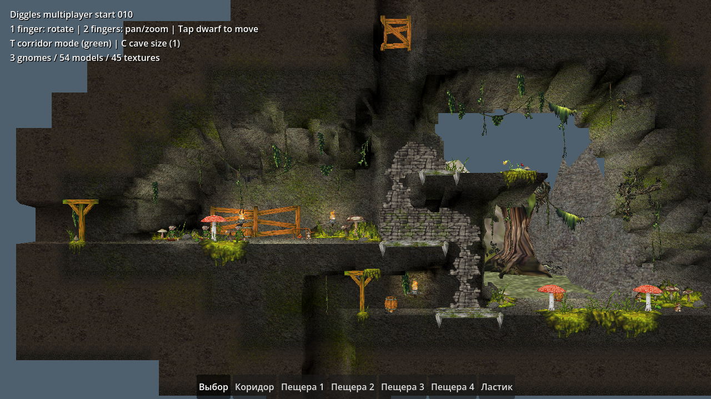
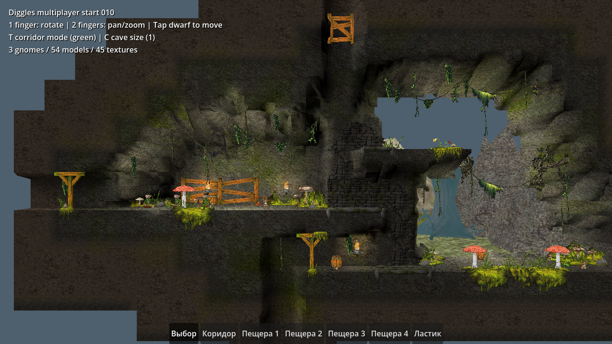

# Свет мировых моделей и глубинный туман — 18.11.2026

Дополнение следующего этапа: общий constructor gain моделей/грунта и material slots1/3 теперь подтверждены и подключены. [Новые доказательства, аудит Minimax и проверки](model-programs-2026-11-18.md). Ниже сохранён исходный checkpoint; его упоминания host gain и неизвестных stages относятся к тому моменту. Старые GPU37 не подтверждают новые blend shaders: их GPU-прогон заблокирован ошибкой автоматической проверки разрешения.

Новый расчёт включён по умолчанию для кладки и выбранных фоновых объектов multiplayer-карты:32 поверхности,1869 вершин, из них7 фоновых поверхностей и969 вершин с отрицательной глубиной. Кладка перестала получать общий Godot-свет поверх восстановленных vertex colors; дальнее дерево смешивается с исходным горизонтом. Геометрия правой пещеры, проходов и пола не менялась.

Это существенное приращение светового пути, **не полное совпадение с оригиналом**. Live owner/FOW, глобальный gain и полный material-stage dispatch ещё имеют явные адаптеры. Остальные модели продолжают использовать прежнее освещение Godot.

## Главное открытие: другой renderer path

Предыдущий аудит правильно восстановил нормали `sphere.dat` и RGB555 helper `0x484CD0`, но тот helper вызывается из отдельной preview-ветки. Он не является основным производителем света мировых моделей. Подставлять в него подобранный RGB555 для каждой кладки было бы ошибкой.

Прослежена цепочка мирового model renderer:

```text
model dispatch 0x486AD0..0x486C7D
    material/program classification
    un-interpolated normal branch 0x48A240
    point + source normal transform 0x48A533..0x48A626
    world color producer 0x4856E0
        four map probes/cache 0x485370
        fixed-point C+7 / owner interpolation
        directional base + registered point lamps
        diffuse + bounded secondary
        depth horizon / owner haze
```

Есть и другие ветви: animated/interpolated geometry, fixed-color программы, материал с shader id9/35, лишающийся этого normal-light вызова. Новый путь ограничен выбранными static masonry/background классами; он не распространён на гномов, воду, FX или все объекты сцены без разбора.

Первичный источник — установленный `Diggles.exe`, SHA-256 `58a01d3d80670a6042c66a82684397c98e39c503e00a6e2c2c511f338a30ed74`. Экспортёр `tools/export_world_model_lighting.py` сверяет хеш, сохраняет10 непрерывных диапазонов с полными инструкциями/байтами и10 числовых констант. Данные: `godot/models/native_world_model_lighting.json`. Это статический анализ, не захват live render state.

## Восстановленные правила

Нормаль читается из sphere table и преобразуется исходным instance rotation. Базовый свет использует те же числовые коэффициенты, которые были найдены для грунта, но их применение к моделям теперь подтверждено отдельным вызовом:

```text
level = (3.5999999046 - 2.5460000038*Nx - 2.5460000038*Ny) * base
```

`base` получается из четырёх `C+7` через исходные фиксированные веса и `+64`. Четыре owner-байта проходят собственное преобразование:

- Byte0 даёт отрицательный вклад, который может обнулить базовый свет.
- Bytes1..127 переходят в отдельную haze-ветку.
- Для bytes>=128 вычитается128; положительная часть умножается на1.3, обрезается до128.
- Интерполяция raw owner fields даёт силу ламп; отдельная интерполяция haze не тождественна яркости.

Для положительной visibility вклад лампы имеет строгий радиус и `exp(-2*d²/r²)*max(0.1,dot(N,L))`. Отрицательная visibility уменьшает базовый свет. Затем применяется renderer gain и выполняется округление/разделение цветов: diffuse до255, secondary overflow до64. У preview helper предел secondary другой — переносить его сюда нельзя.

### Туман

Отрицательная глубина обрабатывается через текущий `horizon_set` depth: для этой карты32. Это глубина мира/renderer-space, не расстояние от камеры и не Godot exponential fog. Ближайший horizon выбирается существующим scene adapter по camera XY, с исходным radius30.

`HorizonSet` переводит RGB через **float32×256**, не×255. `Info_Fog_Urw_c` даёт bytes `(78,96,110)` при принятом nearest-even. Эти же literals/producer уже исследовались в предыдущем чате: [torch-placement-gates-2026-11-18.md](torch-placement-gates-2026-11-18.md).

В `0x485C61..0x485CAA` обнаружена необычная последовательность: после ослабления red diffuse этот результат повторно используется для green/blue; аналогично обновлённый secondary red участвует в secondary green/blue. Реализация сохраняет эту последовательность инструкций, а не заменяет её обычным RGB lerp. Для половины fog depth и входного diffuse46 получается diffuse `(23,11,11)`, secondary `(39,67,74)`. На полной глубине diffuse=0, secondary равен horizon RGB. Это статическое прочтение конкретного EXE; live frame trace пока не выполнен.

Положительная глубина имеет отдельную owner haze с началом7 и slope1.02; она не заменена глубинным горизонтом. При текущем полном host visibility haze=0, но её арифметика вынесена и проверена отдельно.

## Интеграция и ограничения

`native_world_model_light.gd` содержит расчёт полей/цветов; `native_world_model.gdshader` использует texture×diffuse+secondary и исходные default gamma/brightness. Материал unshaded: освещение Godot повторно не применяется. Альфа-контур сохраняет прежний порог материала; fog не заливает прозрачные texels. Полупрозрачная вода и FX этим shader не заменены.

В multiplayer изменён только материал/цвет выбранных mesh instances. Координаты вершин и UV сохраняются точно. Повторное кодирование normals в Godot octahedral format даёт максимальную разницу0.000125; исходные normals для вычисления света кешируются до повторного кодирования, поэтому при relighting ошибка не накапливается. Mesh resource другой инстанции не перекрашивается через общий cache.

Первичный расчёт выполняется один раз. Повторный нужен при смене horizon или создании/перемещении источника. При изменении лампы проверяется её старый/новый радиус; незатронутые model buffers остаются прежними. Камера внутри того же horizon не вызывает постоянных rebuild. Девять исходных lamps и auto-torch lights используются совместно с terrain; новые дубликаты lights не добавлены.

Явные пределы:

1. **Owner/FOW:** в сцене всё ещё задано `[255,255,255,255]`. Реальные live C+34/owner bytes и их производство не перенесены. Pure helper умеет другие состояния, но это не реализованный обзор гномов/столба.
2. **Gain:** у моделей он поступает из renderer+14 ← manager+38E4; найдена запись через callback `set_brightness`, регистрация `0x61B6AA`. В сцене сейчас явно задан0.1 для согласованного начального контекста с terrain. Это не захваченный live model gain и не доказанное значение из constructor грунта. Полная пользовательская настройка/временные изменения manager ещё не перенесены.
3. **Texture stages:** single MODULATE с secondary и gamma — явная программа адаптера. Полный native material/texture-program dispatch ещё не восстановлен для каждого выбранного placement.
4. **Координаты:** world Z использует существующее упаковочное преобразование `.5*logicalZ+7`; выбор cell через floor — host policy. Оригинальный helper использует FISTP и дробную часть; live x87 rounding mode не захвачен. Нельзя обещать побитовое совпадение fractional probes. Отсутствующие четыре corners не подменяются border lighting.
5. **Область:** только выбранные static классы с полными импортированными corners. Ни сгенерированный мир вокруг карты, ни вода, ни dynamic actors этим этапом не завершены. Используется начальный экспорт C+7, без полного динамического producer visibility/light attributes.

## Кадры одного ракурса

До смены model lighting (остальные системы текущие):



Новый расчёт на том же ракурсе:



[Крупно](world-model-lighting-2026-11-18/native_close.png), [под углом](world-model-lighting-2026-11-18/native_oblique.png). Кадры подтверждают изменение кладки/дерева и сохранение проходов; они не доказывают полное совпадение с оригинальной игрой. Дерево остаётся геометрически грубым, часть фоновых стен и остальных объектов ещё заметно отличается.

## Проверки

```powershell
python -B tools/export_world_model_lighting.py --check
godot --headless --path godot --script res://tools/world_model_light_self_test.gd
godot --path godot --script res://tools/world_model_light_self_test.gd -- --capture-world-light
# Предыдущее освещение моделей для сравнения:
godot --path godot -- --legacy-model-lighting
```

31 headless assertion,37 OpenGL assertions: owner branches, base interpolation, normal response, strict lamp radius, overflow64, fog/haze arithmetic, actual production surfaces, сохранение геометрии/UV и ограничение нормалей, отсутствие rebuild на каждом кадре и при далёкой лампе, обновление цветов от нового источника. GPU pixel `(0.2863,0.3804,0.4078)` согласуется с независимым расчётом texture×diffuse+secondary→gamma в пределах3/255; отдельно проверено сохранение transparent cutout.

Регрессии: terrain556, auto-torches33, flame/accident scene13, hanging branch16 (12 мутаций), depth routes19, manual task27, original model material208. Lint0/0, все3 сцены smoke0/0. [Журналы и машинный результат](world-model-lighting-2026-11-18/validation.json).

APK не собирался. Новый FPS на телефоне не измерялся. Следующий этап — восстановить фактический global gain и material stage states, затем live owner/visibility: они сейчас ограничивают точность сильнее, чем дальнейшая ручная корректировка текстур.
